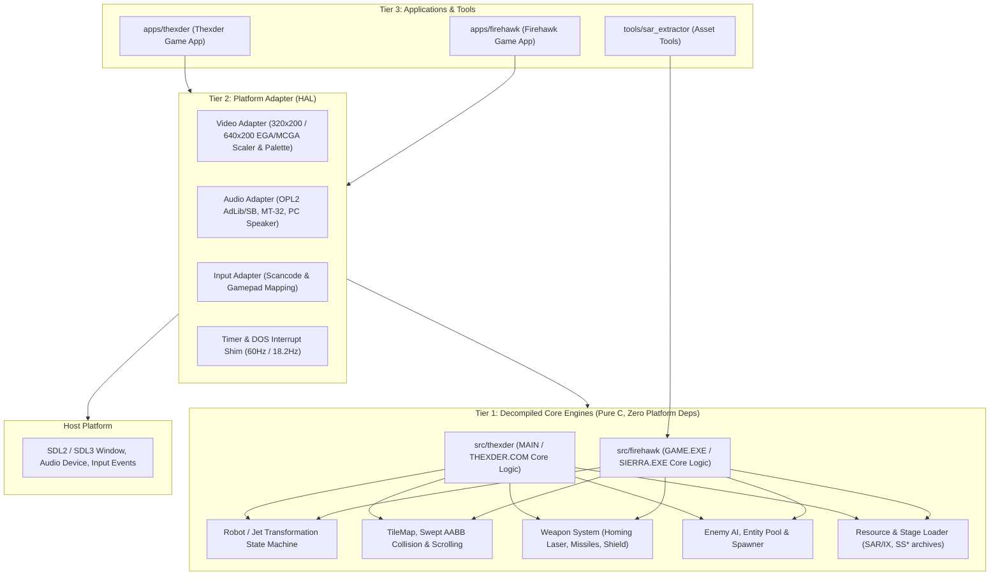

# Architecture & Layer Boundaries

## 1. Multi-Subsystem Tiered Architecture

The repository enforces a strict, modular tiered architecture for decompiling and porting **Thexder** and **Firehawk (Thexder 2)**:

```
+-------------------------------------------------------------------------------+
|                       REPOSITORY LAYER BOUNDARIES                             |
|                                                                               |
|   [Tier 3: Presentation & Applications]                                       |
|      • apps/firehawk (Firehawk game executable)                               |
|      • apps/thexder  (Thexder game executable)                                |
|      • tools/sar_extractor, tools/* (Asset extractors & inspectors)           |
|         │                                                                     |
|         ▼                                                                     |
|   [Tier 2: Platform Adapter (HAL)] (src/platform / libs/PlatformAdapter)      |
|      • SDL2 / SDL3 Presentation: Windowing, Scaler, Palette (EGA/MCGA/Tandy)  |
|      • Audio Synthesis: AdLib / Sound Blaster (OPL2), MT-32 MIDI, Tandy/Beep  |
|      • Input Translation: DOS scancodes to modern Keyboard / Gamepad          |
|      • Virtual DOS Subsystem: Tick Timer (60Hz / 18.2Hz), File I/O Shim       |
|         │                                                                     |
|         ▼                                                                     |
|   [Tier 1: Decompiled Core Engines] (src/firehawk, src/thexder)               |
|      • Portable ISO C99/C11 (.c and .h files) from Ghidra decompilation       |
|      • ZERO External Dependencies (NO SDL, NO OpenGL, NO OS headers)          |
|      • Memory-safe state machines, original game loop, player physics, AI     |
|      • Decoupled Render, Audio, and Hardware Command Interfaces               |
|         │                                                                     |
|         ▼                                                                     |
|   [Hardware / OS Layer] (Windows, Linux, macOS via SDL2 / SDL3)              |
+-------------------------------------------------------------------------------+
```



---

## 2. Universal Governance for Current & Future Modules

1. **Decompiled Core Isolation (Zero External Dependencies):**
   - Decompiled core modules (`src/firehawk`, `src/thexder`, `libs/*Core`) must be written in clean, standard C (`.h` and `.c`).
   - Core code must **never** include SDL headers (`#include <SDL...>`), OpenGL, Windows headers (`<windows.h>`), or POSIX OS headers (`<unistd.h>`).
   - All display, sound, and input interactions must route through abstract callback structures or command queues defined in the platform interface.
2. **Co-located File Organization:**
   - Headers (`.h`) and implementations (`.c` or `.cpp`) must reside in the same directory. Never create split `include/` and `src/` subdirectories within a subsystem.
3. **Traceability to Ghidra Decompilation:**
   - Every decompiled function and data structure must include a Doxygen comment referencing its original DOS binary, segment:offset, or assembly label (e.g. `/// @details Ghidra: GAME.EXE @ 1000:03A4 (player_update)`).
4. **Modular CMake Build:**
   - Every library, application, and tool has its own `CMakeLists.txt` and must apply standard compiler warning flags (`-Wall -Wextra -pedantic`, `/W4`).
5. **Header Guards:**
   - Always use `#pragma once` as the first non-comment line in all headers.
6. **Cross-Platform Portability:**
   - All code must compile and run cleanly on both **Linux** (GCC, Clang) and **Windows** (MSVC, Clang-CL).
7. **Offline Asset & Data Extraction Tools (Python Only):**
   - All offline tools regarding reading, extracting, inspecting, and analyzing game assets and data files (e.g. `tools/sar_extractor.py`, `tools/extract_graphics.py`, `tools/frame_diff.py`, `tools/extract_stages.py`) must be implemented exclusively in Python.
   - C and C++ are reserved strictly for decompiled core engines, platform HAL adapters, and native game executables. If any data reading/extraction tools exist in C, convert them to Python.

---

## 3. Concurrency, Streaming & Real-Time Invariants

1. **Fixed-Step Simulation Timestep:**
   - Original DOS games ran on hardware timer interrupts (typically 60 Hz vertical blank or 18.2 Hz timer tick). Simulation loops must operate on a deterministic, fixed delta time.
2. **Zero Dynamic Allocation on Fast Paths (CERT ERR55-CPP / MISRA):**
   - High-frequency simulation paths (collision queries, homing laser targeting, enemy update loops, frame rendering) must not perform dynamic heap allocations (`malloc`, `free`, `new`). Operate strictly on pre-allocated static tables, struct pools, or stack buffers.
3. **Decoupled Video & Audio Seams:**
   - The core game writes to a linear virtual video buffer (e.g. 320x200 8-bit index or 640x200 EGA bitplanes) and triggers audio events via abstract sound IDs. The platform adapter handles scaling, shader/palette conversion, and audio synthesis.

---

## 4. Abstraction & Layer Boundaries

1. **Program to Abstractions:**
   - Encapsulate rendering and audio backends behind abstract driver interfaces mimicking DOS hardware drivers (`.DRV`).
2. **Strict Layer Boundary Hierarchy:**
   - Applications set up the Platform Adapter and invoke Core Engine ticks.
   - Core Engine never queries hardware devices directly.
3. **Visibility & Encapsulation:**
   - Keep internal helper functions `static` in `.c` files unless exposure in the companion `.h` is required. Treat visibility changes as breaking interface shifts.

---

## 5. Error Handling & Language Restrictions

1. **No Exceptions in Core Engine:**
   - Decompiled core operations, file parsers, and simulation loops must report errors via explicit return codes, `bool`, or status structures.
2. **Deterministic Data Types:**
   - All integer types must use standard fixed-width headers (`<stdint.h>` for C, `<cstdint>` for C++): `uint8_t`, `int16_t`, `uint32_t`, etc.
