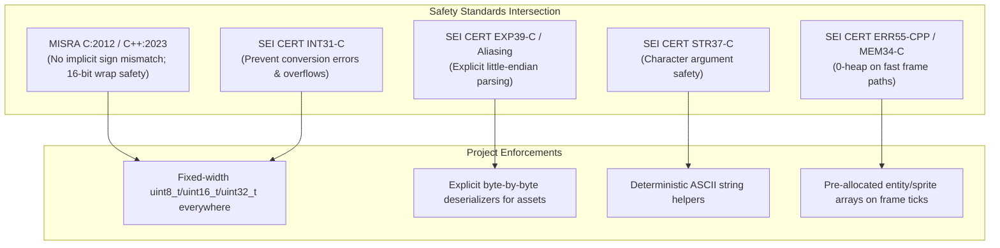

# Compliance Frameworks

Every line of code generated across the decompiled core engines, platform adapters, and tools must comply with safety and portability standards:
- **MISRA C:2012 / MISRA C++:2023** (Safety and Determinism)
- **SEI CERT C / C++ Coding Standard** (Secure Systems)

If a prompt requests a solution that violates these rules, you must refuse, explain the violation, and provide the safe alternative.

---

## 1. Safety Rules & Specific Enforcements

### MISRA C:2012 Rule 10.3 / MISRA C++:2023 Rule 7.0.6 & SEI CERT INT31-C (Signed/Unsigned Conversions)
- Conversions between signed and unsigned integer types must be explicit (`static_cast` in C++, cast in C), deliberate, and range-verified.
- When porting 16-bit x86 DOS assembly where registers (`AX`, `BX`, `CX`, `DX`) and segment offsets wrap around 65536, integer truncation and overflow must be deliberately handled or masked with `& 0xFFFF` to preserve original 16-bit semantics.
- Fixed-width integers must strictly use `<stdint.h>` in C (`uint8_t`, `int16_t`, `uint32_t`) and `<cstdint>` with `std::` prefix in C++ (`std::uint8_t`, `std::int32_t`).

### Endianness & Strict Aliasing (EXP39-C / MISRA C:2012 Rule 11.3)
- DOS files (`.SAR`, `.IX`, `SS*`, `.BIN`, `SAVEGM.DAT`) are stored in little-endian format.
- **Never cast raw byte buffers directly to struct pointers** (`(MyStruct*)buffer` is strictly forbidden). Doing so causes unaligned memory access crashes on ARM/modern architectures and violates strict aliasing.
- Always parse binary headers using explicit little-endian deserialization helpers (e.g. `read_uint16_le(const uint8_t* p)`, `read_uint32_le(const uint8_t* p)`).

### SEI CERT STR37-C (Character Handling & Determinism)
- Standard character functions from `<ctype.h>` / `<cctype>` (`tolower`, `toupper`, `isalpha`) take an `int` parameter whose value must be representable as `unsigned char` or equal to `EOF`.
- For file paths, resource names (e.g. `RES1.IX`, `KA00`), and config strings, use locale-independent ASCII helpers (`to_lower_ascii`, `string_equals_ignore_case_ascii`) to eliminate dependence on host locale.

### SEI CERT ERR55-CPP / MEM34-C (Zero-Heap Fast Paths & Exception Safety)
- High-frequency simulation, collision detection, and weapon targeting paths must not perform dynamic heap allocations (`malloc`, `free`, `new`, `std::vector`).
- In C++, functions marked `noexcept` must never allow an exception to escape. Operate strictly on pre-allocated pools, stack buffers, or `std::string_view`.

---

## 2. Safety Intersection Model

### ASCII Diagram: Compliance Intersection

```
+-------------------------------------------------------------------------------+
|                       SAFETY COMPLIANCE FRAMEWORK                             |
|                                                                               |
|       MISRA C:2012 / C++:2023                       SEI CERT C / C++          |
|   ┌───────────────────────────┐       ┌───────────────────────────┐           |
|   │ Rule 10.3 / Rule 7.0.6    │       │ INT31-C                   │           |
|   │ (Explicit cast; no sign   │◄─────►│ (Safe integer conversion; │           |
|   │  mismatches; 16-bit wrap) │       │  no truncation/wrap)      │           |
|   └─────────────┬─────────────┘       └─────────────┬─────────────┘           |
|                 │                                   │                         |
|                 └─────────────────┬─────────────────┘                         |
|                                   ▼                                           |
|                   ┌───────────────────────────────┐                           |
|                   │    Deterministic Standards    │                           |
|                   │                               │                           |
|                   │ • EXP39-C: Explicit LE reads  │                           |
|                   │ • STR37-C: ASCII char helpers │                           |
|                   │ • ERR55-CPP: 0-heap fast paths│                           |
|                   │ • IWYU & <stdint.h> policy    │                           |
|                   └───────────────────────────────┘                           |
+-------------------------------------------------------------------------------+
```


