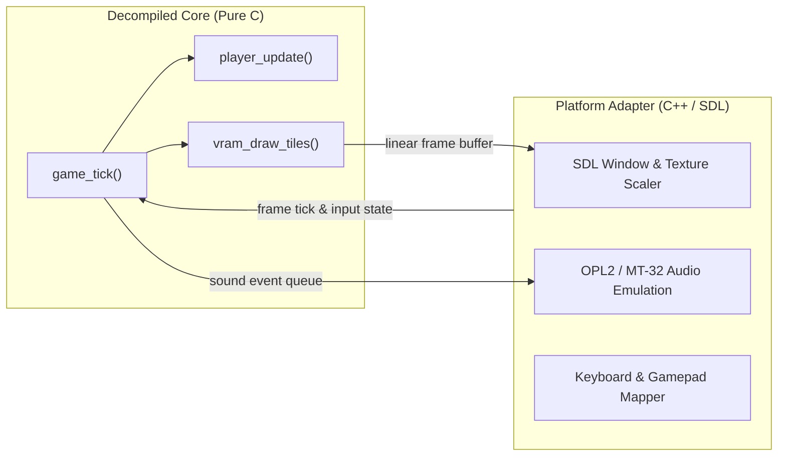

# Code Standards: C Decompilation & C++ Platform Harness

This document defines code standards across both the **C decompiled core engines** (`src/firehawk`, `src/thexder`) and the **C++ platform adapters / applications** (`src/platform`, `apps/*`).

---

## 1. Decompiled C Code Standards (C99 / C11)

All decompiled game logic must be written in standard, warning-free ISO C:

- **Explicit Initialization:** Every variable must be initialized immediately upon declaration (e.g. `uint32_t count = 0;`, `entity_t entity = {0};`).
- **Standard Fixed-Width Types:** Use types from `<stdint.h>` (`uint8_t`, `uint16_t`, `uint32_t`, `int8_t`, `int16_t`, `int32_t`) and `<stdbool.h>` (`bool`, `true`, `false`). Never use ambiguous legacy types (`unsigned int`, `long`, `WORD`, `DWORD`).
- **Memory & Resource Management:**
  - Raw pointers must have strictly documented ownership semantics.
  - Subsystems must provide explicit paired lifecycle functions: `void subsystem_init(void)` and `void subsystem_shutdown(void)`.
  - Zero dynamic heap allocation on frame loops. Use pre-allocated global or static pools matching original DOS memory layouts.
- **Header Guards:** Every header file (`.h`) must begin with `#pragma once` as the first non-comment line.
- **Decompilation Traceability:** Every function decompiled from Ghidra must note its original binary, segment:offset, and Ghidra signature:
  ```c
  /// @brief Updates player position, jet/robot kinematics, and tile collision.
  /// @details Ghidra: GAME.EXE @ 1000:1B40 (player_update_motion)
  /// @param[in,out] player Pointer to player entity state.
  void player_update_motion(player_state_t* player);
  ```

---

## 2. Modern C++ Platform Harness & Adapter Standards (C++17)

Platform adapters (SDL2/SDL3 video, audio, input, window management) may be authored in modern C++17:

- **Strict RAII:** All host resources (SDL_Window, SDL_Renderer, SDL_AudioDevice, file handles) must be managed by object lifetimes. Raw `new` and `delete` expressions are strictly **forbidden**.
- **Smart Pointers:** Use `std::unique_ptr` with custom deleters for SDL resources (e.g. `std::unique_ptr<SDL_Window, void(*)(SDL_Window*)>`).
- **Safe Alternatives:** Use `std::string_view` for read-only string parameters and `std::optional` instead of sentinel magic values.
- **Attributes:** Use `[[nodiscard]]` on all functions returning status codes or resource handles.

---

## 3. Include-What-You-Use (IWYU) & Header Hygiene

- **Direct Inclusion:** Every source (`.c`, `.cpp`) and header (`.h`, `.hpp`) file must directly include the headers declaring every symbol, type, or macro it uses.
- **Standard Headers:**
  - In C: `#include <stdint.h>`, `#include <stddef.h>`, `#include <stdbool.h>`, `#include <string.h>`.
  - In C++: `#include <cstdint>`, `#include <cstddef>`, `#include <memory>`, `#include <vector>`.
- **Decoupling:** Prefer forward declarations of structs (`typedef struct player_state player_state_t;`) in headers when only pointers are referenced.
- **Unused Headers:** Prune any unused `#include` statements promptly.

---

## 4. Architecture Diagrams

### ASCII Diagram: Decompiled C Engine to C++ Platform Seam

```
+-------------------------------------------------------------------------------+
|                       C CORE TO C++ PLATFORM INTERACTION                      |
|                                                                               |
|   Decompiled C Core (src/firehawk/):                                          |
|     - game_tick(frame_input_t input, frame_buffer_t* vram, audio_cmd_t* sfx)   |
|     - Pure C99/C11, zero dependencies, fixed-size structs, 0-heap             |
|                              ▲                                                |
|                              │ (C ABI Function Calls / Plain Structs)         |
|                              ▼                                                |
|   C++ Platform Adapter (src/platform/):                                       |
|     - RAII Window & SDL3/SDL2 Renderer                                        |
|     - AdLib OPL2 / MT-32 Synth Engine                                         |
|     - Host Gamepad / Keyboard Event Pump                                      |
+-------------------------------------------------------------------------------+
```


