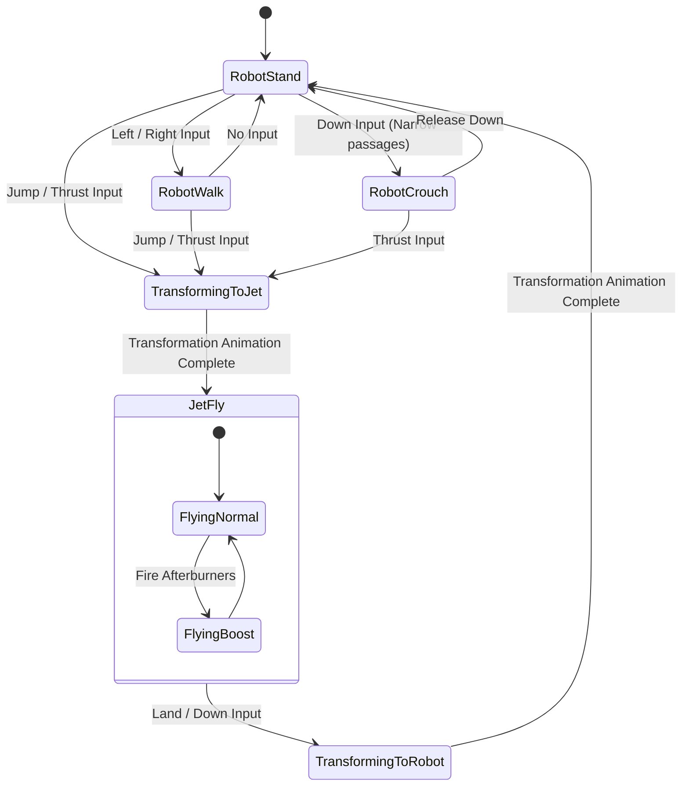

# Domain Modeling & Game Entities Standard

This rule mandates type-driven domain modeling across the **entire codebase**—encompassing the decompiled C modules (`src/firehawk`, `src/thexder`) and the platform harness.

---

## 1. Core Principles

1. **Model Domain Nouns with Explicit Types:**
   - Avoid passing untyped raw primitives across business logic and subsystem boundaries.
   - Use strongly-named C enums and structs to encapsulate domain concepts:
     - `transform_mode_t`: `MODE_ROBOT_STAND`, `MODE_ROBOT_WALK`, `MODE_ROBOT_CROUCH`, `MODE_JET_FLYING`, `MODE_TRANSFORM_TO_JET`, `MODE_TRANSFORM_TO_ROBOT`.
     - `weapon_type_t`: `WEAPON_HOMING_LASER`, `WEAPON_MISSILE_NORMAL`, `WEAPON_MISSILE_HOMING`.
     - `direction_t`: `DIR_LEFT`, `DIR_RIGHT`, `DIR_UP`, `DIR_DOWN`, `DIR_UP_LEFT`, etc.
2. **Make Illegal Game States Unrepresentable:**
   - The state machine must enforce valid state transitions. For example, a robot cannot fire forward jet thrusters while in crouch mode; it must transition through transform states.
   - Shield activation must check that the player has sufficient energy points before toggling `shield_active = true`.
3. **Binary Layout Fidelity for Assets & Saves:**
   - Disk assets (`SAVEGM.DAT`, `RES*.IX`, `SS*` stage headers) must have explicitly packed or offset-verified struct definitions matching the 16-bit DOS format.
   - Ensure struct alignment issues are documented and deserialized with explicit endian-safe functions.
4. **Zero Dynamic Allocation:**
   - Entity pools (`entity_t entities[MAX_ENTITIES]`), particle buffers, and collision caches must operate with fixed static capacities.

---

## 2. Architecture: Game State Modeling

### ASCII Diagram: Thexder / Firehawk Domain State Model

```
+-------------------------------------------------------------------------------+
|                       GAME DOMAIN SUBSYSTEM MODEL                             |
|                                                                               |
|   player_state_t:                                                             |
|     ├── transform_mode: [RobotStand | RobotWalk | JetFly | Transforming]      |
|     ├── energy:         uint16_t (0 .. MAX_ENERGY, e.g. 1000)                 |
|     ├── shield:         uint8_t  (active, duration counter)                   |
|     ├── position:       world_pos_t { int16_t x; int16_t y; }                 |
|     ├── velocity:       velocity_t  { int8_t vx; int8_t vy; }                 |
|     └── weapon:         weapon_state_t { homing_target, beam_length }         |
|                                                                               |
|   tilemap_state_t:                                                            |
|     ├── stage_index:    uint8_t (0 .. 12)                                     |
|     ├── scroll_x, y:    uint16_t                                              |
|     └── grid:           tile_id_t [MAP_HEIGHT][MAP_WIDTH]                     |
+-------------------------------------------------------------------------------+
```



---

## 3. Implementation Rules for Decompiled Structs

1. **Fixed-Width Scalar Members:**
   - All struct members must use fixed-width integer types from `<stdint.h>` (`uint8_t`, `int16_t`, etc.).
2. **Deterministic Enums:**
   - Explicitly assign initial enum values (`MODE_ROBOT = 0`) to prevent compiler-dependent or undefined representation values.
3. **Clear Ownership & Seams:**
   - Entity state must not contain raw unmanaged pointers to other entities; reference entities by array indices (`uint8_t target_entity_idx`) to avoid dangling pointers.
