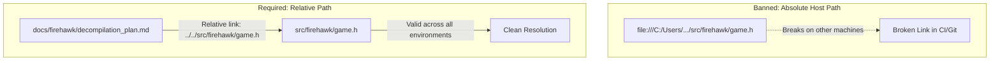

# Relative Pathnames in Documentation & Code References

## 1. Core Mandate

All file, directory, header, source, asset, and test references authored in repository documentation (`docs/*.md`, `README.md`, design specs, implementation plans, and decompilation notes) must strictly use **relative pathnames**.

Absolute host filesystem paths (`C:\Users\...`, `D:\...`, `/home/...`, `/Users/...`) and absolute URI schemes (`file:///...`) are **strictly prohibited** in all documentation, markdown files, and commit messages.

---

## 2. Rationale & Portability

1. **Cross-Platform Portability**: The codebase is engineered to run seamlessly across Windows (MSVC) and Linux (GCC/Clang). Absolute paths tie documentation to a single developer's host machine and filesystem layout.
2. **Git Hosting & Markdown Viewers**: Relative links resolve natively on GitHub, GitLab, Gitea, and local offline editors (VS Code, Obsidian, Antigravity). Absolute links and `file:///` URIs fail immediately in web browsers and third-party environments.
3. **CI/CD Pipeline Verification**: Automated documentation validation and link-checking scripts fail when encountering host-specific path anchors.
4. **Information Security & Privacy**: Absolute paths leak local user usernames, machine configurations, and private directory structures into version control.

---

## 3. Reference Conventions

### 3.1 Prose & In-Line Code Backticks
When referencing repository files within textual descriptions, tables, or list items, use pathnames relative to the **repository root**:
- **Required**: `` `src/firehawk/game.h` ``
- **Required**: `` `src/platform/video_adapter.cpp` ``
- **Required**: `` `tools/sar_extractor.c` ``
- **Required**: `` `docs/firehawk/decompilation_plan.md` ``
- **Banned**: `` `C:\Users\Developer\workspace\Thexder-Decompiled.git\src\firehawk\game.h` ``
- **Banned**: `` `/home/developer/Thexder-Decompiled/src/firehawk/game.h` ``

### 3.2 Markdown Hyperlinks
When providing clickable Markdown links within files inside `docs/`, use relative paths resolved from the **document's directory**:
- Sibling document link: `[Implementation Plan](decompilation_plan.md)`
- Target source header link: `[`game.h`](../../src/firehawk/game.h)`
- Target asset link: `[`RES1.IX`](../../assets/firehawk/RES1.IX)`
- **Banned**: `[`game.h`](file:///c:/Users/Stavros/workspace/Thexder-Decompiled.git/src/firehawk/game.h)`

---

## 4. Architectural Model: Relative vs Absolute Pathing

### ASCII Path Resolution Architecture

```
+-------------------------------------------------------------------------------+
|                       PATH RESOLUTION ARCHITECTURE                            |
|                                                                               |
|   BANNED (ABSOLUTE HOST PATHS / FILE URIs):                                   |
|   file:///c:/Users/Stavros/workspace/Thexder-Decompiled.git/src/firehawk      |
|   * Fragile: Fails on Linux, CI runners, and other developers' workstations   |
|                                                                               |
|   REQUIRED (RELATIVE PATH RESOLUTION):                                        |
|   Repository Root: Thexder-Decompiled.git/                                    |
|   ├── docs/                                                                   |
|   │   └── firehawk/                                                           |
|   │       └── decompilation_plan.md ────(relative link)────┐                  |
|   │             "../../src/firehawk/game.h"                │                  |
|   └── src/                                                 │                  |
|       └── firehawk/                                        ▼                  |
|           └── game.h <─────────────────────────────────────┘                  |
|   * Portable: Resolves correctly on every operating system, IDE, and GitHub   |
+-------------------------------------------------------------------------------+
```



---

## 5. Verification Checklist

Before publishing, outputting, or committing any documentation file:
- [ ] No occurrences of `file:///` exist anywhere in the document.
- [ ] No occurrences of drive letters (e.g., `C:`, `D:`) exist in file links or code paths.
- [ ] No occurrences of user home directories (e.g., `/home/`, `C:\Users\`, `/Users/`) exist.
- [ ] Links between documents and source files resolve correctly using relative navigation (`../`).
- [ ] Forward slashes (`/`) are strictly used as the path separator in all Markdown links and prose paths.
