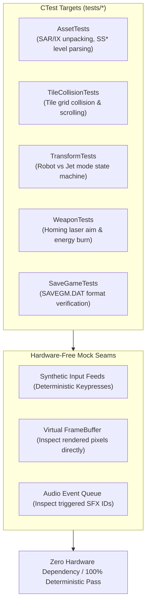

# Testing & Verification Standards

This rule governs automated testing, hardware-free simulation, and regression testing across the **Thexder & Firehawk Decompilation project**.

---

## 1. Testing Architecture & Mock Seams

All core logic must be 100% testable in a headless environment without an SDL window, GPU context, or audio hardware.

```
+-------------------------------------------------------------------------------+
|                       AUTOMATED TESTING & SEAM ARCHITECTURE                   |
|                                                                               |
|   tests/ (Unit, Regression & Headless Simulation Suites)                      |
|         │                                                                     |
|         ├── [Asset Tests]: SAR/IX archive extraction, SS* stage header parser |
|         ├── [Physics & Tile Collision]: Swept AABB, solid & breakable tiles   |
|         ├── [Transform Tests]: Robot <-> Jet mode transitions, bounds checks  |
|         ├── [Weapon System Tests]: Homing laser targeting & energy drain      |
|         ├── [Shield Tests]: Barrier activation, timer countdown, deflection   |
|         └── [SaveGame Tests]: SAVEGM.DAT struct layout, checksum verification |
|         │                                                                     |
|         ▼                                                                     |
|   Deterministic CTest Execution (`ctest --output-on-failure` -> 100% Pass)    |
+-------------------------------------------------------------------------------+
```



---

## 2. Test-Driven Bug Fixing (TDD)

When fixing any defect or discrepancy against original DOS behavior:
1. **Never write the fix first.**
2. **Step 1 (RED):** Write a targeted test that reproduces the bug or discrepancy. Confirm failure under `ctest`.
3. **Step 2 (GREEN):** Implement the minimal, safe fix in the decompiled C module.
4. **Step 3 (REFACTOR):** Confirm all tests pass with zero compiler warnings and clean formatting.

---

## 3. Repository Testing Conventions

1. **Automated CTest Suite:**
   - Execute all test suites via:
     ```bash
     ctest --test-dir build --output-on-failure
     ```
   - 100% of tests must pass with zero failures.
2. **Hardware-Free Simulation Requirement:**
   - Unit tests must **never** initialize SDL or require an active display/audio device.
   - Use memory buffers and headless callback harnesses.
3. **Behavioral Parity with DOS Original:**
   - Whenever feasible, verify algorithmic state against DOSBox memory dumps or trace logs.
