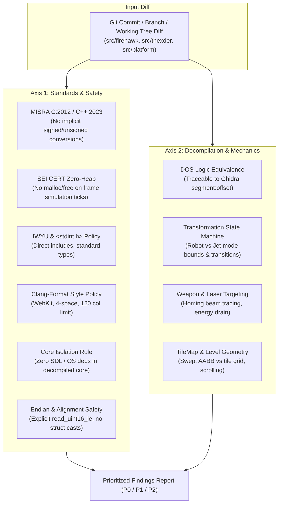

# Dual-Axis Code Review Workflow

This skill executes a systematic, dual-axis code review on any patch, commit range, pull request, or local working tree across all current and future modules in the repository.

---

## 1. Dual-Axis Review Model

```
+-------------------------------------------------------------------------------+
|                         DUAL-AXIS CODE REVIEW MODEL                           |
|                                                                               |
|   Diff / Working Tree (src/firehawk, src/thexder, src/platform, tools/*)      |
|         │                                                                     |
|         ├───► [Axis 1: Standards & Safety] ─────────────────────────┐         |
|         │       • MISRA C:2012 / C++:2023 & SEI CERT C/C++          │         |
|         │       • IWYU & <stdint.h> / <cstdint> compliance          │         |
|         │       • Code Formatting (clang-format -i / check-format)  │         |
|         │       • Core Isolation (Zero SDL/external deps in Core)   ▼         |
|         │       • Endian safety (explicit LE helpers, no bad casts) [Prioritized]
|         │                                                       [ Findings  ] |
|         └───► [Axis 2: Decompilation & Spec Integrity] ────────►[ Report    ] |
|                 • DOS 16-bit register/segment math equivalence      ▲         |
|                 • Transformation & kinematics stability (Swept AABB)│         |
|                 • Real-time & frame path safety (0-heap fast paths) │         |
|                 • Cross-platform portability (Linux & Win32)        ┘         |
+-------------------------------------------------------------------------------+
```



---

## 2. Review Protocol

When executing a code review:
1. **Analyze Diff Scope:** Review files by layer (Core C logic first, then Platform adapter, then CMake/tools).
2. **Axis 1 (Standards & Safety):** Verify `#include <stdint.h>`, `#pragma once`, zero heap in game ticks, endian safety, and formatting.
3. **Axis 2 (Decompilation & Logic):** Verify that decompiled C accurately reflects the original 16-bit assembly logic and game mechanics.
4. **Produce Report:** Group issues into:
   - **P0 (Blocker):** Memory corruption, aliasing violation, Core isolation violation, build failures.
   - **P1 (Important):** Missing IWYU headers, unhandled 16-bit integer wrap, missing Ghidra address comment.
   - **P2 (Polish):** Formatting discrepancy, comment readability, naming improvements.
