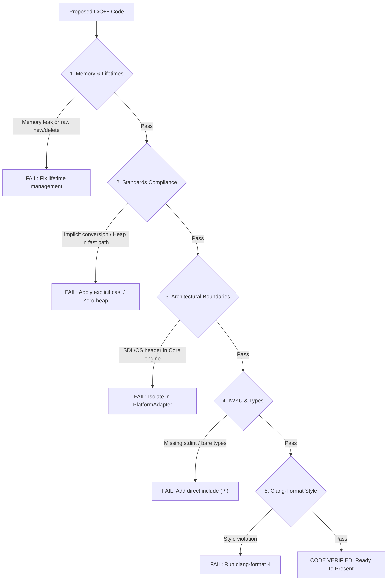

# Code Verification Checklist & Safety Gate

Before presenting any C (`.c`, `.h`) or C++ (`.cpp`, `.hpp`) code snippet, writing an implementation file, or proposing a refactoring across any library in this repository, internally verify the code against this comprehensive 19-point safety gate.

---

## 1. Verification Gate Architecture

```
+-------------------------------------------------------------------------------+
|                       CODE COMPLIANCE & SAFETY GATE                           |
|                                                                               |
|   Proposed Code Snippet / Implementation Diff                                 |
|         │                                                                     |
|         ├── [1. Memory & Types]: RAII in C++, paired init/cleanup in C, {}    |
|         ├── [2. Standards]: MISRA C:2012 / C++:2023, SEI CERT INT31-C         |
|         ├── [3. Core Isolation]: 0 SDL/OS headers in Core, cross-platform     |
|         ├── [4. IWYU & Tooling]: Direct headers, scripts/verify_iwyu_cstdint.py|
|         ├── [5. Formatting]: clang-format -i, scripts/verify_clang_format.py  |
|         └── [6. Documentation]: Full Doxygen + Ghidra address, relative paths |
|         │                                                                     |
|         ▼                                                                     |
|   Pass All 19 Checks -> Approved for Output / Merge                           |
+-------------------------------------------------------------------------------+
```



---

## 2. The 19-Point Verification Checklist

1. **Memory & Lifetimes:** Did I ensure clean lifetime management? (In C: explicit paired `init`/`shutdown` functions, zero memory leaks. In C++: RAII, smart pointers, zero raw `new`/`delete`).
2. **Explicit Initialization:** Are all variables explicitly initialized (`0` or `{0}` in C, `{}` in C++)?
3. **Safety Attributes:** Did I apply `[[nodiscard]]` (or `NODISCARD` macro in C) to all functions returning status codes or error states?
4. **Documentation Completeness:** Are all public APIs documented with full Doxygen templates (`/// @brief`, `@details`, `@param`, `@return`), including Ghidra address traceability (`@details Ghidra: binary @ seg:off`)?
5. **Standards Compliance:** Does this code strictly comply with MISRA C:2012 / C++:2023 and SEI CERT (explicit casts, safe 16-bit to 32-bit promotions)?
6. **TDD:** Did I write a failing test first if fixing a bug or regression (per [`.agents/skills/tdd-bug-fixing`](../tdd-bug-fixing/SKILL.md))?
7. **Header Guards:** Are headers using `#pragma once` as the first non-comment line?
8. **File Co-location:** Are companion header (`.h`) and implementation (`.c` / `.cpp`) files co-located in the same directory?
9. **Core Layer Isolation:** Do Core decompiled engines (`src/firehawk`, `src/thexder`) maintain **zero external dependencies**? (`#include <SDL...>`, OpenGL, and OS headers are strictly banned in core engines).
10. **Concise Naming:** Are all function names concise (strictly fewer than 30 characters)?
11. **Cross-Platform Portability:** Does code compile and run cleanly on both **Linux** (GCC/Clang) and **Windows** (MSVC/Clang-CL)?
12. **Compiler Warning Cleanliness:** Does the code compile with zero warnings under `-Wall -Wextra -pedantic` (`-Werror`) on GCC/Clang and `/W4` on MSVC?
13. **Documentation Paths:** Are all file paths mentioned in documentation and comments relative?
14. **Dual Diagrams:** If diagrams are involved in documentation, are both **ASCII** and **Mermaid** diagrams included?
15. **Fixed-Width Integers:** Did I explicitly `#include <stdint.h>` in C files and `<cstdint>` (with `std::` prefix) in C++ files? Did I include `<stddef.h>` / `<cstddef>` for `size_t`?
16. **IWYU:** Does the code directly include every header declaring symbols or types it uses?
17. **Binary Deserialization Safety:** Are binary assets (`.SAR`, `.IX`, `SS*`, `SAVEGM.DAT`) deserialized using explicit little-endian read helpers instead of raw byte pointer casts to structs?
18. **Zero Heap on Fast Paths:** Are real-time simulation loops, collision queries, and weapon targeting free of dynamic heap allocations?
19. **Clang-Format Cleanliness:** Has all modified code been formatted with clang-format (`python scripts/verify_clang_format.py --files <files>`)?
