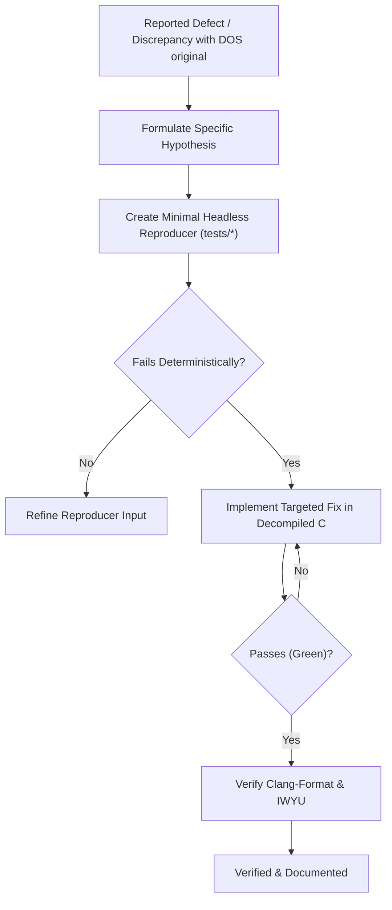

# Systematic Bug Diagnosis & Decompilation Troubleshooting

This skill enforces a disciplined, hypothesis-driven diagnostic loop for defects, physics glitches, collision tunneling, weapon targeting faults, and state machine regressions across the **Thexder & Firehawk Decompilation repository**.

It strictly prevents speculative trial-and-error patching by requiring a reproducible, deterministic feedback loop before any fix is attempted.

---

## 1. Diagnostic Philosophy

1. **No Fixes Without Diagnosis:**
   - Never speculate or patch production code until the root cause is isolated and demonstrated with a failing test or reproducer.
2. **Deterministic Feedback Loop First:**
   - Construct a minimal, deterministic reproducer (e.g. headless test feeding recorded inputs or raw asset chunks) that goes **RED** exclusively on the defect.
3. **Verify Diagnostic Seams:**
   - Ensure the diagnostic test exercises genuine decompiled routines rather than a shallow test mock.
4. **Compare Against Reference DOSBox Run:**
   - When game behavior differs from original DOS execution, use DOSBox debug logs, memory dumps, or register traces to isolate the discrepancy.

---

## 2. Common Decompilation Defect Classes

```
+-------------------------------------------------------------------------------+
|                    DECOMPILATION DEFECT CATEGORIES                            |
|                                                                               |
|   1. 16-bit Integer Overflow & Sign Extension:                                |
|      • DOS 8086 registers (AX, BX) wrapped at 65536.                          |
|      • In 32/64-bit C, uint16_t promoted to int32_t may not wrap naturally!   |
|                                                                               |
|   2. Endianness & Struct Memory Packing:                                      |
|      • Misinterpreting little-endian multi-byte fields.                       |
|      • Compiler adding padding bytes between struct members.                  |
|                                                                               |
|   3. Far Pointer / Segment Offset Translation:                                |
|      • Segments shifted by 4 (seg * 16 + off) miscalculated in linear memory. |
|                                                                               |
|   4. Fixed-Point Math & Scaling:                                              |
|      • Velocity and angle tables stored as 8.8 fixed point or raw integer.    |
+-------------------------------------------------------------------------------+
```



---

## 3. Diagnostic Protocol

1. **Step 1: Isolate Function in Ghidra:**
   - Identify the exact routine responsible (e.g. `GAME.EXE @ 1000:05B0`).
   - Check disassembly against decompiled C logic, examining register flags (ZF, CF, SF) and conditional jumps.
2. **Step 2: Replay with Exact Inputs:**
   - Write a unit test feeding identical player state and delta values.
3. **Step 3: Resolve Discrepancy:**
   - Correct the C implementation to match the exact mathematical semantics of the x86 assembly.
4. **Step 4: Regression Test:**
   - Add the test case to the test suite to ensure future refactorings do not reintroduce the regression.
