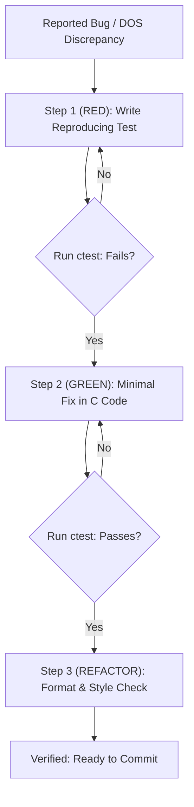

# Test-Driven Bug Fixing (TDD) Workflow

This skill enforces a strict, regression-proof Test-Driven Development (TDD) workflow for all bug fixes and DOS behavioral discrepancies.

---

## 1. Red-Green-Refactor Protocol

```
+-------------------------------------------------------------------------------+
|                         STRICT TDD BUG-FIXING LOOP                            |
|                                                                               |
|   1. RED: Write failing headless test reproducing the defect/discrepancy       |
|      ctest --output-on-failure  -> FAIL (exit code != 0)                      |
|         │                                                                     |
|         ▼                                                                     |
|   2. GREEN: Implement minimal, safe fix in decompiled C logic                 |
|      ctest --output-on-failure  -> PASS (100% tests pass)                     |
|         │                                                                     |
|         ▼                                                                     |
|   3. REFACTOR & FORMAT: Apply clang-format -i & verify zero warnings          |
|      python scripts/verify_clang_format.py                                    |
|      python scripts/verify_iwyu_cstdint.py                                    |
+-------------------------------------------------------------------------------+
```



---

## 2. Core Rules

1. **Never write the fix before the failing test:** A fix without a reproducer is unverifiable and prone to regressions.
2. **Deterministic & Headless:** Tests must run without SDL graphics or sound hardware.
3. **Preserve DOS Semantics:** Ensure the test validates against observed original game behavior (e.g. from DOSBox).
