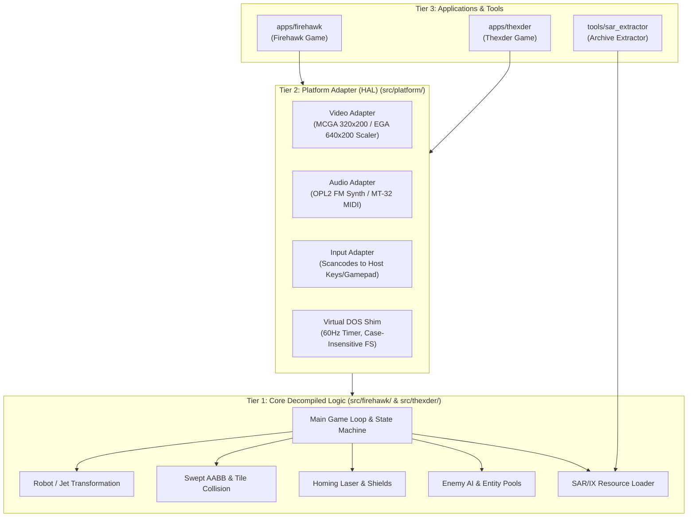

# System Architecture & Engine Design

## 1. Overview

This project decompiles and modernizes two classic DOS action games developed by Game Arts and published by Sierra On-Line:
1. **Thexder** (DOS 1987)
2. **Firehawk: Thexder II** (DOS 1990)

The decompilation produces portable ISO C99/C11 source code (`.c` and `.h`) for the game logic, coupled with a modern platform abstraction harness (SDL2 or SDL3) that builds with CMake and allows native execution on modern operating systems (Windows, Linux, macOS).

---

## 2. Tiered System Architecture

```
+-------------------------------------------------------------------------------+
|                       SYSTEM ARCHITECTURE MODEL                               |
|                                                                               |
|   Tier 3: Game Applications & Asset Tools                                     |
|   ┌──────────────────────────────────┐  ┌──────────────────────────────────┐  |
|   │ apps/firehawk (Firehawk Runner)  │  │ apps/thexder (Thexder Runner)    │  |
|   └─────────────────┬────────────────┘  └─────────────────┬────────────────┘  |
|                     │ tools/sar_extractor (Asset Tool)    │                   |
|                     ▼                                     ▼                   |
|   Tier 2: Platform Abstraction Layer (HAL) (src/platform/)                    |
|   ┌────────────────────────────────────────────────────────────────────────┐  |
|   │ • Video: 320x200 / 640x200 EGA/MCGA frame buffer, palette & aspect     │  |
|   │ • Audio: OPL2 (AdLib/SB) FM synthesis, MT-32 MIDI, PC speaker, Tandy   │  |
|   │ • Input: Scancode mapping, keyboard & modern gamepad translation       │  |
|   │ • Timer: Deterministic 60Hz frame loop / 18.2Hz DOS tick shim          │  |
|   │ • Filesystem: Virtual DOS file lookup mapping to assets/               │  |
|   └──────────────────────────────────┬─────────────────────────────────────┘  |
|                                      │                                        |
|                                      ▼                                        |
|   Tier 1: Decompiled Core Engines (src/firehawk/, src/thexder/)               |
|   ┌────────────────────────────────────────────────────────────────────────┐  |
|   │ • Pure ISO C99/C11 (.c and .h files)                                   │  |
|   │ • ZERO external dependencies (no SDL, no OS headers, 0-heap fast path)│  |
|   │ • Subsystems:                                                          │  |
|   │     - Transform state machine (Robot <-> Jet modes)                    │  |
|   │     - Swept AABB kinematics & tile collision                           │  |
|   │     - Weapon auto-targeting (homing laser, missiles, shield)           │  |
|   │     - Enemy AI tables, spawner state, and entity pools                 │  |
|   │     - Stage map reader (SS* levels) & SAR/IX resource archive loader   │  |
|   └────────────────────────────────────────────────────────────────────────┘  |
+-------------------------------------------------------------------------------+
```



---

## 3. Directory Layout

```text
Thexder-Decompiled/
├── assets/                       # Original DOS game files
│   ├── firehawk/                 # Firehawk (GAME.EXE, RES*.SAR, SS*, *.DRV)
│   └── thexder/                  # Thexder (MAIN, THEXDER.COM, MAP*.BIN)
├── docs/                         # Comprehensive reverse-engineering documentation
│   ├── architecture.md           # This document
│   ├── decompilation_guide.md    # Methodology, Ghidra workflows, standards
│   ├── implementation_plan.md    # Actionable implementation plan for Firehawk
│   └── firehawk/                 # Firehawk-specific documentation
│       ├── file_formats.md       # SAR, IX, SS*, DAT format specs
│       ├── decompiled_functions_audit.md # Decompiled functions & drivers audit
│       └── exact_decompiled_functions_plan.md # 1:1 decompiled module plan
├── src/
│   ├── common/                   # Shared types, endian helpers, math
│   ├── firehawk/                 # Decompiled Firehawk engine (.c and .h)
│   ├── thexder/                  # Decompiled Thexder engine (.c and .h)
│   └── platform/                 # SDL platform adapter (video, audio, input)
├── apps/
│   ├── firehawk/                 # Standalone native Firehawk executable
│   └── thexder/                  # Standalone native Thexder executable
├── tools/                        # Offline CLI utilities (SAR extractor, map viewer)
├── tests/                        # Headless regression and unit tests (CTest)
├── scripts/                      # Automated verification and formatting scripts
├── CMakeLists.txt                # Root CMake project
└── .clang-format                 # Repository-wide code style definition
```

