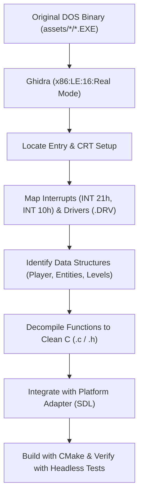

# Master Decompilation & Reverse-Engineering Guide

## 1. Introduction

This guide documents the standardized process for decompiling 16-bit x86 DOS binaries in this repository (**Thexder** and **Firehawk: Thexder II**) using **Ghidra**, translating disassembled routines into portable ISO C99/C11 code, and validating behavioral parity against the original games.

---

## 2. Ghidra Setup for 16-Bit Real Mode DOS Binaries

### 2.1 Importing DOS Binaries
1. **Target Architecture:** `x86:LE:16:Real Mode`
   - Language: `x86`
   - Endian: `Little`
   - Size: `16-bit`
   - Variant: `Real Mode`
2. **DOS MZ Executables (`GAME.EXE`, `SIERRA.EXE`, `MAIN`):**
   - Ghidra automatically detects the `MZ` signature (`4D 5A`), loads relocations, and configures the initial code segment (`CS:IP`) and stack segment (`SS:SP`).
   - Base Segment: Set to `0x1000` (effective linear base `0x10000`) or `0x0000` depending on segment displacement.
3. **DOS COM Binaries (`THEXDER.COM`, `EXISTS.COM`):**
   - Load at offset `0x0100` (leaving bytes `0x0000 - 0x00FF` for the DOS Program Segment Prefix / PSP).

---

## 3. Reverse-Engineering Workflow

```
+-------------------------------------------------------------------------------+
|                       GHIDRA REVERSE-ENGINEERING PIPELINE                     |
|                                                                               |
|   Step 1: Ingest Binary & Segment Setup                                       |
|      • Verify MZ Header (Relocations, Initial CS:IP, DGROUP)                  |
|      • Auto-analyze with 16-bit disassembly & decompiler                      |
|         │                                                                     |
|         ▼                                                                     |
|   Step 2: Trace Entry Point & CRT Initialization                              |
|      • Follow start -> setup segment registers (DS=DGROUP, SS:SP)             |
|      • Locate command-line / argument parsing and jump to main()              |
|         │                                                                     |
|         ▼                                                                     |
|   Step 3: Map DOS Interrupts & Hardware Access                                |
|      • INT 21h (Filesystem AH=3Dh/3Fh, Memory AH=48h)                         |
|      • INT 10h (Video mode AH=00h, Palette, Cursor)                           |
|      • I/O Ports: IN/OUT on 0x388/0x389 (AdLib), 0x220 (Sound Blaster)       |
|         │                                                                     |
|         ▼                                                                     |
|   Step 4: Recover Data Structures & Global State                              |
|      • Identify player struct, entity arrays, tile map buffers                |
|      • Define structs in Ghidra Data Type Manager                             |
|         │                                                                     |
|         ▼                                                                     |
|   Step 5: Translate to Clean C (.h / .c)                                      |
|      • Pure portable C with standard <stdint.h> types                         |
|      • Preserve exact 16-bit math and register wrapping semantics             |
|      • Document Ghidra source address in Doxygen tags                         |
+-------------------------------------------------------------------------------+
```



---

## 4. 16-Bit x86 to Modern C Translation Patterns

### 4.1 Segment:Offset Far Pointers
In DOS Real Mode, memory addresses are computed as `(Segment * 16) + Offset`:
- In modern 32-bit/64-bit flat memory, replace segmented pointers with direct pointers (`uint8_t*`) or array indices into a pre-allocated memory pool.
- Never store raw 16-bit segment values; store canonical indices or direct pointers.

### 4.2 16-Bit Arithmetic & Register Wrapping
On the 8086 CPU, 16-bit additions and subtractions wrap modulo 65536 ($2^{16}$):
- In C, operating on `uint16_t` naturally wraps on unsigned overflow.
- When performing signed math or when operations promote to signed 32-bit `int`, explicitly mask or cast:
  ```c
  uint16_t new_pos = (uint16_t)(pos + vel);
  ```

### 4.3 Calling Conventions
16-bit DOS code often passes arguments in registers (`AX`, `BX`, `CX`, `DX`) or on the stack (`__cdecl`, `__pascal`):
- Ghidra decompilation will initially display registers (`in_AX`, `in_DX`).
- Clean these up into standard C function prototypes with semantic parameter names:
  ```c
  /// @brief Draws a tile at the given grid coordinates.
  /// @details Ghidra: GAME.EXE @ 1000:24A0 (draw_tile)
  void draw_tile(uint16_t col, uint16_t row, uint8_t tile_id);
  ```

### 4.4 Endianness & Struct Alignment
- DOS files and memory are little-endian.
- When reading assets from disk (`.SAR`, `.IX`, `SS*`, `SAVEGM.DAT`), **do not** cast raw buffers directly to structs.
- Use explicit deserialization helpers:
  ```c
  static inline uint16_t read_u16_le(const uint8_t* p) {
      return (uint16_t)(p[0] | ((uint16_t)p[1] << 8));
  }
  ```

---

## 5. Documentation & Traceability Policy

Every decompiled source file must maintain 100% traceability to the original binary:
1. Include the Ghidra function name, binary name, and segment:offset address in the Doxygen header.
2. Note original global variable offsets in DGROUP.
3. Keep original variable names alongside semantic names in comments where helpful.

