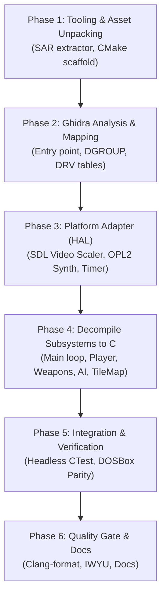

# Firehawk (Thexder II) Decompilation & Porting Plan

## 1. Executive Summary

This plan outlines the end-to-end strategy to reverse-engineer and decompile **Firehawk: Thexder II** (DOS release in `assets/firehawk/`) using **Ghidra**, translating original 16-bit x86 Real Mode assembly into clean, portable ISO C99/C11 files (`.c` and `.h`).

The target outcome is a fully playable native game built with **CMake** that runs on modern operating systems (Windows, Linux, macOS) through an SDL-based platform abstraction layer, accompanied by comprehensive reverse-engineering documentation.

---

## 2. Implementation Roadmap

```
+-------------------------------------------------------------------------------+
|                       FIREHAWK DECOMPILATION ROADMAP                          |
|                                                                               |
|   [Phase 1: Tooling & Asset Unpacking]                                        |
|      • Ghidra project setup (x86:LE:16:Real Mode)                             |
|      • Build tools/sar_extractor to extract RES*.SAR / RES*.IX archives       |
|      • Scaffold CMake project structure                                       |
|         │                                                                     |
|         ▼                                                                     |
|   [Phase 2: Binary Disassembly & Memory Mapping]                              |
|      • Identify GAME.EXE & SIERRA.EXE entry points, CRT init, and main loop   |
|      • Map DGROUP data segments, player structs, and entity tables            |
|      • Reverse-engineer *.DRV driver dispatch interfaces                      |
|         │                                                                     |
|         ▼                                                                     |
|   [Phase 3: Platform Abstraction Layer (HAL)]                                 |
|      • SDL2/3 Video Scaler (MCGA 320x200 / EGA 640x200 -> Modern 4:3 Window)  |
|      • OPL2 (AdLib/SB) FM synth & MT-32 MIDI audio backend                    |
|      • Input translation: Scancodes to Keyboard / Gamepad                     |
|      • Virtual DOS 60Hz frame timer & asset filesystem shim                   |
|         │                                                                     |
|         ▼                                                                     |
|   [Phase 4: Core Subsystem Decompilation into C (.c / .h)]                    |
|      • 4.1: Game loop & state machine (Title -> Practice -> Mission)          |
|      • 4.2: Resource manager & stage loader (SS000 - SS120)                   |
|      • 4.3: TileMap, scrolling & swept AABB collision                         |
|      • 4.4: Player transformation (Robot <-> Jet), kinematics, crouch         |
|      • 4.5: Weapon system (Homing laser auto-targeting, missiles, shields)    |
|      • 4.6: Entity pool & enemy AI dispatch                                   |
|      • 4.7: Sprite renderer & blitter                                         |
|      • 4.8: Audio sequencer & music event triggers                            |
|      • 4.9: HUD & SaveGame (SAVEGM.DAT)                                       |
|         │                                                                     |
|         ▼                                                                     |
|   [Phase 5: Playable Integration & Verification]                              |
|      • Headless simulation tests (collision, weapons, saves)                  |
|      • Cross-verification with DOSBox frame captures & memory dumps           |
|      • Full playable campaign run (Stages 0 to 12)                            |
|         │                                                                     |
|         ▼                                                                     |
|   [Phase 6: Quality Gate & Documentation]                                     |
|      • Clang-format, IWYU, zero-warning compiler build                        |
|      • Complete Ghidra memory map and address index documentation             |
+-------------------------------------------------------------------------------+
```



---

## 3. Detailed Phase Breakdown

### Phase 1: Tooling, Asset Unpacking & Infrastructure
- **Objective:** Establish the development environment, unpack game assets for inspection, and set up the build system.
- **Tasks:**
  1. **Ghidra Project:**
     - Initialize a Ghidra project for `assets/firehawk/GAME.EXE` and `SIERRA.EXE`.
     - Set target language to `x86:LE:16:Real Mode`.
  2. **Asset Extraction Tool (`tools/sar_extractor.c`):**
     - Develop an offline CLI tool to parse `RES1.IX`, `RES2.IX`, `RES3.IX` and extract individual resource chunks from `RES*.SAR`.
     - Output unpacked graphics, palettes, and sound banks for verification.
  3. **Build System (`CMakeLists.txt`):**
     - Configure top-level CMake project targeting C99/C11 for core engines and C++17 for platform harness.
     - Add strict warning flags (`-Wall -Wextra -pedantic`, `/W4`).

### Phase 2: Binary Disassembly & Reverse-Engineering in Ghidra
- **Objective:** Map out the executable structure, entry points, interrupt vectors, and data segments.
- **Tasks:**
  1. **Entry Point & CRT:**
     - Disassemble `GAME.EXE` start routine. Locate segment register setups (`DS = DGROUP`, `SS:SP`).
     - Trace startup sequence into `game_main()`.
  2. **Memory Map Construction:**
     - Define memory blocks:
       - `CODE` (Game logic, rendering, math)
       - `DATA` / `DGROUP` (Global variables, state flags, look-up tables)
       - `BSS` (Uninitialized entity pools, tile buffers, screen scratchpads)
  3. **DOS Intercepts & Driver Interfaces:**
     - Locate `INT 21h` calls (file open `AH=3Dh`, file read `AH=3Fh`, memory allocation `AH=48h`).
     - Analyze driver dispatch tables (`MCGA320.DRV`, `EGA640.DRV`, `SNDBLAST.DRV`, `MT32.DRV`).
  4. **Data Structure Extraction:**
     - Identify `player_state_t` layout in DGROUP.
     - Identify `entity_t` active table (enemies, projectiles, particles).
     - Identify `stage_header_t` and tile grid arrays.

### Phase 3: Platform Abstraction Layer (HAL) Development
- **Objective:** Build the modern host runtime in `src/platform/` to host the decompiled C engine.
- **Tasks:**
  1. **Virtual Framebuffer & Video Scaler:**
     - Allocate a linear 320x200 8-bit index buffer (or 640x200 EGA bitplane buffer).
     - Implement modern aspect-ratio preserving integer scaler using SDL2 or SDL3 texture streaming.
     - Implement palette conversion (16-color EGA / 256-color MCGA to 32-bit RGBA).
  2. **Audio Synthesis Backend:**
     - Implement OPL2 FM synthesis emulation for AdLib / Sound Blaster music and sound effects.
     - Implement MIDI message queue for Roland MT-32 output.
  3. **Input Translation:**
     - Map DOS keyboard scancodes (`IBMKBD.DRV`) to modern SDL key codes and gamepad buttons.
  4. **Virtual DOS Timer & Filesystem:**
     - Create a fixed 60 Hz frame simulation tick with delta accumulator.
     - Provide a case-insensitive file reader mapping DOS file requests to `assets/firehawk/`.

### Phase 4: Core Subsystem Decompilation into C (`.c` & `.h`)
- **Objective:** Decompile all game routines from Ghidra into clean, portable C code in `src/firehawk/`.
- **Subsystems to decompile:**
  1. **Main Loop & Game States (`game_main.c`, `game_loop.c`):**
     - Decompile state transitions: Title screen $\rightarrow$ Demo $\rightarrow$ Introduction $\rightarrow$ Stage Play $\rightarrow$ Stage Complete $\rightarrow$ Game Over.
  2. **Resource Manager (`res_manager.c`):**
     - C implementation of index searching (`RES*.IX`) and volume reading (`RES*.SAR`).
  3. **TileMap & Stage Loader (`stage_loader.c`, `tilemap.c`):**
     - Parse `SS000` through `SS120`. Load tile properties (solid, breakable, energy recharge, hazard).
     - Implement horizontal and vertical screen scrolling logic.
  4. **Player Kinematics & Transformation (`player.c`):**
     - Robot mode: Walking, jumping, gravity, crouching (to navigate 1-tile gaps).
     - Jet mode: Free flight kinematics, afterburner acceleration, momentum damping.
     - Transformation state machine: Transitions, bounding box morphing, animation timer.
  5. **Weapons & Defenses (`weapons.c`):**
     - Homing laser: Line-of-sight targeting raycasts, angle tracking, beam drawing, energy consumption.
     - Missile systems: Normal and homing missiles.
     - Energy shield: Damage absorption, barrier animation, timer countdown.
  6. **Entity Pool & Enemy AI (`entities.c`, `enemy_ai.c`):**
     - Manage fixed-size active entity pool.
     - Implement enemy behavior routines, projectile firing, and collision responses.
  7. **Collision Detection (`collision.c`):**
     - Swept AABB checks against tile grid and entity-to-entity hitboxes.
  8. **HUD & Save State (`hud.c`, `savegame.c`):**
     - Render score, energy gauge, shield gauge, and mission communication text (`COMMDATA`).
     - Parse and write `SAVEGM.DAT` with checksum validation.

### Phase 5: Verification, Playability & Quality Assurance
- **Objective:** Verify 100% functional equivalence with the original DOS game.
- **Tasks:**
  1. **Headless Unit Tests (`tests/`):**
     - Test SAR unpacking on actual game archives.
     - Test swept AABB collision against known stage tile layouts.
     - Test transformation state machine transitions and boundaries.
     - Test save game reading and writing.
  2. **DOSBox Behavioral Cross-Check:**
     - Compare frame-by-frame physics and player movement against DOSBox runs.
  3. **Full Campaign Playtesting:**
     - Verify smooth progression through all stages (Stage 0 to Stage 12).

### Phase 6: Repository Quality Gate & Documentation
- **Objective:** Enforce code standards, formatting, and document all findings.
- **Tasks:**
  1. Format all code using `python scripts/verify_clang_format.py --fix`.
  2. Verify IWYU and fixed-width types using `python scripts/verify_iwyu_cstdint.py`.
  3. Ensure zero compiler warnings under `-Wall -Wextra -pedantic` and `/W4`.
  4. Complete the function-by-function Ghidra address index in `docs/firehawk/decompilation_plan.md`.

---

## 4. Key Subsystem Milestones & Deliverables

| Milestone | Target Deliverable | Verification Gate |
| :--- | :--- | :--- |
| **M1: Asset Tool** | `tools/sar_extractor` extracts all `.SAR` archives | All entries match `.IX` sizes |
| **M2: HAL Scaffold** | SDL window displays test MCGA 320x200 color bar | Window opens, scales 4:3, clean shutdown |
| **M3: Stage Renderer** | Stage 1 (`SS010`) background tiles rendered & scrolled | Matches DOS screenshot exactly |
| **M4: Player Mechanics** | Robot walks, jumps, crouches, and transforms to Jet | Controls responsive, no collision tunneling |
| **M5: Combat Loop** | Laser targets enemies, energy drains, shield activates | Homing beam locks onto nearest enemy |
| **M6: Full Playable** | Complete Stage 1 through 12 playable end-to-end | Victory screen reachable without crash |

