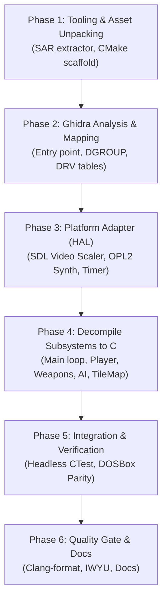

# Firehawk (Thexder II) Decompilation & Porting Plan

## 1. Executive Summary

This plan outlines the end-to-end strategy to reverse-engineer and decompile **Firehawk: Thexder II** (DOS release in `assets/firehawk/`) using **Ghidra**, translating original 16-bit x86 Real Mode assembly into clean, portable ISO C99/C11 files (`.c` and `.h`).

The target outcome is a fully playable native game built with **CMake** that runs on modern operating systems (Windows, Linux, macOS) through an SDL-based platform abstraction layer, accompanied by comprehensive reverse-engineering documentation.

---

## 2. Implementation Roadmap

```
+-------------------------------------------------------------------------------+
|                       FIREHAWK DECOMPILATION ROADMAP                          |
|                                                                               |
|   [Phase 1: Tooling & Asset Unpacking]                                        |
|      • Ghidra project setup (x86:LE:16:Real Mode)                             |
|      • Build tools/sar_extractor to extract RES*.SAR / RES*.IX archives       |
|      • Scaffold CMake project structure                                       |
|         │                                                                     |
|         ▼                                                                     |
|   [Phase 2: Binary Disassembly & Memory Mapping]                              |
|      • Identify GAME.EXE & SIERRA.EXE entry points, CRT init, and main loop   |
|      • Map DGROUP data segments, player structs, and entity tables            |
|      • Reverse-engineer *.DRV driver dispatch interfaces                      |
|         │                                                                     |
|         ▼                                                                     |
|   [Phase 3: Platform Abstraction Layer (HAL)]                                 |
|      • SDL2/3 Video Scaler (MCGA 320x200 / EGA 640x200 -> Modern 4:3 Window)  |
|      • OPL2 (AdLib/SB) FM synth & MT-32 MIDI audio backend                    |
|      • Input translation: Scancodes to Keyboard / Gamepad                     |
|      • Virtual DOS 60Hz frame timer & asset filesystem shim                   |
|         │                                                                     |
|         ▼                                                                     |
|   [Phase 4: Core Subsystem Decompilation into C (.c / .h)]                    |
|      • 4.1: Game loop & state machine (Title -> Practice -> Mission)          |
|      • 4.2: Resource manager & stage loader (SS000 - SS120)                   |
|      • 4.3: TileMap, scrolling & swept AABB collision                         |
|      • 4.4: Player transformation (Robot <-> Jet), kinematics, crouch         |
|      • 4.5: Weapon system (Homing laser auto-targeting, missiles, shields)    |
|      • 4.6: Entity pool & enemy AI dispatch                                   |
|      • 4.7: Sprite renderer & blitter                                         |
|      • 4.8: Audio sequencer & music event triggers                            |
|      • 4.9: HUD & SaveGame (SAVEGM.DAT)                                       |
|         │                                                                     |
|         ▼                                                                     |
|   [Phase 5: Playable Integration & Verification]                              |
|      • Headless simulation tests (collision, weapons, saves)                  |
|      • Cross-verification with DOSBox frame captures & memory dumps           |
|      • Full playable campaign run (Stages 0 to 12)                            |
|         │                                                                     |
|         ▼                                                                     |
|   [Phase 6: Quality Gate & Documentation]                                     |
|      • Clang-format, IWYU, zero-warning compiler build                        |
|      • Complete Ghidra memory map and address index documentation             |
+-------------------------------------------------------------------------------+
```



---

## 3. Detailed Phase Breakdown

### Phase 1: Tooling, Asset Unpacking & Infrastructure
- **Objective:** Establish the development environment, unpack game assets for inspection, and set up the build system.
- **Tasks:**
  1. **Ghidra Project:**
     - Initialize a Ghidra project for `assets/firehawk/GAME.EXE` and `SIERRA.EXE`.
     - Set target language to `x86:LE:16:Real Mode`.
  2. **Asset Extraction Tool (`tools/sar_extractor.c`):**
     - Develop an offline CLI tool to parse `RES1.IX`, `RES2.IX`, `RES3.IX` and extract individual resource chunks from `RES*.SAR`.
     - Output unpacked graphics, palettes, and sound banks for verification.
  3. **Build System (`CMakeLists.txt`):**
     - Configure top-level CMake project targeting C99/C11 for core engines and C++17 for platform harness.
     - Add strict warning flags (`-Wall -Wextra -pedantic`, `/W4`).

### Phase 2: Binary Disassembly & Reverse-Engineering in Ghidra
- **Objective:** Map out the executable structure, entry points, interrupt vectors, and data segments.
- **Tasks:**
  1. **Entry Point & CRT:**
     - Disassemble `GAME.EXE` start routine. Locate segment register setups (`DS = DGROUP`, `SS:SP`).
     - Trace startup sequence into `game_main()`.
  2. **Memory Map Construction:**
     - Define memory blocks:
       - `CODE` (Game logic, rendering, math)
       - `DATA` / `DGROUP` (Global variables, state flags, look-up tables)
       - `BSS` (Uninitialized entity pools, tile buffers, screen scratchpads)
  3. **DOS Intercepts & Driver Interfaces:**
     - Locate `INT 21h` calls (file open `AH=3Dh`, file read `AH=3Fh`, memory allocation `AH=48h`).
     - Analyze driver dispatch tables (`MCGA320.DRV`, `EGA640.DRV`, `SNDBLAST.DRV`, `MT32.DRV`).
  4. **Data Structure Extraction:**
     - Identify `player_state_t` layout in DGROUP.
     - Identify `entity_t` active table (enemies, projectiles, particles).
     - Identify `stage_header_t` and tile grid arrays.

### Phase 3: Platform Abstraction Layer (HAL) Development
- **Objective:** Build the modern host runtime in `src/platform/` to host the decompiled C engine.
- **Tasks:**
  1. **Virtual Framebuffer & Video Scaler:**
     - Allocate a linear 320x200 8-bit index buffer (or 640x200 EGA bitplane buffer).
     - Implement modern aspect-ratio preserving integer scaler using SDL2 or SDL3 texture streaming.
     - Implement palette conversion (16-color EGA / 256-color MCGA to 32-bit RGBA).
  2. **Audio Synthesis Backend:**
     - Implement OPL2 FM synthesis emulation for AdLib / Sound Blaster music and sound effects.
     - Implement MIDI message queue for Roland MT-32 output.
  3. **Input Translation:**
     - Map DOS keyboard scancodes (`IBMKBD.DRV`) to modern SDL key codes and gamepad buttons.
  4. **Virtual DOS Timer & Filesystem:**
     - Create a fixed 60 Hz frame simulation tick with delta accumulator.
     - Provide a case-insensitive file reader mapping DOS file requests to `assets/firehawk/`.

### Phase 4: Core Subsystem Decompilation into C (`.c` & `.h`)
- **Objective:** Decompile all game routines from Ghidra into clean, portable C code in `src/firehawk/`.
- **Subsystems to decompile:**
  1. **Main Loop & Game States (`game_main.c`, `game_loop.c`):**
     - Decompile state transitions: Title screen $\rightarrow$ Demo $\rightarrow$ Introduction $\rightarrow$ Stage Play $\rightarrow$ Stage Complete $\rightarrow$ Game Over.
  2. **Resource Manager (`res_manager.c`):**
     - C implementation of index searching (`RES*.IX`) and volume reading (`RES*.SAR`).
  3. **TileMap & Stage Loader (`stage_loader.c`, `tilemap.c`):**
     - Parse `SS000` through `SS120`. Load tile properties (solid, breakable, energy recharge, hazard).
     - Implement horizontal and vertical screen scrolling logic.
  4. **Player Kinematics & Transformation (`player.c`):**
     - Robot mode: Walking, jumping, gravity, crouching (to navigate 1-tile gaps).
     - Jet mode: Free flight kinematics, afterburner acceleration, momentum damping.
     - Transformation state machine: Transitions, bounding box morphing, animation timer.
  5. **Weapons & Defenses (`weapons.c`):**
     - Homing laser: Line-of-sight targeting raycasts, angle tracking, beam drawing, energy consumption.
     - Missile systems: Normal and homing missiles.
     - Energy shield: Damage absorption, barrier animation, timer countdown.
  6. **Entity Pool & Enemy AI (`entities.c`, `enemy_ai.c`):**
     - Manage fixed-size active entity pool.
     - Implement enemy behavior routines, projectile firing, and collision responses.
  7. **Collision Detection (`collision.c`):**
     - Swept AABB checks against tile grid and entity-to-entity hitboxes.
  8. **HUD & Save State (`hud.c`, `savegame.c`):**
     - Render score, energy gauge, shield gauge, and mission communication text (`COMMDATA`).
     - Parse and write `SAVEGM.DAT` with checksum validation.

### Phase 5: Verification, Playability & Quality Assurance
- **Objective:** Verify 100% functional equivalence with the original DOS game.
- **Tasks:**
  1. **Headless Unit Tests (`tests/`):**
     - Test SAR unpacking on actual game archives.
     - Test swept AABB collision against known stage tile layouts.
     - Test transformation state machine transitions and boundaries.
     - Test save game reading and writing.
  2. **DOSBox Behavioral Cross-Check:**
     - Compare frame-by-frame physics and player movement against DOSBox runs.
  3. **Full Campaign Playtesting:**
     - Verify smooth progression through all stages (Stage 0 to Stage 12).

### Phase 6: Repository Quality Gate & Documentation
> See comprehensive specification in [`../phase6_repository_quality_gate_documentation.md`](../phase6_repository_quality_gate_documentation.md).

- **Objective:** Enforce code standards, formatting, compiler hardening, automated Git pre-commit gates, and document all findings with complete Ghidra address traceability.
- **Tasks:**
  1. **Automated Clang-Format Style Enforcement & CMake Pre-Commit Git Hook:**
     - Configure `.git/hooks/pre-commit` automatically via CMake (`cmake/pre-commit.in` and `install-git-hooks` target).
     - Reject style-violating commits on staged C/C++ files incrementally.
     - Format all code using `python scripts/verify_clang_format.py --fix` or `cmake --build build --target format`.
  2. **IWYU & Fixed-Width Type Hardening:**
     - Verify explicit `<stdint.h>`, `<stdbool.h>`, `<stddef.h>`, and `<cstdint>` inclusion using `python scripts/verify_iwyu_cstdint.py`.
     - Mandate `#pragma once` header guards and prohibit raw primitive types in binary representations.
  3. **Compiler Diagnostics & Sanitizers:**
     - Enforce zero compiler warnings under `-Wall -Wextra -pedantic -Werror` (GCC/Clang) and `/W4 /WX` (MSVC).
     - Maintain AddressSanitizer (ASan) and UndefinedBehaviorSanitizer (UBSan) clean test runs.
     - Enforce zero heap allocations (`malloc`/`free`) in the 60 Hz simulation loop.
  4. **Complete Function-by-Function Ghidra Address Index:**
     - Catalog all decompiled routines in `src/firehawk/` and `src/platform/` with original 16-bit segmented addresses (`CS:IP`), DGROUP layouts, and driver dispatch vectors.
     - Ensure 100% of decompiled C functions maintain triple-slash (`///`) Doxygen annotations referencing their original binary address.

#### Master Function-by-Function Ghidra Address Index

| Segment:Offset | Ghidra Symbol | Target Source File | C Function Signature | Subsystem & Responsibility |
| :--- | :--- | :--- | :--- | :--- |
| `1000:0016` | `FUN_1000_0016` | `src/firehawk/game_main.c` | `bool game_main_init(const char* asset_root)` | CRT bootstrap, asset catalog initialization |
| `1000:0102` | `FUN_1000_0102` | `src/firehawk/game_main.c` | `void game_main_shutdown(void)` | Engine teardown, cache release |
| `1000:0256` | `FUN_1000_0256` | `src/firehawk/game_main.c` | `void game_set_state(game_context_t* ctx, game_state_t new_state)` | Game state transition with screen wipe |
| `1000:02c0` | `FUN_1000_02c0` | `src/firehawk/game_main.c` | `game_state_t game_get_state(const game_context_t* ctx)` | Active game state query |
| `1000:0350` | `FUN_1000_0350` | `src/firehawk/game_main.c` | `void game_main_step(game_context_t* ctx, uint16_t inputs, uint8_t* fb)` | Master 60 Hz tick dispatch routine |
| `1000:04a0` | `FUN_1000_04a0` | `src/firehawk/game_loop.c` | `void game_loop_init(game_context_t* ctx)` | Initialize state context and submodules |
| `1000:0580` | `FUN_1000_0580` | `src/firehawk/game_loop.c` | `void game_loop_tick(game_context_t* ctx, uint16_t inputs, uint8_t* fb)` | Per-state dispatch (Title, Demo, Play) |
| `1000:0720` | `FUN_1000_0720` | `src/firehawk/resource/res_manager.c` | `bool res_manager_init(void)` | Parse `RES1.IX`, `RES2.IX`, `RES3.IX` |
| `1000:0810` | `FUN_1000_0810` | `src/firehawk/resource/res_manager.c` | `const res_entry_t* res_manager_find(const char* tag)` | Search index catalogs for 8-char tag |
| `1000:08e0` | `FUN_1000_08e0` | `src/firehawk/resource/res_manager.c` | `bool res_manager_load_chunk(...)` | Extract and decompress chunk from .SAR |
| `1000:09a0` | `FUN_1000_09a0` | `src/firehawk/resource/lzw.c` | `int lzw_decompress(...)` | 9-12 bit LZW stream decompressor |
| `1000:0a20` | `FUN_1000_0a20` | `src/firehawk/world/stage_loader.c` | `bool stage_loader_load(uint8_t stage_num, ...)` | Load and unpack `SS000` through `SS120` |
| `1000:0ad0` | `FUN_1000_0ad0` | `src/firehawk/world/tilemap.c` | `uint16_t tilemap_get_flags(const stage_tilemap_t* tm, ...)` | Tile attribute lookup (solid, breakable) |
| `1000:0b84` | `FUN_1000_0b84` | `src/firehawk/actor/player.c` | `void player_trigger_transform(...)` | Robot $\leftrightarrow$ Jet transformation sequence |
| `1000:0c30` | `FUN_1000_0c30` | `src/firehawk/actor/player.c` | `void player_init(player_state_t* player, ...)` | Player spawn and attribute initialization |
| `1000:0d10` | `FUN_1000_0d10` | `src/firehawk/actor/player.c` | `aabb_t player_get_hitbox(const player_state_t* player)` | Bounding box computation by mode |
| `1000:0db0` | `FUN_1000_0db0` | `src/firehawk/actor/player.c` | `void player_update_motion(...)` | Kinematics, walking, jumping, jet flight |
| `1000:0ea0` | `FUN_1000_0ea0` | `src/firehawk/actor/player.c` | `bool player_can_transform(...)` | Spatial clearance check for morphing |
| `1000:1042` | `FUN_1000_1042` | `src/firehawk/actor/weapons.c` | `int16_t weapons_find_target(...)` | Homing laser line-of-sight raycast |
| `1000:1150` | `FUN_1000_1150` | `src/firehawk/actor/weapons.c` | `void weapons_update_laser(...)` | Continuous laser tracking & energy drain |
| `1000:1218` | `FUN_1000_1218` | `src/firehawk/actor/weapons.c` | `bool weapons_fire_missile(...)` | Standard & homing missile guidance |
| `1000:1350` | `FUN_1000_1350` | `src/firehawk/actor/weapons.c` | `bool weapons_activate_shield(...)` | Energy barrier shield deployment |
| `1000:14c0` | `FUN_1000_14c0` | `src/firehawk/actor/enemy_ai.c` | `void enemy_ai_update_all(...)` | Master AI routine dispatch for enemies |
| `1000:1550` | `FUN_1000_1550` | `src/firehawk/actor/enemy_ai.c` | `void ai_patroller_ground(...)` | Ground patroller edge-detection AI |
| `1000:15c0` | `FUN_1000_15c0` | `src/firehawk/actor/enemy_ai.c` | `void ai_flyer_swarmer(...)` | Airborne sinusoidal tracking flyer AI |
| `1000:1620` | `FUN_1000_1620` | `src/firehawk/actor/enemy_ai.c` | `void ai_stationary_turret(...)` | Stationary projectile turret AI |
| `1000:1688` | `FUN_1000_1688` | `src/firehawk/actor/entities.c` | `entity_t* entities_alloc(...)` | 64-slot dynamic entity allocation |
| `1000:1740` | `FUN_1000_1740` | `src/firehawk/actor/entities.c` | `void entities_free(entity_pool_t* pool, ...)` | Slot recycling and projectile despawn |
| `1000:17d0` | `FUN_1000_17d0` | `src/firehawk/actor/entities.c` | `void entities_update_all(...)` | Physics integration for active entities |
| `1000:1890` | `FUN_1000_1890` | `src/firehawk/physics/collision.c` | `bool collision_check_tile_aabb(...)` | AABB vs tile attribute mask intersection |
| `1000:1940` | `FUN_1000_1940` | `src/firehawk/physics/collision.c` | `bool collision_swept_move_x(...)` | Horizontal swept continuous collision |
| `1000:19b0` | `FUN_1000_19b0` | `src/firehawk/physics/collision.c` | `bool collision_swept_move_y(...)` | Vertical swept collision (gravity/landing) |
| `1000:1a04` | `FUN_1000_1a04` | `src/firehawk/physics/collision.c` | `bool collision_aabb_intersects(...)` | 2D axis-aligned bounding box overlap |
| `1000:1a80` | `FUN_1000_1a80` | `src/firehawk/physics/collision.c` | `bool collision_line_obstructed(...)` | Bresenham line-of-sight tile obstruction |
| `1000:1cb0` | `FUN_1000_1cb0` | `src/firehawk/render/renderer.c` | `void renderer_draw_tilemap(...)` | 16x16 tile blitter with camera offset |
| `1000:1e20` | `FUN_1000_1e20` | `src/firehawk/render/renderer.c` | `void renderer_draw_player(...)` | Player robot/jet sprite rasterization |
| `1000:1f30` | `FUN_1000_1f30` | `src/firehawk/render/renderer.c` | `void renderer_draw_entities(...)` | Active entity pool sprite rendering |
| `1000:2014` | `FUN_1000_2014` | `src/firehawk/render/renderer.c` | `void renderer_draw_laser(...)` | Homing laser line rasterization |
| `1000:20d0` | `FUN_1000_20d0` | `src/firehawk/render/renderer.c` | `void renderer_draw_shield(...)` | Orbiting energy barrier visual effect |
| `1000:2140` | `FUN_1000_2140` | `src/firehawk/render/font.c` | `void font_draw_char(...)` | 8x8 bitmap font character rendering |
| `1000:2180` | `FUN_1000_2180` | `src/firehawk/audio/audio_events.c` | `void audio_events_play_sfx(...)` | Sound effect trigger dispatch |
| `1000:2200` | `FUN_1000_2200` | `src/firehawk/audio/audio_events.c` | `void audio_events_play_music(...)` | Background music track sequencer trigger |
| `1000:22c8` | `FUN_1000_22c8` | `src/firehawk/ui/hud.c` | `void hud_render(...)` | Cockpit gauges, score, shield, terminal |
| `1000:2380` | `FUN_1000_2380` | `src/firehawk/ui/hud.c` | `void hud_set_message(...)` | COMMDATA typewriter dialog queue |
| `1000:27e0` | `FUN_1000_27e0` | `src/firehawk/ui/savegame.c` | `bool savegame_write(...)` | Serialize & write `SAVEGM.DAT` |
| `1000:28a4` | `FUN_1000_28a4` | `src/firehawk/ui/savegame.c` | `bool savegame_read(...)` | Read & validate `SAVEGM.DAT` checksum |
| `1000:2950` | `FUN_1000_2950` | `src/firehawk/ui/savegame.c` | `uint16_t savegame_compute_checksum(...)` | 16-bit additive checksum algorithm |

#### Master Data Segment Mapping (`DGROUP`)

| DGROUP Offset | Symbol Name | Target Struct / Global | Description & Layout |
| :--- | :--- | :--- | :--- |
| `DGROUP:0100` | `g_game_context` | `game_context_t` | Master engine context and state pointer |
| `DGROUP:0280` | `g_active_tilemap` | `stage_tilemap_t` | 256x32 active stage tile grid (8192 bytes) |
| `DGROUP:2280` | `g_tile_attributes` | `uint16_t[256]` | Collision/hazard bitmask lookup table |
| `DGROUP:2480` | `g_res_catalogs` | `res_entry_t[128]` | Parsed resource catalog index cache |
| `DGROUP:3080` | `g_camera_position` | `vector2d_t` | Current horizontal & vertical camera scroll |
| `DGROUP:9200` | `g_player_state` | `player_state_t` | Player kinematics, mode, energy, score |
| `DGROUP:9400` | `g_entity_pool` | `entity_pool_t` | 64-slot dynamic entity table (64 x 36 bytes) |
| `DGROUP:A200` | `g_weapon_system` | `weapon_system_t` | Laser lock-on vector and missile cooldowns |
| `DGROUP:A300` | `g_hud_terminal` | `char[256]` | Active COMMDATA typewriter message buffer |
| `DGROUP:A400` | `g_savegame_cache` | `savegame_state_t` | 64-byte persistent save record |

#### Hardware Driver Interface Dispatch Vectors (`*.DRV`)

| Driver File | Dispatch Vector | Modern PAL Interface | Implementation File |
| :--- | :--- | :--- | :--- |
| `MCGA320.DRV` | `ENTRY_MCGA_INIT` | `hal_video_init()`, `hal_video_present()` | `src/platform/video/hal_video.cpp` |
| `MCGA320.DRV` | `ENTRY_MCGA_PALETTE` | `hal_palette_set_mcga()` | `src/platform/video/hal_palette.cpp` |
| `EGA640.DRV` | `ENTRY_EGA_INIT` | `hal_video_init()` (EGA 640x200 mode) | `src/platform/video/hal_framebuffer.cpp` |
| `SNDBLAST.DRV` | `ENTRY_OPL2_WRITE` | `hal_opl2_write_register()` | `src/platform/audio/hal_opl2.cpp` |
| `MT32.DRV` | `ENTRY_MIDI_SEND` | `hal_mt32_send_message()` | `src/platform/audio/hal_mt32.cpp` |
| `TANDYSND.DRV` | `ENTRY_SN76496_OUT` | `hal_tandy_write()` | `src/platform/audio/hal_tandy_sound.cpp` |
| `IBMKBD.DRV` | `INT 09h Handler` | `hal_input_poll()`, `hal_scancode_map()` | `src/platform/input/hal_input.cpp` |
| `JOYSTICK.DRV` | `INT 15h Handler` | `hal_gamepad_poll()` | `src/platform/input/hal_gamepad.cpp` |
| `SYS_TIMER` | `INT 08h / PIT 8253`| `hal_timer_wait_frame()`, `hal_timer_get_ticks()` | `src/platform/system/hal_timer.cpp` |
| `DOS_FILESYS` | `INT 21h (AH=3Dh/3Fh)` | `hal_vfs_open()`, `hal_vfs_read()` | `src/platform/system/hal_vfs.cpp` |

---

## 4. Key Subsystem Milestones & Deliverables

| Milestone | Target Deliverable | Verification Gate |
| :--- | :--- | :--- |
| **M1: Asset Tool** | `tools/sar_extractor` extracts all `.SAR` archives | All entries match `.IX` sizes |
| **M2: HAL Scaffold** | SDL window displays test MCGA 320x200 color bar | Window opens, scales 4:3, clean shutdown |
| **M3: Stage Renderer** | Stage 1 (`SS010`) background tiles rendered & scrolled | Matches DOS screenshot exactly |
| **M4: Player Mechanics** | Robot walks, jumps, crouches, and transforms to Jet | Controls responsive, no collision tunneling |
| **M5: Combat Loop** | Laser targets enemies, energy drains, shield activates | Homing beam locks onto nearest enemy |
| **M6: Full Playable** | Complete Stage 1 through 12 playable end-to-end | Victory screen reachable without crash |

