# Firehawk (Thexder II) Decompiled Functions & Drivers Audit

## 1. Executive Summary & Inventory

This document provides a comprehensive comparative audit of all decompiled functions across the original 16-bit x86 Real Mode DOS binaries and hardware drivers (`assets/firehawk/`) against the modern portable C99/C11 engine (`src/firehawk/`) and C++17 Platform Abstraction Layer (`src/platform/`).

The reverse-engineering corpus consists of **4 DOS executables**, **3 DOS batch utilities**, and **13 Sierra device drivers (`*.DRV`)**:

| Target Binary / Driver | Original Role / Platform Scope | Decompiled Functions / Slots | Status in Modern Port | Primary Modern Destination |
| :--- | :--- | :---: | :---: | :--- |
| **`GAME.EXE`** | Core Game Engine & Simulation | **231 functions** | **Subsystems Implemented / Hardware Stubs Omitted** | [`src/firehawk/`](../../src/firehawk/) |
| **`SIERRA.EXE`** | DOS Memory Check & Loader | **1 function** | **Superseded** | Native binary startup via CMake |
| **`DEMO.EXE`** | Rolling Attract Mode & Demo | **62 functions** | **Superseded** | `STATE_DEMO` & [`test_golden_replay.c`](../../tests/test_golden_replay.c) |
| **`INSTALL.EXE`** | Hardware Configuration Utility | **111 functions** | **Superseded** | Dynamic SDL2/SDL3 HAL initialization |
| **`*.COM` Utilities** | `EXISTS.COM`, `GODIR.COM`, `SPACE.COM` | N/A (DOS Scripts) | **Obsolete** | Native VFS & OS shims |
| **Video Drivers** | `MCGA320`, `EGA640`, `TANDY320` | **16 dispatch slots** each | **Mode 13h Active; EGA/Tandy Assets Emulated** | [`src/platform/video/`](../../src/platform/video/) |
| **Audio Drivers** | `ADL`, `SNDBLAST`, `MT32`, `TANDY`, etc. | **16 dispatch slots** | **OPL2, MT-32 & Tandy Active; CMS Omitted** | [`src/platform/audio/`](../../src/platform/audio/) |
| **Input Drivers** | `IBMKBD`, `JOYSTICK`, `TANDYKBD` | **4 dispatch slots** | **IBMKBD & JOYSTICK Active; TANDY Omitted** | [`src/platform/input/`](../../src/platform/input/) |

---

## 2. Core Executable (`GAME.EXE`): Implemented vs Not Implemented

`GAME.EXE` contains **231 decompiled functions** in `reference/raw_decompiled/GAME.EXE_decompiled.c`. All gameplay logic, kinematics, dynamic entities, level formats, weapon raycasts, decompression algorithms, and cockpit UI were isolated and mapped to pure C99 modules in `src/firehawk/`.

```mermaid
flowchart TD
    subgraph DecompiledSource["Decompiled GAME.EXE Functions"]
        F_BOOT["entry / FUN_1000_0016<br/>(CRT & Segment Setup)"]
        F_TICK["FUN_1000_0188<br/>(Master Simulation Tick)"]
        F_STATE["FUN_1000_0256<br/>(State Transitions)"]
        F_LZW["FUN_1000_252b / 2608<br/>(9-12 bit LZW Decompressor)"]
        F_SAR["FUN_1000_24a0<br/>(RES*.IX & SAR Resolver)"]
        F_STAGE["FUN_1000_05ae<br/>(SS* Binary Stage Loader)"]
        F_CAM["FUN_1000_0621<br/>(Camera Scrolling & Clamping)"]
        F_KIN["FUN_1000_0a12<br/>(12.4 Fixed Kinematics & Crouch)"]
        F_TRANS["FUN_1000_0b84<br/>(Robot <-> Jet Morph State)"]
        F_WEAP["FUN_1000_1042 / 1218 / 1350<br/>(Laser Raycast, Missile, Shield)"]
        F_ENT["FUN_1000_14c0 / 1688<br/>(64-Slot Pool & Spawner AI)"]
        F_COLL["FUN_1000_1890 / 1a04<br/>(Swept AABB & Hitbox Collision)"]
        F_REND["FUN_1000_1cb0 / 1e20 / 2014<br/>(Tiles, Sprites & Laser Blitter)"]
        F_HUD["FUN_1000_22c8<br/>(Cockpit Gauges & Text)"]
        F_SAVE["FUN_1000_27e0 / 28a4<br/>(SAVEGM.DAT & Checksum)"]
    end

    subgraph NativeC["Modern C99 Implementation (src/firehawk/)"]
        M_MAIN["game_main.c / game_loop.c"]
        M_RES["res_manager.c / lzw.c"]
        M_WORLD["stage_loader.c / tilemap.c"]
        M_ACTOR["player.c / weapons.c"]
        M_ENT["entities.c / enemy_ai.c"]
        M_PHYS["collision.c"]
        M_REND["renderer.c / font.c"]
        M_UI["hud.c / savegame.c"]
    end

    F_BOOT & F_TICK & F_STATE --> M_MAIN
    F_LZW & F_SAR --> M_RES
    F_STAGE & F_CAM --> M_WORLD
    F_KIN & F_TRANS & F_WEAP --> M_ACTOR
    F_ENT --> M_ENT
    F_COLL --> M_PHYS
    F_REND --> M_REND
    F_HUD & F_SAVE --> M_UI
```

### 2.1 Implemented Subsystems & Function Mappings

1. **Lifecycle & State Machine:**
   - **Original (`entry`, `FUN_1000_0016`, `FUN_1000_0188`, `FUN_1000_0256`):**
     Configured `DS = DGROUP`, cleared BSS memory at `0xDC15` (size `0x17` words), called driver jump tables via DGROUP function pointers (`0x0508`, `0x0597`), and ran a 60 Hz tick dispatching through game state handlers.
   - **Modern ([`game_main.c`](../../src/firehawk/game_main.c), [`game_loop.c`](../../src/firehawk/game_loop.c)):**
     Translated to `game_main_init()` and `game_loop_tick()`. Replaces raw 16-bit far pointers with structured C contexts. Employs a deterministic 60 Hz simulation accumulator without OS dependencies.

2. **Resource Manager & LZW Decompression:**
   - **Original (`FUN_1000_24a0`, `FUN_1000_252b`, `FUN_1000_2608`):**
     Queried `RES1.IX`, `RES2.IX`, `RES3.IX` for 8-byte chunk identifiers, read compressed byte streams from `RES*.SAR`, and decompressed 9-to-12 bit variable-width LZW with dynamic dictionary resets (`0x100`) and End-Of-Information markers (`0x101`).
   - **Modern ([`res_manager.c`](../../src/firehawk/resource/res_manager.c), [`lzw.c`](../../src/firehawk/resource/lzw.c)):**
     Implemented in `res_manager_load_chunk()` and `lzw_decompress()`. Verified to match exact byte outputs (`SHIP.bin` 10,528 B, `REGFONT` 4,096 B, `ITEM.bin` 2,592 B) with zero dynamic allocation inside the decompression hot path.

3. **World, Tilemap & Stage Loader:**
   - **Original (`FUN_1000_05ae`, `FUN_1000_0621`):**
     Deserialized stage headers across `SS000` through `SS120`, loaded tile attribute grids, parsed enemy spawner records, and updated viewport scroll offsets.
   - **Modern ([`stage_loader.c`](../../src/firehawk/world/stage_loader.c), [`tilemap.c`](../../src/firehawk/world/tilemap.c)):**
     Implemented in `stage_loader_load_stage()` and `tilemap_update_cam()`. Preserves authentic tile interaction flags (`TILE_FLAG_SOLID`, `BREAKABLE`, `LAVA_HAZARD`, `WATER`, `RECHARGE`).

4. **Player Kinematics & Transformation:**
   - **Original (`FUN_1000_0a12`, `FUN_1000_0b84`):**
     12.4 fixed-point velocity integration, gravity acceleration, direction flipping, 1-tile crawlspace crouch clearance ($16 \times 14$ px), thruster momentum in jet mode, and transformation lockout when vertical clearance is under 32 px.
   - **Modern ([`player.c`](../../src/firehawk/actor/player.c)):**
     Implemented in `player_update()` and `player_trigger_transform()`. Bit-exact behavior confirmed by regression replays.

5. **Weapons & Combat Systems:**
   - **Original (`FUN_1000_1042`, `FUN_1000_1218`, `FUN_1000_1350`):**
     Homing laser forward FOV target scanning, line-of-sight raycasts through tile geometry, continuous 2 units/tick energy depletion, dumbfire/seeking missile trajectories, and 50-energy barrier shield countdown.
   - **Modern ([`weapons.c`](../../src/firehawk/actor/weapons.c)):**
     Implemented in `weapons_find_target()`, `weapons_update_laser()`, `weapons_fire_missile()`, and `weapons_activate_shield()`.

6. **Dynamic Entities & Enemy AI Pool:**
   - **Original (`FUN_1000_14c0`, `FUN_1000_1688`):**
     Fixed 64-slot entity array, spawner activation within camera trigger margins, and behavior updates for ground patrollers, airborne swarmers, stationary turrets, and stage bosses.
   - **Modern ([`entities.c`](../../src/firehawk/actor/entities.c), [`enemy_ai.c`](../../src/firehawk/actor/enemy_ai.c)):**
     Implemented in `entities_alloc()` and `enemy_ai_update_all()`.

7. **Collision Detection Engine:**
   - **Original (`FUN_1000_1890`, `FUN_1000_1a04`):**
     Axis-separated swept AABB against 16x16 tile grids (preventing tunneling) and inter-entity bounding box intersection checks.
   - **Modern ([`collision.c`](../../src/firehawk/physics/collision.c)):**
     Implemented in `collision_swept_move_x()`, `collision_swept_move_y()`, and `collision_aabb_intersects()`.

8. **Presentation & UI:**
   - **Original (`FUN_1000_1cb0`, `FUN_1000_1e20`, `FUN_1000_2014`, `FUN_1000_22c8`, `FUN_1000_27e0`, `FUN_1000_28a4`):**
     Tile blitting to backbuffer, masked sprite rasterization with horizontal mirroring, vector laser beam rendering, cockpit gauge draws, and `SAVEGM.DAT` binary persistence.
   - **Modern ([`renderer.c`](../../src/firehawk/render/renderer.c), [`hud.c`](../../src/firehawk/ui/hud.c), [`savegame.c`](../../src/firehawk/ui/savegame.c)):**
     Implemented in `renderer_draw_tilemap()`, `hud_render()`, and `savegame_write()`.

---

### 2.2 Functions in `GAME.EXE` NOT Implemented (and Technical Rationale)

Approximately 190 functions in `GAME.EXE` were low-level DOS CRT glue, real-mode interrupt handlers, direct I/O port manipulation, or obsolete auxiliary routines:

1. **Direct BIOS & DOS Interrupt Calls (Omitted):**
   - `swi(0x10)` (BIOS INT 10h): Switched between video mode `0x03` (80x25 text) and mode `0x13` (320x200 MCGA). *Rationale:* Replaced by modern SDL window and texture creation in [`hal_video.cpp`](../../src/platform/video/hal_video.cpp).
   - `swi(0x16)` (BIOS INT 16h, e.g. `FUN_1000_8de7`): Read raw keystrokes directly from the BIOS keyboard ring buffer at memory address `0040:001A`. *Rationale:* Superseded by [`hal_input.cpp`](../../src/platform/input/hal_input.cpp) event pumps.
   - `swi(0x1a)` (BIOS INT 1Ah, e.g. `FUN_1000_8d3a`): Polled system clock tick counters to estimate 18.2 Hz elapsed time. *Rationale:* Replaced by microsecond performance counters and deterministic 60 Hz frame delays in [`hal_timer.cpp`](../../src/platform/system/hal_timer.cpp).
   - `swi(0x21)` (DOS INT 21h, e.g. `AH=3Dh` open, `AH=3Fh` read, `AH=48h` allocate memory): Low-level DOS handle management and far-heap allocation. *Rationale:* Replaced by the case-insensitive VFS in [`hal_vfs.cpp`](../../src/platform/system/hal_vfs.cpp).

2. **Direct Hardware Port I/O Instructions (Omitted):**
   - `out_port(0x03C8, 0x03C9)`: Programmed the RAMDAC color registers one byte at a time. *Rationale:* Modeled cleanly in [`hal_palette.cpp`](../../src/platform/video/hal_palette.cpp) via 32-bit RGBA texture palette lookups.
   - `in_port(0x03DA)`: Polled bit 3 of the VGA input status register 1 in a tight loop waiting for vertical retrace (VBLANK). *Rationale:* Handled via SDL VSync and performance counter delta accumulators in [`hal_delay_frame()`](../../src/platform/hal.cpp).
   - `out_port(0x0020, 0x0020)`: Sent Non-Specific End of Interrupt (EOI) to the 8259 Programmable Interrupt Controller. *Rationale:* Real-mode PIC interrupts do not exist in modern OS user space.

3. **Segment Register & Far-Pointer Arithmetic (Omitted):**
   - Functions adjusting `DS`, `ES`, `SS`, and far call thunks (e.g. `thunk_FUN_1000_1ced`, `FUN_1000_8ce7` - `FUN_1000_8cfe`). In modern flat 32/64-bit architectures, segmented memory is obsolete.

4. **Auxiliary Cutscene Scripts & Floppy Prompts (`FUN_1000_2d0d` - `FUN_1000_4fff`) (Omitted):**
   - Contained hardcoded prompt routines for DOS floppy disk swapping ("Insert Disk 2 in Drive A:"), Sierra copyright banner fades, and command-line driver argument decoders passed from `SIERRA.EXE`.

---

## 3. Auxiliary Executables: Comparison

| Executable | Decompiled Functions | Original DOS Behavior | Implementation Decision in Modern Port | Rationale |
| :--- | :---: | :--- | :--- | :--- |
| **`SIERRA.EXE`** | 1 (`entry` at `135c:0012`) | Read `RESOURCE.CFG`, verified available DOS conventional memory (`AH=48h`), unpacked embedded segments, and executed `GAME.EXE <drv_args>`. | **Not Implemented / Superseded** | CMake produces a direct native executable linking the modern HAL directly to `firehawk_core`. No DOS launcher needed. |
| **`DEMO.EXE`** | 62 (`FUN_1000_0226`..`FUN_1000_065d`) | Standalone promotional binary that bypassed menu input, fed recorded demo keys into a stripped engine loop, and looped promotional title cards. | **Superseded by `test_golden_replay`** | Attract mode logic is consolidated into `STATE_DEMO` inside [`game_main.c`](../../src/firehawk/game_main.c) and tested via [`test_golden_replay.c`](../../tests/test_golden_replay.c). |
| **`INSTALL.EXE`** | 111 (`FUN_1000_0010`..`FUN_1000_040e`) | Text-mode/CGA setup wizard allowing users to configure graphics adapters (CGA, EGA, MCGA, Tandy), sound cards, and joystick calibration, writing choices to `RESOURCE.CFG`. | **Not Implemented / Superseded** | Platform layer auto-negotiates SDL window scaling, modern 48kHz audio mixing, and gamepad controllers automatically without configuration files. |
| **`EXISTS.COM`** | COM script | Batch helper checking file presence on floppy. | **Not Implemented** | Obsolete DOS batch utility. |
| **`GODIR.COM`** | COM script | Batch helper navigating directories. | **Not Implemented** | Obsolete DOS batch utility. |
| **`SPACE.COM`** | COM script | Checked available hard disk cluster space. | **Not Implemented** | Obsolete DOS batch utility. |

---

## 4. Hardware Driver Files (`*.DRV`): Implemented vs Not Implemented

All 13 `.DRV` files adhere to the Sierra Driver Standard (4-byte jump instruction followed by 32-bit magic `0x87654321`, driver type ID, description, and a 16-bit offset jump table).

### 4.1 Video Drivers (`MCGA320.DRV`, `EGA640.DRV`, `TANDY320.DRV`)

Each video driver provided 16 dispatch slots:

| Slot # | API Slot Name | `MCGA320.DRV` (Original) | Modern Video HAL ([`hal_video.cpp`](../../src/platform/video/hal_video.cpp)) | Status |
| :---: | :--- | :--- | :--- | :---: |
| **0** | `init_video` | Sets Mode 13h ($320 \times 200$, 256 colors) via INT 10h | `video_driver_init()`: Allocates linear framebuffer | **Implemented** |
| **1** | `terminate_video` | Restores 80x25 text mode (INT 10h AH=00h AL=03h) | `video_driver_shutdown()`: Frees framebuffer memory | **Implemented** |
| **2** | `set_palette` | Writes DAC triplets to I/O ports `0x03C8` / `0x03C9` | `hal_palette_set_dac()`: Sets 256 ARGB color table | **Implemented** |
| **3** | `draw_sprite` | Copies linear byte array to video RAM at `0xA000` | `video_driver_draw_sprite()`: Linear backbuffer blit | **Implemented** |
| **4** | `draw_masked_sprite`| Blits sprite skipping index 0 / transparent pixels | `video_driver_draw_masked_sprite()`: Masked blit | **Implemented** |
| **5** | `fill_rect` | Fills rectangular block in VRAM | `hal_framebuffer_fill_rect()`: Rect fill | **Implemented** |
| **6** | `copy_rect` | VRAM-to-VRAM scratch copy | `hal_framebuffer_copy_rect()`: Rect blit | **Implemented** |
| **7** | `scroll_screen` | Modifies hardware CRTC start address / moves memory | `video_driver_scroll_screen()`: Sub-region shift | **Implemented** |
| **8** | `vsync_wait` | Loops on port `0x03DA` bit 3 waiting for vertical blank | Synchronized through `hal_delay_frame()` at 60 Hz | **Implemented** |
| **9** | `flip_page` | Flips page or completes frame draw | Uploads 320x200 texture to SDL renderer & presents | **Implemented** |
| **10** | `set_clip_rect` | Sets bounding box coordinates for blitter clipping | `hal_framebuffer_set_clip()`: Rect bounds check | **Implemented** |
| **11** | `clear_screen` | `REP STOSW` zeroing 64,000 bytes at `0xA000:0000` | `hal_framebuffer_clear()`: Clears buffer | **Implemented** |
| **12-15** | Internal Helpers | Unused driver-internal subroutines | Omitted (internal driver private helpers) | **Omitted** |

- **`EGA640.DRV` & `TANDY320.DRV`:**
  The EGA driver wrote 4 bitplanes using EGA Graphics Controller registers (`0x03CE`/`0x03CF`), while `TANDY320.DRV` handled 2-bit/4-bit packed interleaved lines. Because modern hardware displays 32-bit color, the core game utilizes the linear MCGA $320 \times 200$ mode, and tools ([`tools/extract_graphics.py`](../../tools/extract_graphics.py)) decompress original EGA bitplanes into standard pixel maps.

---

### 4.2 Audio Drivers (`ADL`, `SNDBLAST`, `MT32`, `STD`, `TANDY`, `CMS`)

| Driver File | Target Hardware | Original DOS Mechanism | Modern Platform Layer ([`src/platform/audio/`](../../src/platform/audio/)) | Status |
| :--- | :--- | :--- | :--- | :---: |
| **`ADL.DRV`** | AdLib (Yamaha YM3812) | Direct register writes to I/O port `0x0388` | Emulated in [`hal_opl2.cpp`](../../src/platform/audio/hal_opl2.cpp) via 9-channel FM synth engine | **Implemented** |
| **`SNDBLAST.DRV`** | Sound Blaster 1.0/2.0 | OPL2 FM music + 8-bit mono DSP PCM voice (`0x220`) | Emulated in [`hal_opl2.cpp`](../../src/platform/audio/hal_opl2.cpp) & [`hal_audio_mixer.cpp`](../../src/platform/audio/hal_audio_mixer.cpp) | **Implemented** |
| **`MT32.DRV`** | Roland MT-32 / LAPC-I | Intelligent MPU-401 MIDI commands at port `0x0330` | Implemented in [`hal_mt32.cpp`](../../src/platform/audio/hal_mt32.cpp) via MIDI message queue | **Implemented** |
| **`STD.DRV`** | IBM PC Internal Speaker | PIT 8253 timer 2 frequency square wave (`0x42`/`0x61`) | Implemented in [`hal_tandy_sound.cpp`](../../src/platform/audio/hal_tandy_sound.cpp) square-wave generator | **Implemented** |
| **`TANDY.DRV` / `TANDY3V.DRV`** | Tandy 1000 / PCjr Sound | Texas Instruments SN76496 3-voice chip at port `0x00C0` | Implemented in [`hal_tandy_sound.cpp`](../../src/platform/audio/hal_tandy_sound.cpp) 3-voice synth | **Implemented** |
| **`CMS.DRV`** | Creative Music System (Game Blaster) | Dual Philips SAA1099 12-voice sound chips | Historical novelty; omitted in modern HAL in favor of OPL2 / MT-32 | **Omitted** |

- **Dispatch Table Coverage:**
  Slots 0 through 9 (`init`, `shutdown`, `play_music`, `stop_music`, `pause_music`, `resume_music`, `play_sfx`, `stop_sfx`, `set_volume`, and `update` sequencer tick) are fully implemented across all active backends and unified by [`hal_audio.cpp`](../../src/platform/audio/hal_audio.cpp).

---

### 4.3 Input Drivers (`IBMKBD.DRV`, `JOYSTICK.DRV`, `TANDYKBD.DRV`)

| Driver File | Original DOS Mechanism | Modern Platform Layer ([`src/platform/input/`](../../src/platform/input/)) | Status |
| :--- | :--- | :--- | :---: |
| **`IBMKBD.DRV`** | Hooked hardware `INT 09h`, read PS/2 keyboard controller port `0x0060`, and acknowledged PIC via port `0x0020`. | [`hal_input.cpp`](../../src/platform/input/hal_input.cpp) & [`hal_scancode.cpp`](../../src/platform/input/hal_scancode.cpp) translate SDL scancodes to IBM PC Set 1 Make/Break codes in a ring buffer. | **Implemented** |
| **`JOYSTICK.DRV`** | Polled analog RC timing discharge on game port `0x0201` or invoked BIOS `INT 15h AH=84h`. | [`hal_gamepad.cpp`](../../src/platform/input/hal_gamepad.cpp) maps modern SDL gamepad directional hats/sticks and buttons to DOS joystick bits (`HAL_JOY_BUTTON_1..4`). | **Implemented** |
| **`TANDYKBD.DRV`** | Handled Tandy 1000 proprietary keyboard scan matrix. | Obsolete on modern systems (standardized on Set 1 scancodes). | **Omitted** |

---

## 5. Comprehensive Function & Driver Traceability Matrix

| Subsystem / Driver | Ghidra Symbol / Slot | Original DOS Real-Mode Action | Modern C/C++ Implementation | Implementation Status |
| :--- | :--- | :--- | :--- | :---: |
| **Core Entry** | `entry` / `1000:0000` | Setup `DS=DGROUP`, `SS:SP`, clear BSS | [`game_main_init()`](../../src/firehawk/game_main.c) | **Implemented** |
| **Master Loop** | `FUN_1000_0188` | 60 Hz dispatch for input, entities, render | [`game_loop_tick()`](../../src/firehawk/game_loop.c) | **Implemented** |
| **State Machine** | `FUN_1000_0256` | Switch between Title, Demo, Stage, Over | [`game_set_state()`](../../src/firehawk/game_main.c) | **Implemented** |
| **Stage Loader** | `FUN_1000_05ae` | Parse `SS000`..`SS120` level data & spawners | [`stage_loader_load_stage()`](../../src/firehawk/world/stage_loader.c) | **Implemented** |
| **Tilemap Cam** | `FUN_1000_0621` | Sub-pixel panning & boundary clamping | [`tilemap_update_cam()`](../../src/firehawk/world/tilemap.c) | **Implemented** |
| **Player Kinematics** | `FUN_1000_0a12` | 12.4 fixed movement, gravity, crouch | [`player_update()`](../../src/firehawk/actor/player.c) | **Implemented** |
| **Transformation** | `FUN_1000_0b84` | Morph Robot $\leftrightarrow$ Jet with hitbox checks | [`player_trigger_transform()`](../../src/firehawk/actor/player.c) | **Implemented** |
| **Homing Laser** | `FUN_1000_1042` | Forward FOV raycast & line-of-sight lock | [`weapons_update_laser()`](../../src/firehawk/actor/weapons.c) | **Implemented** |
| **Missiles** | `FUN_1000_1218` | Spawn dumbfire & tracking projectiles | [`weapons_fire_missile()`](../../src/firehawk/actor/weapons.c) | **Implemented** |
| **Shield Barrier** | `FUN_1000_1350` | 50-energy invulnerability barrier | [`weapons_activate_shield()`](../../src/firehawk/actor/weapons.c) | **Implemented** |
| **Entity Dispatch** | `FUN_1000_14c0` | Iterate active pool & tick AI routines | [`enemy_ai_update_all()`](../../src/firehawk/actor/enemy_ai.c) | **Implemented** |
| **Entity Allocator** | `FUN_1000_1688` | Fixed 64-slot pool allocation and reuse | [`entities_alloc()`](../../src/firehawk/actor/entities.c) | **Implemented** |
| **Tile Collision** | `FUN_1000_1890` | Swept AABB against 16x16 solid grid | [`collision_swept_move_x()`](../../src/firehawk/physics/collision.c) | **Implemented** |
| **Hitbox Collision**| `FUN_1000_1a04` | Entity-to-entity AABB intersection | [`collision_aabb_intersects()`](../../src/firehawk/physics/collision.c) | **Implemented** |
| **Tile Blitter** | `FUN_1000_1cb0` | 16x16 backbuffer blit with sub-tile offsets | [`renderer_draw_tilemap()`](../../src/firehawk/render/renderer.c) | **Implemented** |
| **Sprite Blitter** | `FUN_1000_1e20` | Masked transparent sprite blit | [`renderer_draw_player()`](../../src/firehawk/render/renderer.c) | **Implemented** |
| **Laser Rasterizer**| `FUN_1000_2014` | Multi-joint glowing laser beam rasterizer | [`renderer_draw_laser()`](../../src/firehawk/render/renderer.c) | **Implemented** |
| **Audio Routing** | `FUN_1000_2180` | Dispatch SFX and music triggers to HAL | [`audio_events_play_sfx()`](../../src/firehawk/audio/audio_events.c) | **Implemented** |
| **Cockpit HUD** | `FUN_1000_22c8` | Draw gauges, shield bar, score, and text | [`hud_render()`](../../src/firehawk/ui/hud.c) | **Implemented** |
| **SAR Archive** | `FUN_1000_24a0` | Binary search `RES*.IX` index for chunks | [`res_manager_load_chunk()`](../../src/firehawk/resource/res_manager.c) | **Implemented** |
| **LZW Decompress** | `FUN_1000_252b` | 9-to-12 bit variable LZW stream decoder | [`lzw_decompress()`](../../src/firehawk/resource/lzw.c) | **Implemented** |
| **SaveGame Write** | `FUN_1000_27e0` | Write `SAVEGM.DAT` with 16-bit checksum | [`savegame_write()`](../../src/firehawk/ui/savegame.c) | **Implemented** |
| **SaveGame Read** | `FUN_1000_28a4` | Read & validate checksum on `SAVEGM.DAT` | [`savegame_read()`](../../src/firehawk/ui/savegame.c) | **Implemented** |
| **BIOS Screen Set** | `swi(0x10)` | Mode 13h / text mode switch via BIOS | [`hal_video.cpp`](../../src/platform/video/hal_video.cpp) (SDL Window/Renderer) | **Superseded by HAL** |
| **BIOS Key Buffer** | `swi(0x16)` | Polled BIOS keyboard ring buffer | [`hal_input.cpp`](../../src/platform/input/hal_input.cpp) (SDL Event Pump) | **Superseded by HAL** |
| **BIOS Time Tick** | `swi(0x1a)` | Read 18.2 Hz timer tick count | [`hal_timer.cpp`](../../src/platform/system/hal_timer.cpp) (Microsecond Counter) | **Superseded by HAL** |
| **DOS File & Memory**| `swi(0x21)` | INT 21h handle I/O and `AH=48h` heap alloc | [`hal_vfs.cpp`](../../src/platform/system/hal_vfs.cpp) (Virtual DOS VFS) | **Superseded by HAL** |
| **Hardware Ports** | `IN`/`OUT` | Access to ports `0x3C8`, `0x3DA`, `0x20` | Handled internally in Video, Palette & Timer HAL | **Superseded by HAL** |
| **Floppy Prompts** | `FUN_1000_2d0d`.. | Scripted dialogs for multi-floppy swapping | Unnecessary in unified filesystem | **Omitted** |
| **`SIERRA.EXE`** | Bootstrap | DOS memory checker and loader | Built directly into native binary | **Superseded** |
| **`DEMO.EXE`** | Attract Engine | Hardcoded rolling demo sequence | [`test_golden_replay.c`](../../tests/test_golden_replay.c) & `STATE_DEMO` | **Superseded** |
| **`INSTALL.EXE`** | Config Utility | DOS hardware menu selection wizard | Automatic SDL runtime device negotiation | **Superseded** |
| **`MCGA320.DRV`** | Slots 0-11 | 256-color video blitting & DAC setting | [`hal_video.cpp`](../../src/platform/video/hal_video.cpp) & [`hal_framebuffer.cpp`](../../src/platform/video/hal_framebuffer.cpp) | **Implemented** |
| **`EGA640.DRV`** | Slots 0-11 | 4-bitplane EGA planar blitter | Replaced by 320x200 linear MCGA blit | **Emulated in Tools** |
| **`SNDBLAST.DRV`** | Slots 0-9 | Sound Blaster FM / DSP audio driver | [`hal_opl2.cpp`](../../src/platform/audio/hal_opl2.cpp) & [`hal_audio.cpp`](../../src/platform/audio/hal_audio.cpp) | **Implemented** |
| **`ADL.DRV`** | Slots 0-9 | AdLib OPL2 synthesizer driver | [`hal_opl2.cpp`](../../src/platform/audio/hal_opl2.cpp) | **Implemented** |
| **`MT32.DRV`** | Slots 0-9 | Roland MT-32 MPU-401 MIDI driver | [`hal_mt32.cpp`](../../src/platform/audio/hal_mt32.cpp) | **Implemented** |
| **`TANDY.DRV`** | Slots 0-9 | SN76496 3-Voice Sound driver | [`hal_tandy_sound.cpp`](../../src/platform/audio/hal_tandy_sound.cpp) | **Implemented** |
| **`STD.DRV`** | Slots 0-9 | IBM PC Internal Speaker driver | [`hal_tandy_sound.cpp`](../../src/platform/audio/hal_tandy_sound.cpp) | **Implemented** |
| **`CMS.DRV`** | Slots 0-9 | Creative Music System (Game Blaster) | Omitted (historical curiosity) | **Omitted** |
| **`IBMKBD.DRV`** | Slots 0-3 | PC Keyboard INT 09h hook & scancodes | [`hal_input.cpp`](../../src/platform/input/hal_input.cpp) & [`hal_scancode.cpp`](../../src/platform/input/hal_scancode.cpp) | **Implemented** |
| **`JOYSTICK.DRV`** | Game Port | Read analog RC timing on port `0x201` | [`hal_gamepad.cpp`](../../src/platform/input/hal_gamepad.cpp) (SDL Gamepad API) | **Implemented** |
| **`TANDYKBD.DRV`** | Slots 0-3 | Tandy 1000 keyboard interface | Standardized on IBM PC Set 1 scancodes | **Omitted** |

