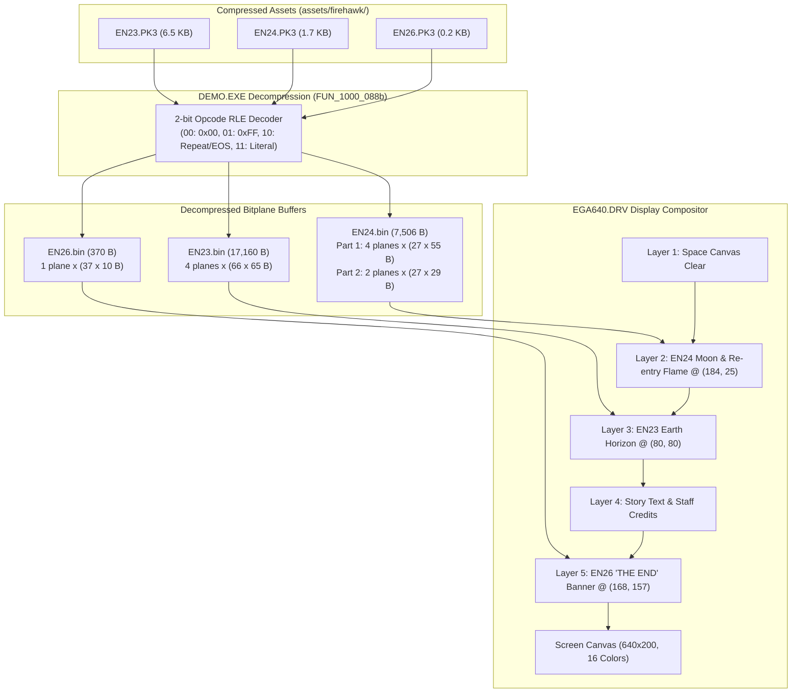
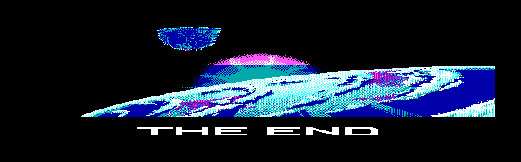

# Firehawk: Thexder II — EN2*.PK3 Graphic Pack Technical Audit & Reverse-Engineering Analysis

## 1. Executive Summary

The `assets/firehawk/` release contains three standalone compressed archive files bearing the `.PK3` extension:
- `EN23.PK3` (6,591 bytes)
- `EN24.PK3` (1,764 bytes)
- `EN26.PK3` (244 bytes)

Through static disassembly of `DEMO.EXE` and the `EGA640.DRV` display driver, this audit establishes the complete format, purpose, decompression algorithm, and visual rendering pipeline for these assets:

1. **Role in Game:** `EN2*.PK3` are the **English Ending Cutscene Graphics** for **Scene 2 (Atmospheric Re-entry)** and the game's finale. The naming prefix `EN2` signifies **Ending Scene 2 (English Release)**.
2. **Compression Format:** Unlike the main game assets in `RES*.SAR` (which use 9-to-12 bit variable-width LZW compression), `.PK3` files utilize a proprietary **2-bit Opcode Run-Length Encoding (RLE)** stream optimized for planar EGA memory masks.
3. **Graphics Architecture:** The decompressed payloads represent raw 1-bit, 2-bit, and 4-bit EGA bitplanes rendered onto an EGA 640x200 16-color backbuffer, or dynamically translated into packed nibbles for MCGA 320x200 mode.
4. **Tooling:** A dedicated Python extraction and decoding tool ([`tools/pk3_extractor.py`](../../tools/pk3_extractor.py)) has been developed, tested, and added to the repository to extract all raw binaries, render high-resolution PNGs, and composite the complete 640x200 cutscene screen.

---

## 2. File Inventory & Metric Summary

| Filename | Compressed Size | Decompressed Size | Expansion Ratio | Geometry `(W x H)` | Planes | Destination Screen Rect `(X, Y, W, H)` | Visual Subject |
| :--- | :--- | :--- | :--- | :--- | :--- | :--- | :--- |
| `EN23.PK3` | 6,591 B | 17,160 B | 2.60x | 528 x 65 px | 4 (EGA) | `(80, 80, 528, 65)` | Earth curvature / planet horizon |
| `EN24.PK3` | 1,764 B | 7,506 B | 4.25x | 216 x 84 px | 4 + 2 | `(184, 25, 216, 84)` | Moon (celestial sphere) & Firehawk atmospheric re-entry burn |
| `EN26.PK3` | 244 B | 370 B | 1.52x | 296 x 10 px | 1 (Mono) | `(168, 157, 296, 10)` | **"THE END"** victory typography banner |



---

## 3. The 2-Bit Opcode RLE Compression Algorithm

The `.PK3` files do not carry container headers, magic bytes, or table-of-contents records. The entire file is a pure, headerless byte stream decoded sequentially.

### 3.1 Opcode Byte Layout

Every token in the compressed stream begins with a single control byte `B`:

$$\text{Bit:}\quad \underbrace{b_7 \quad b_6}_{\text{Mode (2 bits)}} \quad \underbrace{b_5 \quad b_4 \quad b_3 \quad b_2 \quad b_1 \quad b_0}_{\text{Run Count } (L - 1)}$$

- **Run Length:** $L = (B \ \& \ \text{0x3F}) + 1$ (encodes lengths from $1$ to $64$ bytes).
- **Mode:** $M = (B \gg 6) \ \& \ 3$

| Mode Bits | Hex Range | Meaning | Additional Bytes | Decompression Action |
| :---: | :---: | :--- | :---: | :--- |
| `00b` | `0x00 .. 0x3F` | **Zero Run** | None | Emit $L$ bytes of `0x00` |
| `01b` | `0x40 .. 0x7F` | **Solid Run** | None | Emit $L$ bytes of `0xFF` |
| `10b` | `0x80 .. 0xBF` | **Byte Repeat / EOS** | 1 byte ($V$) if $L > 1$ | If $B == \text{0x80}$ ($L = 1$): **End-of-Stream (EOS)** terminator. Stop.<br/>Else: Read next byte $V$, emit $L$ copies of $V$. |
| `11b` | `0xC0 .. 0xFF` | **Literal Run** | $L$ bytes | Read and copy next $L$ bytes verbatim from stream |

> [!NOTE]
> Every valid `.PK3` file in Firehawk ends with the single byte `0x80`. This cleanly terminates the decoder loop without relying on file size counters.

### 3.2 Disassembly Verification (`DEMO.EXE`)

The decoder routine is located at address `1000:088b` in `DEMO.EXE`:

```x86
FUN_1000_088b:
    push   es
    push   si
    mov    ax, ds
    mov    es, ax
    mov    si, bx              ; SI = pointer to compressed PK3 stream
    xor    ch, ch              ; CH = 0

LAB_1000_0895:
    lodsb  si                  ; AL = *SI++
    mov    bl, al
    and    bl, 0x3f            ; BL = opcode & 0x3F
    inc    bl                  ; BL = (opcode & 0x3F) + 1
    mov    cl, bl              ; CL = run count (1..64)
    mov    bl, al
    and    bl, 0xc0            ; Test mode bits [7:6]
    jz     LAB_1000_08c6       ; Mode 00b: Zero run

    rol    bl, 1               ; Shift bit 7 into Carry
    jnc    LAB_1000_08c0       ; Mode 01b: 0xFF run

    rol    bl, 1               ; Shift bit 6 into Carry
    jnc    LAB_1000_08b2       ; Mode 10b: Repeat / EOS

    ; Mode 11b: Literal copy
    rep movsb es:[di], [si]
    jmp    LAB_1000_0895

LAB_1000_08b2:                 ; Mode 10b handler
    mov    al, cl
    dec    al
    jz     LAB_1000_08bd       ; If count == 1 (opcode 0x80): End Of Stream!
    lodsb  si                  ; Read byte V to repeat
    rep stosb es:[di], al      ; Store CL copies of V
    jmp    LAB_1000_0895

LAB_1000_08bd:                 ; Stream termination
    pop    si
    pop    es
    ret

LAB_1000_08c0:                 ; Mode 01b handler
    mov    al, 0xff
    rep stosb es:[di], al      ; Store CL copies of 0xFF
    jmp    LAB_1000_0895

LAB_1000_08c6:                 ; Mode 00b handler
    xor    al, al
    rep stosb es:[di], al      ; Store CL copies of 0x00
    jmp    LAB_1000_0895
```

---

## 4. Decompressed Data Structures & Bitplane Geometry

### 4.1 Planar Memory Architecture

In DOS EGA mode (`EGA640.DRV`), video memory consists of 4 parallel bitplanes:
- **Plane 0:** Blue bit
- **Plane 1:** Green bit
- **Plane 2:** Red bit
- **Plane 3:** Intensity bit

For a graphic of width $W_{\text{bytes}}$ and height $H_{\text{lines}}$, each bitplane occupies exactly $S = W_{\text{bytes}} \times H_{\text{lines}}$ bytes. The total decompressed payload is $4 \times S$ bytes.

The pixel at coordinate $(x, y)$ is assembled from bit position $7 - (x \bmod 8)$ of byte offset $y \times W_{\text{bytes}} + \lfloor x / 8 \rfloor$:

$$\text{ColorIndex}(x, y) = \text{bit}_0 \ | \ (\text{bit}_1 \ll 1) \ | \ (\text{bit}_2 \ll 2) \ | \ (\text{bit}_3 \ll 3)$$

### 4.2 File Structure Analysis

#### `EN23.PK3`: Earth Horizon / Planetary Curvature
- **Decompressed Size:** $17,160$ bytes
- **Dimension Formula:** $66 \text{ bytes (width)} \times 65 \text{ lines (height)} = 4,290 \text{ bytes per plane}$
- **Planes:** $4 \times 4,290 = 17,160 \text{ bytes}$ (exact byte-for-byte match)
- **Pixel Width:** $66 \times 8 = 528\text{ pixels}$
- **Pixel Height:** $65\text{ scanlines}$
- **Display Location:** Centered horizontally at $X = 80\text{ px}$ ($10\text{ bytes}$), $Y = 80\text{ scanline}$. Spans $X \in [80, 607]$, $Y \in [80, 144]$.

#### `EN24.PK3`: Moon & Firehawk Atmospheric Re-Entry Burn
- **Decompressed Size:** $7,506$ bytes
- **Structure:** Two vertically stitched segments blitted sequentially:
  - **Part 1 (Moon & Upper Spacecraft):**
    $27 \text{ bytes} \times 55 \text{ lines} = 1,485 \text{ bytes/plane} \times 4 \text{ planes} = 5,940 \text{ bytes}$.
    Screen position: $X = 184\text{ px}$ ($23\text{ bytes}$), $Y = 25\text{ scanline}$. Spans $X \in [184, 399]$, $Y \in [25, 79]$.
  - **Part 2 (Atmospheric Flame & Plasma Tail):**
    $27 \text{ bytes} \times 29 \text{ lines} = 783 \text{ bytes/plane} \times 2 \text{ planes} = 1,566 \text{ bytes}$.
    Screen position: $X = 184\text{ px}$, $Y = 80\text{ scanline}$. Spans $X \in [184, 399]$, $Y \in [80, 108]$.
- **Total Payload:** $5,940 + 1,566 = 7,506\text{ bytes}$ (exact byte-for-byte match).

#### `EN26.PK3`: "THE END" Victory Typography Banner
- **Decompressed Size:** $370$ bytes
- **Dimension Formula:** $37 \text{ bytes (width)} \times 10 \text{ lines (height)} = 370 \text{ bytes}$ (1-bit monochrome plane)
- **Pixel Width:** $37 \times 8 = 296\text{ pixels}$
- **Pixel Height:** $10\text{ scanlines}$
- **Display Location:** Horizontally centered at $X = 168\text{ px}$ ($21\text{ bytes}$), $Y = 157\text{ scanline}$. Spans $X \in [168, 463]$, $Y \in [157, 166]$.
- **Content:** Large stylized block lettering spelling **"T H E   E N D"**.

---

## 5. Screen Coordinate Addressing in `EGA640.DRV`

When `DEMO.EXE` dispatches blit requests to the video driver via `BP = 0x14` (`draw_sprite`), the destination register `DI` encodes the screen position in a packed 16-bit word:

$$\text{DI} = (Y_{\text{scanline}} \ll 8) \ | \ X_{\text{byte\_column}}$$

Inside `EGA640.DRV` at offset `0x05ac`, the driver decodes this register:

```x86
    mov    ax, di
    and    di, 0x00ff          ; DI = X byte column
    xchg   ah, al              ; AL = Y scanline
    xor    ah, ah
    xchg   di, ax              ; DI = Y scanline, AX = X column
    shl    di, 1               ; DI = Y * 2 (lookup index into scanline_table)
    mov    di, cs:[di + 0x00b6]; DI = scanline_table[Y] (e.g. Y * 80)
    add    di, ax              ; DI = (Y * 80) + X column
```

This confirms the coordinate mapping:
- `DI = 0x1917` $\rightarrow Y = 0x19 = 25$, $X_{\text{byte}} = 0x17 = 23$ ($X = 184\text{ px}$)
- `DI = 0x5017` $\rightarrow Y = 0x50 = 80$, $X_{\text{byte}} = 0x17 = 23$ ($X = 184\text{ px}$)
- `DI = 0x500a` $\rightarrow Y = 0x50 = 80$, $X_{\text{byte}} = 0x0a = 10$ ($X = 80\text{ px}$)
- `DI = 0x9d15` $\rightarrow Y = 0x9d = 157$, $X_{\text{byte}} = 0x15 = 21$ ($X = 168\text{ px}$)

---

## 6. How the Data is Used in the Game

In `DEMO.EXE` (attract engine and ending sequencer), routine `FUN_1000_0e26` executes when `CS:[0x20d]` indicates the ending cinematic should play:

1. **Hardware Detection:** Reads `[0x558]`. If running under EGA 640x200, it prepares planar blits; under MCGA 320x200, routine `FUN_1000_1c44` re-packs the planar data into 4-bit nibbles.
2. **Atmosphere Descent Rendering:**
   - Decompresses `EN24.PK3`.
   - Blits the celestial sphere (Moon) at $(184, 25)$ with bitplanes masked for lighting.
   - Blits the atmospheric flame trail at $(184, 80)$ with color registers set for blue/cyan engine burn.
3. **Planet Horizon Layering:**
   - Decompresses `EN23.PK3`.
   - Layers the Earth curvature at $(80, 80)$, masking the space background.
4. **Narrative Text Overlay:**
   - Sequentially renders the English closing story:
     > *"THE SECOND NEDIAM INCIDENT HAS ENDED.*  
     > *WITH ONLY MINUTES LEFT TO SPARE,*  
     > *NEDIAM'S CENTRAL BRAIN, A MAMMOTH*  
     > *HYBRID THEXDER, WAS ANNIHILATED.*  
     > *CAUGHT IN THE EARTH'S GRAVITY, THE FIREHAWK RE-ENTERED THE ATMOSPHERE..."*
5. **Finale Banner & Staff Roll:**
   - Decompresses `EN26.PK3`.
   - Renders **"THE END"** at $(168, 157)$ in brilliant white.
   - Loops through staff credits: Executive Producer **Ken Williams**, Original Creator **Mitsuhiro Mazda**, Map Arranger **Osamu Harada**, and Graphic Artists **Masahiko Ikeya** and **Masatoshi Azumi**.

---

## 7. Decoded Visual Renderings

All three graphic assets and the full composite cutscene were extracted and rendered to PNG format using [`tools/pk3_extractor.py`](../../tools/pk3_extractor.py).

### 7.1 Component Sprites

* **EN23 Earth Curvature (528x65):**  
  

* **EN24 Combined Moon & Atmospheric Descent (216x84):**  
  

* **EN26 THE END Typography Banner (296x10):**  
  

### 7.2 Full Composite Screen (640x200 EGA Mode)

Below is the complete reconstructed cutscene screen as presented during the Firehawk: Thexder II ending sequence:



---

## 8. Extraction Tooling (`tools/pk3_extractor.py`)

To ensure reproduction and pipeline integration, the repository includes a standalone decoder utility:

```bash
python tools/pk3_extractor.py
```

### Supported Features
- Decodes all `.PK3` files in `assets/firehawk/` using the exact `DEMO.EXE` RLE routine.
- Dumps raw decompressed binary files to `reference/extracted_data/images/pk3_decoded/raw_bin/`.
- Renders authentic 16-color EGA PNG images for all individual sprites.
- Renders the seamless composite 640x200 cutscene.
- Produces a machine-readable JSON manifest at `reference/extracted_data/images/pk3_decoded/pk3_manifest.json`.

---

## 9. Conclusion

The mystery of `EN23.PK3`, `EN24.PK3`, and `EN26.PK3` is completely resolved:
1. They are not code or sound banks, but **high-resolution graphic packs** for the **Ending Cinematic (Scene 2)** and **"THE END"** credit card.
2. They utilize a distinct **2-bit opcode Run-Length Encoding** rather than the LZW compression of `.SAR` archives.
3. They are accurately preserved and fully decodable into pristine 16-color images with the new [`tools/pk3_extractor.py`](../../tools/pk3_extractor.py) utility.

