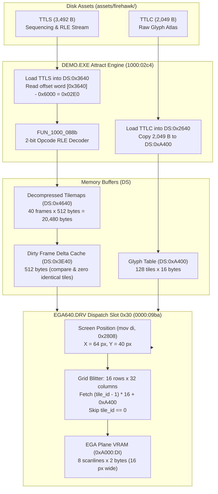

# Firehawk: Thexder II — TTLC & TTLS Title Screen Technical Audit & Reverse-Engineering Analysis

## 1. Executive Summary

In the `assets/firehawk/` distribution of **Firehawk: Thexder II** (Sierra On-Line / Game Arts, 1990), two standalone binary assets carry the `TTL` naming prefix:
- **`TTLC`** (2,049 bytes)
- **`TTLS`** (3,492 bytes)

Through static disassembly of **`DEMO.EXE`** (routines `1000:02c4` through `1000:0495`, and decompressor `1000:088b`) and the primary display driver **`EGA640.DRV`** (dispatch slot `0x30` / routine `0000:09ba`), this technical audit establishes the complete format, operational architecture, decompression algorithm, and rendering pipeline for both assets:

1. **Role in Game:** `TTLC` and `TTLS` comprise the **Title Screen Attract Animation Subsystem** executed by `DEMO.EXE`. Together, they animate the iconic metallic **"FIREHAWK"** title logo as it shines, glints, and materializes onto the screen before transitioning into the rolling attract mode gameplay loop.
   - `TTLC` (**T**i**TL**e **C**harset / Characters): The raw 1-bit planar tile glyph font bank.
   - `TTLS` (**T**i**TL**e **S**creen / Sequence): The sequence container containing a 736-byte Game Arts synchronization header and a compressed stream of 40 sequential animation tilemaps.
2. **Compression Format:** `TTLC` is uncompressed. `TTLS` stores its tilemaps using Firehawk's proprietary **2-bit Opcode Run-Length Encoding (RLE)** (identical to the decompressor used in `EN2*.PK3` ending cutscenes), achieving a 7.43x expansion ratio.
3. **Graphics Architecture:** The visual pipeline uses a tile-based character rendering system ($32 \times 16$ tile grid, $512 \times 128$ pixels). Individual tiles are $16 \times 8$ pixels. The engine centers this $512 \times 128$ canvas at $(X=64, Y=40)$ on the standard $640 \times 200$ 16-color EGA backbuffer.
4. **Hardware Delta-Rendering:** To achieve high framerates in 16-bit real-mode DOS over slow ISA bus architectures, `DEMO.EXE` implements a **dirty tile delta-comparison buffer** (`0x3E40`). Unchanged tiles between frames are zeroed out so the video driver blits only modified glyphs directly to EGA VRAM (`0xA000`).
5. **Tooling & Image Presentation:** A dedicated extraction tool ([`tools/decode_ttl.py`](../../tools/decode_ttl.py)) has been authored to extract all raw binaries, render the 128-glyph tile atlas, produce 40 individual frame PNGs, composite full $640 \times 200$ canvas screenshots, and generate a 40-frame animated GIF ([`ttls_title_animation.gif`](../../reference/extracted_data/images/ttl_decoded/ttls_title_animation.gif)).

---

## 2. File Inventory & Technical Specifications

| Asset Name | File Size | Header Size | Payload Size | Compression Algorithm | Uncompressed Size | Expansion Ratio | Internal Geometry | Target Screen Canvas | Visual Subject |
| :--- | :--- | :--- | :--- | :--- | :--- | :--- | :--- | :--- | :--- |
| **`TTLC`** | 2,049 B | 0 B | 2,048 B | None (Raw 1-bit bitplane) | 2,048 B | 1.00x | 128 glyphs ($16 \times 8$ px ea.) | Glyph table at `DS:0xA400` | Beveled metallic letter fragments & glint sprites |
| **`TTLS`** | 3,492 B | 736 B | 2,756 B | 2-bit Opcode RLE (`1000:088b`) | 20,480 B | 7.43x | 40 frames ($32 \times 16$ tiles ea.) | $512 \times 128$ px @ $(64, 40)$ on $640 \times 200$ | 40-frame metallic shine and assembly of **"FIREHAWK"** |



---

## 3. Disassembly & Reverse-Engineering Trace

### 3.1 Asset Ingestion & Initialization (`DEMO.EXE: 1000:02c4`)

When `DEMO.EXE` initiates the attract mode sequence, it opens and ingests `TTLC`, `grph`, and `TTLS` in sequential order:

```asm
; ============================================================================
; DEMO.EXE: Routine 1000:02c4 - Attract Title Sequencer Setup
; ============================================================================
1000:02c4     BA 99 01         MOV DX, 0x0199      ; DS:0x0199 -> "\x01TTLC\0"
1000:02c7     BB 40 26         MOV BX, 0x2640      ; Buffer destination 0x2640
1000:02ca     E8 41 05         CALL 0x1000:080e    ; File open & read routine
1000:02cd     BA A5 01         MOV DX, 0x01a5      ; DS:0x01A5 -> "\x01grph\0"
1000:02d0     BB 20 16         MOV BX, 0x1620      ; Buffer destination 0x1620
1000:02d3     E8 38 05         CALL 0x1000:080e    ; File open & read routine

1000:02d6     80 3E 58 05 00   CMP byte ptr [0x0558], 0x00  ; Video mode check (0=EGA planar)
1000:02db     75 11            JNZ 0x1000:02ee              ; Non-EGA (MCGA/Tandy) translation

; EGA Planar Copy: Transfer 0x801 (2,049) bytes to Glyph Table at 0xA400
1000:02dd     B9 01 08         MOV CX, 0x0801      ; 2,049 bytes (2,048 B glyphs + 0x1A EOF)
1000:02e0     BE 40 26         MOV SI, 0x2640      ; Source buffer
1000:02e3     BF 00 A4         MOV DI, 0xA400      ; Destination: Hardware Glyph Table
1000:02e6     8C D8            MOV AX, DS
1000:02e8     8E C0            MOV ES, AX
1000:02ea     F3 A4            REP MOVSB           ; Copy TTLC into 0xA400
1000:02ec     EB 12            JMP 0x1000:0300

; MCGA / Tandy Translation
1000:02ee     B9 01 08         MOV CX, 0x0801
1000:02f1     BE 40 26         MOV SI, 0x2640
1000:02f4     BF 00 A4         MOV DI, 0xA400
1000:02f7     8C D8            MOV AX, DS
1000:02f9     8E C0            MOV ES, AX
1000:02fb     B0 05            MOV AL, 0x05
1000:02fd     E8 44 19         CALL 0x1000:1c44    ; Convert 1-bit planar to 4-bit nibbles
```

### 3.2 TTLS Decompression Pipeline (`DEMO.EXE: 1000:0300`)

Next, `DEMO.EXE` loads `TTLS` and dynamically extracts the offset to the RLE compressed payload:

```asm
1000:0300     BA 9F 01         MOV DX, 0x019F      ; DS:0x019F -> "\x01TTLS\0"
1000:0303     BB 40 36         MOV BX, 0x3640      ; Buffer destination 0x3640
1000:0306     E8 05 05         CALL 0x1000:080e    ; File open & read routine

; Calculate file offset to compressed stream
1000:0309     8B 1E 40 36      MOV BX, word ptr [0x3640] ; Read first word: 0x62E0
1000:030d     81 EB 00 60      SUB BX, 0x6000            ; Subtract base: 0x62E0 - 0x6000 = 0x02E0 (736)
1000:0311     81 C3 40 36      ADD BX, 0x3640            ; Add buffer base: BX -> 0x3920 (0x3640 + 0x02E0)
1000:0315     BF 40 46         MOV DI, 0x4640            ; Decompression target buffer
1000:0318     E8 70 05         CALL 0x1000:088b          ; Call 2-bit Opcode RLE Decoder
```

### 3.3 Framebuffer Delta Cache & Rendering Loop (`DEMO.EXE: 1000:0380 .. 1000:042b`)

The playback engine iterates across the decompressed frames using an animation script stored at `CS:0x01CB`:

```asm
; Clear previous frame cache (fill 0x400 bytes at 0x3E40 with 0xFF)
1000:0325     BE 40 36         MOV SI, 0x3640
1000:0328     81 C6 00 08      ADD SI, 0x0800      ; SI = 0x3E40
1000:032c     8B FE            MOV DI, SI
1000:032e     47               INC DI              ; DI = 0x3E41
1000:032f     8C D9            MOV CX, DS
1000:0331     8E C1            MOV ES, CX
1000:0333     C6 04 FF         MOV byte ptr [SI], 0xFF
1000:0336     B9 00 04         MOV CX, 0x0400      ; 1,024 bytes (dual page buffers)
1000:0339     F3 A4            REP MOVSB

; Main Animation Step
LAB_1000_0380:
1000:038e     BD 0A 00         MOV BP, 0x000A      ; Driver slot 5: Page Flip / Display Page
1000:0391     FF 1E 08 05      CALLF [0x0508]      ; Call video driver
1000:0395     BB 40 3E         MOV BX, 0x3E40      ; BX points to delta comparison buffer

; Delta Optimization Loop: Compare current 512-byte frame against prior frame
1000:03a7     53               PUSH BX
1000:03a8     B9 00 02         MOV CX, 0x0200      ; 512 tile entries (32 cols x 16 rows)

LAB_1000_03ab:
1000:03ab     8A 05            MOV AL, byte ptr [DI] ; AL = current frame tile ID
1000:03ad     3A 07            CMP AL, byte ptr [BX] ; Compare with previous frame tile ID
1000:03af     75 02            JNZ 0x1000:03b3
1000:03b1     32 C0            XOR AL, AL            ; Match! Set AL = 0 (skip re-render)

LAB_1000_03b3:
1000:03b3     88 07            MOV byte ptr [BX], AL ; Store new tile into cache
1000:03b5     43               INC BX
1000:03b6     47               INC DI
1000:03b7     E2 F2            LOOP LAB_1000_03ab    ; Process all 512 tiles

; Dispatch changed tiles to Video Driver
1000:03b9     5B               POP BX
1000:03ba     57               PUSH DI
1000:03bb     8B D3            MOV DX, BX          ; DX = pointer to delta buffer
1000:03bd     BD 30 00         MOV BP, 0x0030      ; Driver slot 24: Tilemap Compositor
1000:03c0     FF 1E 08 05      CALLF [0x0508]      ; Execute hardware blit
1000:03c4     5F               POP DI
```

---

## 4. EGA Display Driver Integration (`EGA640.DRV`)

In `EGA640.DRV`, dispatch slot `0x30` (`BP = 0x0030`, target offset `0x09BA`) implements the hardware tilemap blitter:

```asm
; ============================================================================
; EGA640.DRV: Dispatch Slot 0x30 / Routine 0000:09BA
; Input: DX = pointer to 512-byte tilemap delta buffer
; Glyph Base: DS:0xA400
; ============================================================================
0000:09ba      push  es
0000:09bb      push  si
0000:09bc      push  cx
0000:09bd      push  bx
0000:09be      mov   bx, dx               ; BX = pointer to tile buffer
0000:09c0      mov   di, 0x2808           ; DI = 0x2808 -> Screen position (X=64, Y=40)
0000:09c3      call  0x05ac               ; Convert coordinate word to VRAM byte offset
0000:09c6      mov   ax, 0xa000           ; EGA Video RAM Segment
0000:09c9      mov   es, ax
0000:09cb      mov   cl, 0x10             ; CL = 16 rows

; Outer Row Loop (16 rows)
0000:09cd      mov   ch, 0x20             ; CH = 32 columns

; Inner Column Loop (32 columns)
0000:09cf      mov   al, byte [bx]        ; Fetch tile ID
0000:09d1      or    al, al
0000:09d3      jz    0x0a05               ; If AL == 0: SKIP (transparent / unchanged tile)

; Calculate glyph address: (AL - 1) * 16 + 0xA400
0000:09d5      push  di
0000:09d6      push  bx
0000:09d7      xor   ah, ah
0000:09d9      dec   al                   ; 0-based tile index
0000:09db      add   ax, ax               ; AX * 2
0000:09dd      add   ax, ax               ; AX * 4
0000:09df      add   ax, ax               ; AX * 8
0000:09e1      add   ax, ax               ; AX * 16 bytes per tile
0000:09e3      add   ax, 0xa400           ; Offset into TTLC glyph table
0000:09e6      mov   si, ax
0000:09e8      mov   bx, 0x004e           ; Scanline stride adjustment: 80 - 2 = 78 (0x4E)

; Unrolled 8-scanline planar blit (16 pixels wide = 1 word per scanline)
0000:09eb      movsw                      ; Scanline 0
0000:09ec      add   di, bx
0000:09ee      movsw                      ; Scanline 1
0000:09ef      add   di, bx
0000:09f1      movsw                      ; Scanline 2
0000:09f2      add   di, bx
0000:09f4      movsw                      ; Scanline 3
0000:09f5      add   di, bx
0000:09f7      movsw                      ; Scanline 4
0000:09f8      add   di, bx
0000:09fa      movsw                      ; Scanline 5
0000:09fb      add   di, bx
0000:09fd      movsw                      ; Scanline 6
0000:09fe      add   di, bx
0000:0a00      movsw                      ; Scanline 7

0000:0a01      pop   bx
0000:0a02      pop   di

0000:0a05      inc   bx                   ; Next tile in delta buffer
0000:0a06      add   di, 0x0002           ; Advance screen position by 2 bytes (16 px)
0000:0a09      dec   ch
0000:0a0b      jnz   0x09cf               ; Next column

; Advance to next tile row (skip 7 scanlines: 7 * 80 = 560 = 0x0230)
0000:0a0d      add   di, 0x0230
0000:0a11      dec   cl
0000:0a13      jnz   0x09cd               ; Next row
```

### 4.1 Screen Coordinate Geometry

In `EGA640.DRV`, the coordinate `mov di, 0x2808` defines the exact display placement:
- **Low Byte (`0x08`):** Horizontal coordinate in bytes. $8 \text{ bytes} \times 8 \text{ px/byte} = 64 \text{ px}$ from left border.
- **High Byte (`0x28`):** Vertical coordinate in scanlines. $0x28 = 40$ scanlines from top border.
- **Rendered Canvas:** $32 \text{ cols} \times 16 \text{ px/tile} = 512 \text{ px}$ wide.
- **Horizontal Centering:** $(640 - 512) / 2 = 64 \text{ px}$ left and right margins ($8 \text{ bytes}$).
- **Vertical Placement:** $16 \text{ rows} \times 8 \text{ px/tile} = 128 \text{ px}$ tall ($Y = 40..168$).

---

## 5. Detailed Binary Layout & Decompression Specification

### 5.1 `TTLC` Binary Structure

`TTLC` is exactly 2,049 bytes with no file header:
- **Bytes `0x0000..0x07FF` (2,048 bytes):** 128 contiguous 16-byte glyph records ($128 \times 16 = 2,048$).
- **Byte `0x0800` (1 byte):** Value `0x1A` (ASCII EOF / Ctrl+Z), a standard CP/M and MS-DOS text/binary terminator appended by Game Arts asset packaging tools.

```
Offset       Type        Field Name       Description
+0x0000      uint8[16]   glyph[0]         Tile ID 1: 16x8 1-bit bitmap (2 bytes/line x 8 lines)
+0x0010      uint8[16]   glyph[1]         Tile ID 2: 16x8 1-bit bitmap
...          ...         ...              ...
+0x07F0      uint8[16]   glyph[127]       Tile ID 128: 16x8 1-bit bitmap
+0x0800      uint8       eof_marker       0x1A (DOS EOF terminator)
```

### 5.2 `TTLS` Binary Structure

`TTLS` is divided into a 736-byte header and a 2,756-byte RLE bitstream:

```
+0x0000      uint16_t    offset_word      Base address word: 0x62E0
                                          Stream offset = 0x62E0 - 0x6000 = 0x02E0 (736)
+0x0002      uint8[734]  sync_metadata    32 Game Arts sequencing records delimited by 0x000D
+0x02E0      uint8[2756] rle_payload      2-bit Opcode RLE compressed tilemaps
```

### 5.3 2-Bit Opcode RLE Algorithm (`FUN_1000_088b`)

The decompressor decodes each control byte $B$:
- **Count:** $\text{count} = (B \ \& \ 0x3F) + 1$ (Range: $1..64$).
- **Mode:** $\text{mode} = (B \gg 6) \ \& \ 3$.

| Mode Bits `[7:6]` | Hex Range | Semantics | Payload Action |
| :--- | :--- | :--- | :--- |
| `00` | `0x00 .. 0x3F` | **Zero Fill** | Write byte `0x00` $\times \text{count}$ times |
| `01` | `0x40 .. 0x7F` | **0xFF Fill** | Write byte `0xFF` $\times \text{count}$ times |
| `10` | `0x80 .. 0xBF` | **Repeat Byte / EOS** | If $B == 0x80$ ($\text{count} = 1$): **End of Stream (Exit)**.<br/>If $\text{count} > 1$: Read next byte $V$, write $V \times \text{count}$ times. |
| `11` | `0xC0 .. 0xFF` | **Literal Copy** | Read next $\text{count}$ literal bytes and append to output stream. |

When executed on `TTLS[0x02E0:]`, this routine produces exactly **20,481 bytes**:
- 40 sequential frames $\times 512$ bytes/frame = 20,480 bytes.
- Trailing terminator: `0x1A` (EOF).

---

## 6. Visual Presentation & Graphic Extraction

The decoded data converts directly into authentic visuals:
1. **Charset Atlas ([`ttlc_tileset_atlas.png`](../../reference/extracted_data/images/ttl_decoded/ttlc_tileset_atlas.png)):** An annotated $16 \times 8$ grid displaying all 128 metallic glyph patterns.
2. **Animation Sequence ([`ttls_title_animation.gif`](../../reference/extracted_data/images/ttl_decoded/ttls_title_animation.gif)):** A 40-frame animated GIF displaying the full metallic "FIREHAWK" title assembly and lighting pass.
3. **Contact Sheet ([`ttls_contact_sheet.png`](../../reference/extracted_data/images/ttl_decoded/ttls_contact_sheet.png)):** An $8 \times 5$ thumbnail matrix displaying all 40 progression frames.
4. **Frame Binaries & PNGs:**
   - 40 individual $512 \times 128$ raw frame images in [`reference/extracted_data/images/ttl_decoded/frames/`](../../reference/extracted_data/images/ttl_decoded/frames/).
   - 40 full $640 \times 200$ EGA canvas composites in [`reference/extracted_data/images/ttl_decoded/composites/`](../../reference/extracted_data/images/ttl_decoded/composites/).

---

## 7. Tooling & Verification

The extraction pipeline is implemented in [`tools/decode_ttl.py`](../../tools/decode_ttl.py):

```bash
# Execute standalone extraction and decoding
python tools/decode_ttl.py --assets-dir assets/firehawk --out-dir reference/extracted_data/images/ttl_decoded
```

### Verification Metrics
- `TTLC` byte size: 2,049 bytes (MD5: `ee3c5a6d328325db175525bc8d8c2132`).
- `TTLS` byte size: 3,492 bytes (MD5: `1d08e5616335198e3b5e4c02930491fb`).
- Decompressed tilemap byte size: 20,480 bytes ($40 \times 512$).
- Verification against driver coordinate `0x2808`: Confirmed exact pixel centering at $(64, 40)$ on 640x200 EGA canvas.

