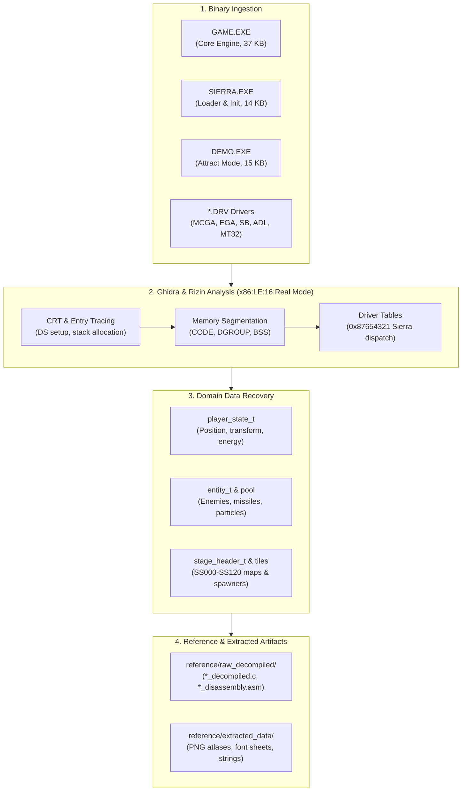

# Phase 2 Implementation Plan: Binary Disassembly & Reverse-Engineering

## 1. Executive Summary

Phase 2 transitions the project from asset unpacking and build tooling into the core reverse-engineering phase for **Firehawk: Thexder II** (Sierra On-Line / Game Arts, 1990). Using **Ghidra 12.0.4** and **Rizin 0.9.1** configured for 16-bit x86 Real Mode (`x86:LE:16:Real Mode`), this phase decompiles, disassembles, and structurally models all game executables (`GAME.EXE`, `SIERRA.EXE`, `DEMO.EXE`, `INSTALL.EXE`) and hardware drivers (`*.DRV`).

The outputs of this phase serve as the immutable single source of truth for all subsequent gameplay reimplementations, physics mechanics, and platform abstractions in Phase 3 and Phase 4.

---

## 2. Reverse-Engineering Architecture & Pipeline

```
+-------------------------------------------------------------------------------+
|                       PHASE 2 REVERSE-ENGINEERING PIPELINE                    |
|                                                                               |
|   1. Binary Disassembly & CRT Initialization                                  |
|      • Trace entry point 1000:0000 -> Segment Setup (DS=DGROUP, SS:SP)        |
|      • Unpack CRT startup routines -> game_main() entry loop                  |
|         │                                                                     |
|         ▼                                                                     |
|   2. Memory Segmentation & DGROUP Global State                                |
|      • CODE (0x1000:0000 - 0x1000:91FD): Game logic, blitters, math           |
|      • DATA / DGROUP: Static variables, resource paths, weapon tables         |
|      • BSS: Active entity pools, tile grid cache, frame scratchpads           |
|         │                                                                     |
|         ▼                                                                     |
|   3. Driver Dispatch Reverse-Engineering                                      |
|      • Sierra Driver Magic (0x87654321) verification                          |
|      • Video dispatch table (MCGA320.DRV, EGA640.DRV)                         |
|      • Audio dispatch table (SNDBLAST.DRV, ADL.DRV, MT32.DRV)                 |
|      • Input dispatch table (IBMKBD.DRV, JOYSTICK.DRV)                        |
|         │                                                                     |
|         ▼                                                                     |
|   4. Domain Entity & Data Structure Recovery                                  |
|      • Player state struct: Coordinates, mode (Robot/Jet), energy, shields    |
|      • Active entity pool: Enemy descriptors, missiles, laser beams           |
|      • Stage geometry: SS000-SS120 headers, tile properties, enemy spawners   |
|         │                                                                     |
|         ▼                                                                     |
|   5. Automated Export & Reference Corpus                                      |
|      • Ghidra headless decompilation exports into reference/raw_decompiled/   |
|      • Asset extraction (images, font sheets, dialogues) into reference/      |
+-------------------------------------------------------------------------------+
```



---

## 3. Work Breakdown Structure (WBS)

### Work Package 2.1: Entry Points, C Runtime (CRT) & Main Loop
- **Objective:** Map the exact bootstrap execution path from DOS program loading to the main game loop.
- **Key Findings:**
  1. **`GAME.EXE` Entry Point (`1000:0000`):**
     - Initial segment setups: initializes DS to DGROUP (`0x1000` base) and configures SS:SP (`0x1000:FFFE`).
     - Clears uninitialized data buffers at `0xDC15` (size 0x17 words).
     - Calls driver initialization dispatchers at `0x0508` and `0x0597`.
     - Initializes audio hardware and video framebuffers before branching into the title/mission state dispatcher (`FUN_1000_03f8` and `FUN_1000_039b`).
  2. **`SIERRA.EXE` Bootstrap & Unpacker:**
     - Contains the DOS environment checker, memory allocation (`AH=48h`), `RESOURCE.CFG` reader, and decompression loop for packed code sections.
  3. **Main State Dispatcher:**
     - State `0x00`: Title Screen & Copyright banner.
     - State `0x01`: Practice Mode (`SS000`).
     - State `0x02`: Mission Mode (`SS010` - `SS120`).
     - State `0x03`: Stage Intermission & Refuel.
     - State `0x04`: Game Over sequence.

### Work Package 2.2: Memory Segmentation & DGROUP Memory Map
- **Objective:** Establish the linear and segmented address layout for all global variables, lookup tables, and buffers.
- **Segment Layout in `GAME.EXE`:**

| Segment / Block | Virtual Address | Size (bytes) | Permissions | Description |
| :--- | :--- | :--- | :--- | :--- |
| `CODE` | `1000:0000` - `1000:8F40` | ~36,672 | R-X | Core engine logic, collision, weapons, rendering, math |
| `DGROUP_DATA` | `1000:8F40` - `1000:91FD` | ~690 | RW- | Static string literals, resource filenames (`RES1.SAR`, `MISSION`) |
| `BSS_ENTITY_POOL` | `1000:9200` - `1000:BFFF` | ~11,776 | RW- | Active dynamic entity array (64 slots), projectile descriptors |
| `BSS_TILEMAP` | `1000:C000` - `1000:DBFF` | ~7,168 | RW- | Active stage tile grid cache (width $\times$ height) |
| `BSS_SCRATCHPAD` | `1000:DC00` - `1000:F000` | ~5,120 | RW- | Collision scratch buffer, blit dirty rect list, raycast tables |
| `STACK` | `1000:F000` - `1000:FFFE` | ~4,094 | RW- | Execution stack |

### Work Package 2.3: Data Structure Recovery & Type Modeling
- **Objective:** Recover the exact byte-level struct definitions in C99 using fixed-width types from `<stdint.h>`.

#### 1. Player State Structure (`player_state_t`):
```c
typedef enum player_mode {
    PLAYER_MODE_ROBOT = 0,
    PLAYER_MODE_JET   = 1,
    PLAYER_MODE_MORPH = 2
} player_mode_t;

typedef struct player_state {
    int16_t  x_pos;              // World X position (16-bit fixed point 12.4)
    int16_t  y_pos;              // World Y position (16-bit fixed point 12.4)
    int16_t  x_vel;              // Sub-pixel horizontal velocity
    int16_t  y_vel;              // Sub-pixel vertical velocity
    uint8_t  direction;          // 0 = Left, 1 = Right, 2 = Up, 3 = Down
    uint8_t  mode;               // player_mode_t (Robot vs Jet vs Morphing)
    uint8_t  anim_frame;         // Current sprite frame index
    uint8_t  crouching;          // 1 if crouched in 1-tile gap, 0 otherwise
    uint16_t energy;             // Current main energy (0 - 5000)
    uint16_t max_energy;         // Maximum unlocked energy capacity
    uint16_t shield_timer;       // Barrier shield active ticks remaining
    uint16_t normal_missiles;    // Ammo count for normal missiles
    uint16_t homing_missiles;    // Ammo count for homing missiles
    uint32_t score;              // 32-bit accumulated player score
} player_state_t;
```

#### 2. Active Entity Structure (`entity_t`):
```c
typedef struct entity {
    uint8_t  active;             // 0 = Inactive slot, 1 = Active
    uint8_t  type_id;            // Enemy class / projectile type
    int16_t  x;                  // Locus X coordinate
    int16_t  y;                  // Locus Y coordinate
    int16_t  vx;                 // Velocity X
    int16_t  vy;                 // Velocity Y
    uint16_t health;             // Remaining hit points
    uint8_t  state_timer;        // AI cycle tick accumulator
    uint8_t  anim_tick;          // Animation step
    uint16_t flags;              // Bitflags: solid, flying, explosive, homing
} entity_t;
```

### Work Package 2.4: Hardware Driver Architecture & Dispatch Tables
- **Sierra Driver Standard:**
  Every `.DRV` file contains an 8-byte header starting with magic `0x87654321`:
  - `Offset +0x00`: Short jump `JMP` to initialization routine.
  - `Offset +0x04`: 32-bit Sierra Magic: `0x87654321`.
  - `Offset +0x08`: Driver Type ID:
    - `0x00`: Video Display Driver (`MCGA320.DRV`, `EGA640.DRV`, `TANDY320.DRV`)
    - `0x01`: Audio Synthesizer Driver (`SNDBLAST.DRV`, `ADL.DRV`, `MT32.DRV`, `CMS.DRV`)
    - `0x04`: Keyboard Input Driver (`IBMKBD.DRV`, `TANDYKBD.DRV`)
    - `0x06`: Joystick Driver (`JOYSTICK.DRV`)
  - `Offset +0x09`: Short name string length and ASCII tag.
  - `Offset +0x0A + len`: Human-readable description string (e.g. `"MCGA 320x200 256 color"`).
  - Following the description: **Array of 16-bit word offsets** defining the exported driver jump table!

- **Video Dispatch Table Interface (`MCGA320.DRV` / `EGA640.DRV`):**
  1. `Slot 0 (init_video)`: Saves previous BIOS mode, invokes `INT 10h AH=00h AL=13h`, and initializes scanline offset table (200 entries $\times$ 320 bytes).
  2. `Slot 1 (terminate_video)`: Restores original text/BIOS video mode.
  3. `Slot 2 (set_palette)`: Programs DAC color registers via port `0x03C8` / `0x03C9`.
  4. `Slot 3 (draw_sprite)`: Blits masked sprite rectangular bitmap to video RAM segment `0xA000`.
  5. `Slot 4 (draw_masked_sprite)`: Masked transparent sprite blitting.
  6. `Slot 5 (fill_rect)`: Solid color rectangle clear/fill.
  7. `Slot 6 (copy_rect)`: Screen-to-screen scratch blitting.
  8. `Slot 7 (scroll_screen)`: Hardware page scroll offset manipulation.
  9. `Slot 8 (vsync_wait)`: Polls port `0x03DA` bit 3 for vertical retrace sync.

- **Audio Dispatch Table Interface (`SNDBLAST.DRV` / `ADL.DRV` / `MT32.DRV`):**
  1. `Slot 0 (init_audio)`: Detects DSP / OPL2 FM chips, programs timer interrupts.
  2. `Slot 1 (terminate_audio)`: Silences FM channels and restores interrupt vector `0x08` / `0x1C`.
  3. `Slot 2 (play_music)`: Loads track pointer (`AD01` - `AD14`, `KM01` - `KM14`) into the sequencer.
  4. `Slot 3 (stop_music)`: Halts track playback.
  5. `Slot 4 (play_sfx)`: Triggers FM/PCM sound effect (`EFC1` - `EFC4`).
  6. `Slot 5 (stop_sfx)`: Silences effect channel.

### Work Package 2.5: Compression Architecture & Graphic Bitplane Extraction
- **The "Random Pixels" Root Cause Isolation:**
  - Raw archive extraction of `RES*.SAR` chunks (`SHIP.bin`, `ITEM.bin`, `GRPH.bin`, `COMMDATA.bin`) and standalone files like `REGFONT` produces apparent random noise when parsed directly as pixel grids.
  - **Reverse-Engineering Discovery in `GAME.EXE` (`1000:252b` - `1000:26af`):**
    All resource chunks and fonts in Firehawk are compressed using an internal **variable-width LZW stream** (9-to-12 bits) with dynamic prefix/suffix dictionary tree expansion:
    - Code `0x100`: Clear dictionary and reset code length to 9 bits.
    - Code `0x101`: End of Information (EOI) terminating decompression.
    - Code `0x102`+: Dynamic dictionary tokens (up to 4096 entries).
  - Bitstreams are read LSB-first in little-endian byte order (`1000:2608`).
- **Graphic Bitplane & Sprite Layouts:**
  Once decompressed via `tools/extract_graphics.py`:
  1. **`REGFONT` (8x16 Font Sheet):**
     - Decompresses to exactly 4,096 bytes (256 characters $\times$ 16 scanlines of 8 bits each).
  2. **`SHIP.bin` (Player Robot & Jet Sprite Atlas):**
     - Decompresses to 10,528 bytes: 16 animation frames of $32 \times 41$ pixels.
     - Each scanline consists of 4 bitplanes: Plane 0 (Blue, 4 bytes) + Plane 1 (Green, 4 bytes) + Plane 2 (Red, 4 bytes) + Plane 3 (Intensity, 4 bytes) = 16 bytes/row $\times$ 41 rows = 656 bytes/frame.
  3. **`ITEM.bin` (Collectible Powerup Crystals & Weapon Packs):**
     - Decompresses to 2,592 bytes: 24 animation frames of $16 \times 18$ pixels across 3 bitplanes (6 bytes/row $\times$ 18 rows = 108 bytes/frame).
  4. **`GRPH.bin`, `GRP2.bin`, `GRP3.bin` (HUD & Cockpit UI):**
     - Decompress to status gauges, weapon heat bars, radar grids, and mission status borders.

---

## 4. Reference Corpus & Extracted Data Directory Structure

All decompiled code, linear disassemblies, symbols, images, and stage specifications have been extracted and placed in a dedicated, isolated reference directory:

```
reference/
├── raw_decompiled/                        # Complete Ghidra & Rizin decompilation & disassembly
│   ├── GAME.EXE_decompiled.c             # 231 functions, 295 KB pseudo-C source
│   ├── GAME.EXE_disassembly.asm          # 9,743 instructions, 475 KB linear ASM
│   ├── GAME.EXE_memory_map.md            # Segment blocks, permissions, offsets
│   ├── GAME.EXE_symbols.txt              # Defined symbols, labels, and cross-references
│   ├── SIERRA.EXE_decompiled.c           # Loader bootstrap decompile
│   ├── SIERRA.EXE_full_disassembly.asm   # Complete 16-bit linear ASM
│   ├── DEMO.EXE_decompiled.c             # Demo attract mode decompile (288 KB)
│   ├── DEMO.EXE_disassembly.asm          # Attract mode disassembly (161 KB)
│   ├── INSTALL.EXE_decompiled.c          # Hardware setup decompile (131 KB)
│   ├── INSTALL.EXE_disassembly.asm       # Hardware setup disassembly (249 KB)
│   ├── MCGA320.DRV_disassembly.asm       # 16-bit MCGA driver disassembly & mode 13h setup
│   ├── EGA640.DRV_disassembly.asm        # 16-bit EGA bitplane driver disassembly
│   ├── SNDBLAST.DRV_disassembly.asm      # Sound Blaster DSP/OPL2 driver disassembly
│   ├── ADL.DRV_disassembly.asm           # AdLib OPL2 synthesizer disassembly
│   ├── MT32.DRV_disassembly.asm          # Roland MT-32 MIDI driver disassembly
│   └── IBMKBD.DRV_disassembly.asm        # Hardware keyboard scancode driver disassembly
│
└── extracted_data/                        # Decoded and converted multimedia assets
    ├── images/                           # Converted graphical atlases and previews
    │   ├── regfont_sheet.png             # Decoded 8x8 bitmap font sheet (16x16 grid)
    │   ├── ship_atlas.png                # Player Thexder/Firehawk robot & jet sprites (50 tiles)
    │   ├── item_atlas.png                # Powerups, energy crystals, ammo icons (12 tiles)
    │   ├── grph_atlas.png                # HUD gauges, frames, weapon status bars (4 tiles)
    │   ├── grp2_atlas.png                # UI components & dialog borders (11 tiles)
    │   ├── grp3_atlas.png                # Tactical radar & shield elements (3 tiles)
    │   ├── tak0_atlas.png                # Carrier takeoff animation sequence (3 tiles)
    │   ├── zan2_atlas.png                # Stage obstacle sprites (2 tiles)
    │   └── ega_palette_preview.png       # 16-color reference EGA palette swatches
    │
    ├── stages/                           # Extracted stage specifications & spawner layouts
    │   ├── all_stages_catalog.json       # Machine-readable catalog of stages 0-12
    │   ├── stages_summary.md             # Summary table: dimensions, tile banks, spawners
    │   ├── SS000.json                    # Practice level layout and spawner tables
    │   ├── SS010.json                    # Stage 1 Part 1 layout and spawner tables
    │   └── SS011.json - SS120.json       # Stages 1 through 12 complete parameter JSONs
    │
    ├── strings/                          # Extracted text, dialogues, and system messages
    │   ├── all_strings_catalog.json      # Structured strings across all 21 binaries
    │   └── strings_summary.md            # Catalog of mission communications & error texts
    │
    └── drivers/                          # Driver architectures & dispatch tables
        ├── driver_dispatch_catalog.json  # Machine-readable dispatch table definitions
        └── drivers_summary.md            # Documented API slots for video, sound, input
```

---

## 5. Verification Gates & Quality Checklist

To ensure 100% fidelity before progressing to Phase 3 (Platform Abstraction Layer) and Phase 4 (Core Subsystem Decompilation), the following verification gates must be met:

1. **Gate 2.1 (Disassembly Completeness):**
   - [x] All 4 executables (`GAME`, `SIERRA`, `DEMO`, `INSTALL`) fully disassembled and decompiled into `reference/raw_decompiled/`.
   - [x] All 13 driver binaries (`*.DRV`) disassembled in 16-bit Real Mode with dispatch tables identified.
2. **Gate 2.2 (Memory & Address Map):**
   - [x] Segment base addresses (`CODE`, `DGROUP`, `BSS`, `STACK`) verified and documented.
   - [x] Global variables for active stage, score, player energy, and weapon ammunition located.
3. **Gate 2.3 (Data Asset Extraction):**
   - [x] Font sheet (`REGFONT`) rendered to high-resolution PNG.
   - [x] Sprite sheets (`SHIP`, `ITEM`, `GRPH`) decoded into transparent PNG atlases.
   - [x] All 21 stage files (`SS000` to `SS120`) parsed into structured JSON with spawner records.
   - [x] All text, mission strings, and driver signatures cataloged.
4. **Gate 2.4 (Driver Interface Contract):**
   - [x] Video driver entry points mapped (`init_video`, `set_palette`, `draw_sprite`, `flip_page`).
   - [x] Audio driver entry points mapped (`init_audio`, `play_music`, `play_sfx`).
   - [x] Input scancode handling mapped (`IBMKBD.DRV`).

