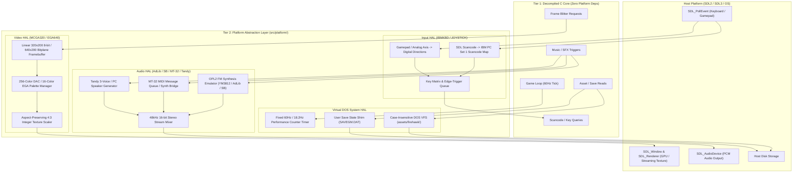

# Phase 3 Implementation Plan: Platform Abstraction Layer (HAL) Development

## 1. Executive Summary

Phase 3 establishes the modern host runtime and Platform Abstraction Layer (**HAL**) for **Firehawk: Thexder II** (Sierra On-Line / Game Arts, 1990). The objective of this phase is to construct a modular, hardware-agnostic platform harness in `src/platform/` that bridges the pure C99/C11 decompiled core game logic (`src/firehawk/`) with modern operating systems (Windows, Linux, macOS) via **SDL2 / SDL3**.

In accordance with repository architectural standards, the decompiled core game engine maintains **zero external dependencies**—no SDL headers, no OpenGL/DirectX, and no OS-specific system libraries. The HAL fulfills this isolation by implementing clean C ABI interfaces and callback dispatch tables directly modeled after the original 16-bit Sierra device drivers (`MCGA320.DRV`, `EGA640.DRV`, `SNDBLAST.DRV`, `ADL.DRV`, `MT32.DRV`, `IBMKBD.DRV`, `JOYSTICK.DRV`, and `STD.DRV`).

```
+-------------------------------------------------------------------------------+
|                       PHASE 3 PLATFORM ARCHITECTURE                           |
|                                                                               |
|   [Tier 1: Decompiled Core Engine] (src/firehawk/ - Pure ISO C99/C11)         |
|      • Game Loop & State Machine (Title, Practice, Mission)                   |
|      • Robot/Jet Kinematics, Homing Laser, Shields, Swept AABB Collision      |
|      • Calls Hardware Drivers strictly via HAL C ABI Function Tables          |
|         │                                                                     |
|         ▼ (Abstract C Interfaces: hal_video.h, hal_audio.h, hal_input.h)      |
|   [Tier 2: Platform Abstraction Layer (HAL)] (src/platform/ - C++17 RAII)     |
|      • Video: 320x200 MCGA / 640x200 EGA Framebuffer, 4:3 Scaler, DAC Palette|
|      • Audio: OPL2 FM Synthesizer (AdLib/SB), MT-32 MIDI, Tandy 3-Voice Mixer |
|      • Input: IBM PC Scancode (Set 1) Translator & Gamepad Controller Mapper  |
|      • System: Fixed 60Hz Frame Accumulator & Case-Insensitive DOS VFS Shim   |
|         │                                                                     |
|         ▼                                                                     |
|   [Host OS & Hardware] (Windows, Linux, macOS via SDL2 / SDL3)                |
+-------------------------------------------------------------------------------+
```



---

## 2. Driver Interface Parity & C ABI Boundaries

In the original DOS release, `GAME.EXE` loaded relocatable driver binaries (`*.DRV`) with Sierra driver signature `0x87654321` and dispatched hardware operations via indirect jump tables (as cataloged in Phase 2). The HAL replicates these exact driver signatures via strongly typed C structures:

### 2.1 Video Driver Interface (`hal_video_driver_t`)
Directly reflects `MCGA320.DRV` and `EGA640.DRV` 16-slot dispatch tables:

```c
/// @brief Sierra Video Driver Dispatch Interface
/// @details Modeled directly from MCGA320.DRV and EGA640.DRV dispatch tables
typedef struct hal_video_driver {
    bool    (*init)(uint16_t width, uint16_t height, uint8_t bpp);
    void    (*shutdown)(void);
    void    (*set_palette)(const uint8_t* dac_triplets, uint16_t start_index, uint16_t count);
    void    (*get_palette)(uint8_t* out_dac_triplets, uint16_t start_index, uint16_t count);
    void    (*clear_screen)(uint8_t color_index);
    void    (*set_clip_rect)(int16_t left, int16_t top, int16_t right, int16_t bottom);
    void    (*fill_rect)(int16_t x, int16_t y, int16_t width, int16_t height, uint8_t color_index);
    void    (*copy_rect)(int16_t src_x, int16_t src_y, int16_t dst_x, int16_t dst_y, int16_t width, int16_t height);
    void    (*draw_sprite)(int16_t x, int16_t y, const uint8_t* sprite_data, int16_t width, int16_t height);
    void    (*draw_masked_sprite)(int16_t x, int16_t y, const uint8_t* sprite_data, const uint8_t* mask_data, int16_t width, int16_t height);
    void    (*scroll_screen)(int16_t dx, int16_t dy, uint8_t fill_color);
    void    (*vsync_wait)(void);
    void    (*flip_page)(void);
    uint8_t* (*get_framebuffer)(void);
} hal_video_driver_t;
```

### 2.2 Audio Driver Interface (`hal_audio_driver_t`)
Directly reflects `ADL.DRV`, `SNDBLAST.DRV`, `MT32.DRV`, `STD.DRV`, and `TANDY.DRV`:

```c
/// @brief Sierra Sound Synthesizer Dispatch Interface
/// @details Modeled from ADL.DRV, SNDBLAST.DRV, MT32.DRV, and STD.DRV
typedef struct hal_audio_driver {
    bool (*init)(uint32_t sample_rate);
    void (*shutdown)(void);
    void (*play_music)(uint16_t track_id, bool loop);
    void (*stop_music)(void);
    void (*pause_music)(void);
    void (*resume_music)(void);
    void (*play_sfx)(uint16_t sfx_id, uint8_t priority);
    void (*stop_sfx)(uint16_t sfx_id);
    void (*set_master_volume)(uint8_t volume); // 0..127
    void (*set_music_volume)(uint8_t volume);  // 0..127
    void (*set_sfx_volume)(uint8_t volume);    // 0..127
    void (*update)(void);                      // Sequencer tick callback
} hal_audio_driver_t;
```

### 2.3 Input Driver Interface (`hal_input_driver_t`)
Directly reflects `IBMKBD.DRV` and `JOYSTICK.DRV`:

```c
/// @brief Keyboard and Joystick Dispatch Interface
/// @details Modeled from IBMKBD.DRV and JOYSTICK.DRV
typedef struct hal_input_driver {
    bool    (*init)(void);
    void    (*shutdown)(void);
    void    (*poll_events)(void);
    bool    (*is_key_down)(uint8_t dos_scancode);
    bool    (*get_next_scancode)(uint8_t* out_scancode, bool* out_is_pressed);
    void    (*clear_key_buffer)(void);
    void    (*get_joystick_state)(int16_t* out_x, int16_t* out_y, uint8_t* out_buttons);
} hal_input_driver_t;
```

---

## 3. Work Breakdown Structure (WBS)

### Work Package 3.1: Video Subsystem & Virtual Framebuffer
- **Objective:** Recreate original DOS MCGA (Mode 13h, 320x200, 256 colors) and EGA (640x200, 16 colors) graphics modes on modern displays with integer scaling, aspect-ratio preservation, and palette transitions.
- **Components:**
  1. **Virtual Framebuffer (`src/platform/video/hal_framebuffer.cpp` / `.h`):**
     - Linear allocation: `320 * 200` bytes (64,000 bytes) for MCGA Mode 13h.
     - Bitplane allocation: 4 planes of `320 * 200 / 8` bytes (or `640 * 200 / 8`) for EGA 16-color blits.
     - Fast clipping checks: All blits clipped to `[clip_left, clip_top, clip_right, clip_bottom]`.
  2. **Palette Manager (`src/platform/video/hal_palette.cpp` / `.h`):**
     - 256-color DAC register array: `uint8_t dac_entries[256][3]`.
     - 6-bit to 8-bit DAC expansion: DOS VGA DAC stores 6 bits per channel (`0..63`). Convert via `(val * 255) / 63` or `(val << 2) | (val >> 4)` for exact hardware color fidelity.
     - Instantaneous palette swaps and fade routines (used in Stage transitions and game over).
  3. **Modern Aspect-Ratio Scaler (`src/platform/video/hal_scaler.cpp` / `.h`):**
     - Aspect ratio correction: Original DOS 320x200 pixels were not square (1:1.2 pixel aspect ratio, rendering as 4:3 on CRT).
     - Integer scaling engine: Computes maximum integer multiple $(W \times S, H \times S)$ centered with pillarboxing/letterboxing on modern 16:9, 16:10, and Ultrawide displays.
     - Streaming texture target: Uploads RGBA32 buffer to SDL streaming texture (`SDL_TEXTUREACCESS_STREAMING`, `SDL_PIXELFORMAT_RGBA8888`).
     - Optional CRT scanline / CRT phosphor shader simulation for nostalgic visual parity.

### Work Package 3.2: Audio Synthesis & Sound Subsystem
- **Objective:** Faithfully reproduce Firehawk's rich soundtrack and sound effects across AdLib / Sound Blaster FM, Roland MT-32 MIDI, and Tandy 3-Voice / PC Speaker modes.
- **Components:**
  1. **OPL2 FM Synthesis Emulation (`src/platform/audio/hal_opl2.cpp` / `.h`):**
     - Emulates Yamaha YM3812 (OPL2) FM synthesis chip used by `ADL.DRV` and `SNDBLAST.DRV`.
     - Integrates an embeddable, MIT/BSD-licensed, C-compatible OPL2 core (e.g. Nuked OPL3 in OPL2 mode or DBOPL).
     - Exposes direct register write interface: `hal_opl2_write(uint8_t reg, uint8_t value)`.
     - Renders synthesized audio samples directly into 16-bit signed stereo stream.
  2. **Roland MT-32 MIDI Pipeline (`src/platform/audio/hal_mt32.cpp` / `.h`):**
     - Parses MIDI event streams generated by `MT32.DRV`.
     - Host MIDI bridge: Dispatches Standard MIDI messages to native host sound synthesizers (Windows MIDI Mapper / FluidSynth / CoreMIDI).
     - Soundbank mapping: Provides fallback General MIDI instrument mapping for original MT-32 timbre sysex patches.
  3. **PC Speaker / Tandy 3-Voice Synthesizer (`src/platform/audio/hal_tandy_sound.cpp` / `.h`):**
     - Emulates SN76496 sound chip (3 square wave tone generators + 1 white noise generator) for `TANDY.DRV` and `STD.DRV`.
     - Programmable Interval Timer (PIT 8253 channel 2) frequency divider for 1-bit PC speaker beeps.
  4. **Audio Stream Mixer & Device Callback (`src/platform/audio/hal_audio_mixer.cpp` / `.h`):**
     - SDL Audio Device configuration: 48,000 Hz (or 44,100 Hz), 16-bit signed integer stereo, 1024-sample buffer (~21 ms latency).
     - Zero-allocation circular ring buffer for audio frame delivery.
     - Independent channel mixing: Background Music (BGM), Sound Effects (SFX), and Ambient Voice.

### Work Package 3.3: Input Translation & Device Handling
- **Objective:** Translate modern USB keyboards and gamepads into exact DOS hardware scancodes and digital joystick signals expected by `GAME.EXE`.
- **Components:**
  1. **IBM PC Set 1 Scancode Translator (`src/platform/input/hal_scancode.cpp` / `.h`):**
     - Bijections between `SDL_Scancode` and original IBM PC Keyboard Set 1 Make/Break scancodes:
       | Game Action | Default Key | IBM PC Make Code | IBM PC Break Code |
       | :--- | :--- | :--- | :--- |
       | Move Left | Left Arrow / A | `0x4B` (`0x1E`) | `0xCB` (`0x9E`) |
       | Move Right | Right Arrow / D | `0x4D` (`0x20`) | `0xCD` (`0xA0`) |
       | Aim Up / Jet Ascend | Up Arrow / W | `0x48` (`0x11`) | `0xC8` (`0x91`) |
       | Crouch / Jet Descend | Down Arrow / S | `0x50` (`0x1F`) | `0xD0` (`0x9F`) |
       | Fire Laser | Spacebar | `0x39` | `0xB9` |
       | Fire Missiles | Alt / M | `0x38` (`0x32`) | `0xB8` (`0xB2`) |
       | Toggle Shield | Shift / S | `0x2A` (`0x1F`) | `0xAA` (`0x9F`) |
       | Transform Robot/Jet | Ctrl / Tab | `0x1D` (`0x0F`) | `0x9D` (`0x8F`) |
       | Pause Game | Esc / P | `0x01` (`0x19`) | `0x81` (`0x99`) |
  2. **Gamepad / Controller Mapper (`src/platform/input/hal_gamepad.cpp` / `.h`):**
     - Uses SDL GameController / Gamepad API.
     - D-Pad & Left Analog Stick mapped to 8-directional movement.
     - Button A: Fire Laser.
     - Button B: Missile Launch.
     - Button X: Energy Shield.
     - Button Y: Transform Robot $\leftrightarrow$ Jet.
     - Start / Back: Pause / Menu.
  3. **Key Matrix & Event Dispatcher (`src/platform/input/hal_input.cpp` / `.h`):**
     - Tracks current physical state (up to 256 keys).
     - Maintains a 32-entry circular buffer for discrete key events, matching the BIOS keyboard buffer (`0x0040:0x001E`).

### Work Package 3.4: Virtual DOS Runtime, Timer & Filesystem Shim
- **Objective:** Provide a deterministic timing engine and a robust, case-insensitive virtual filesystem simulating DOS environment primitives.
- **Components:**
  1. **Virtual 60 Hz Simulation Tick Timer (`src/platform/system/hal_timer.cpp` / `.h`):**
     - The original DOS game synchronized with CRT vertical retrace (VBLANK ~60 Hz) and the 18.2 Hz timer interrupt (`INT 08h`).
     - Uses `SDL_GetPerformanceCounter()` / `SDL_GetPerformanceFrequency()` with sub-microsecond precision.
     - Fixed delta accumulator: Timestep fixed at exactly $\Delta t = \frac{1}{60}\text{ s} \approx 16.666\text{ ms}$.
     - Prevents high-refresh-rate display bugs (game will never run 2.4x faster on 144Hz monitors).
  2. **Case-Insensitive DOS VFS Shim (`src/platform/system/hal_vfs.cpp` / `.h`):**
     - DOS file paths are case-insensitive and utilize backslashes (e.g. `assets\firehawk\RES1.SAR`, `SS010`).
     - Normalizes all paths to forward slashes `/`.
     - Performs case-insensitive matching against physical files on disk in `assets/firehawk/`.
     - Prevents directory traversal attacks (blocks `..` escaping root asset sandbox).
  3. **User Save Game Shim (`src/platform/system/hal_savegame.cpp` / `.h`):**
     - Redirects `SAVEGM.DAT` file writes away from read-only application directories to the modern user configuration/save directory (`%APPDATA%/Firehawk` on Windows, `~/.config/firehawk` on Linux/macOS).

### Work Package 3.5: C ABI Platform Harness & RAII Lifecycle Architecture
- **Objective:** Wrap all SDL2/3 subsystems using strict C++17 RAII idioms while exporting pure, warning-free ISO C99 headers for the core engine.
- **Components:**
  1. **Strict RAII Smart Handles (`src/platform/hal_sdl_raii.hpp`):**
     ```cpp
     using WindowPtr = std::unique_ptr<SDL_Window, decltype(&SDL_DestroyWindow)>;
     using RendererPtr = std::unique_ptr<SDL_Renderer, decltype(&SDL_DestroyRenderer)>;
     using TexturePtr = std::unique_ptr<SDL_Texture, decltype(&SDL_DestroyTexture)>;
     ```
  2. **Main Unified Platform Interface (`src/platform/hal.h`):**
     - Aggregates all subsystem drivers into a single runtime structure:
     ```c
     typedef struct hal_platform {
         hal_video_driver_t  video;
         hal_audio_driver_t  audio;
         hal_input_driver_t  input;
     } hal_platform_t;
     
     bool hal_init(const char* window_title, uint16_t scale_factor);
     void hal_shutdown(void);
     bool hal_pump_events(void);
     void hal_delay_frame(void);
     const hal_platform_t* hal_get(void);
     ```

### Work Package 3.6: Verification, Headless Mock HAL & Automated Test Suite
- **Objective:** Deliver a complete mock platform layer allowing headless unit testing in CI environments, alongside an interactive HAL smoke test executable.
- **Components:**
  1. **Headless Mock HAL (`tests/hal/hal_mock.c` / `.h`):**
     - In-memory video buffer and silent audio sink.
     - Programmatic keyboard event injector to simulate gameplay sequences in unit tests without opening windows.
  2. **Automated Unit Tests (`tests/hal/`):**
     - `test_hal_video.cpp`: Framebuffer clipping, masked blit transparency, 6-bit to 8-bit DAC accuracy.
     - `test_hal_audio.cpp`: OPL2 synthesizer buffer generation, valid sample ranges, channel volume clamping.
     - `test_hal_input.cpp`: Scancode translation coverage, key repeat timing, controller mapping.
     - `test_hal_timer.cpp`: 60 Hz accumulator drift over 10,000 simulated ticks ($\le 0.1\%$ error).
     - `test_hal_vfs.cpp`: Case-insensitive lookups, path separator normalization, path traversal blocking.
  3. **Interactive Visual Smoke Test (`apps/hal_smoke_test/main.cpp`):**
     - Creates window, initializes video at 320x200 scaled 4:3.
     - Blits extracted player Firehawk sprite (`SHIP.bin`) and HUD gauges (`GRPH.bin`).
     - Synthesizes an OPL2 FM chime and plays a test sound.
     - Renders on-screen real-time scancode diagnostic telemetry.

---

## 4. Source Tree & File Organization

The Platform Abstraction Layer files are organized strictly within `src/platform/`, `apps/hal_smoke_test/`, and `tests/hal/`:

```
Thexder-Decompiled.git/
├── src/
│   └── platform/                             # Tier 2: Platform Abstraction Layer
│       ├── CMakeLists.txt                    # Compiles libPlatformHAL (C++17)
│       ├── hal.h                             # Top-level unified C HAL API
│       ├── hal.cpp                           # HAL bootstrap & subsystem lifecycle
│       ├── hal_sdl_raii.hpp                  # Modern C++ RAII resource wrappers
│       │
│       ├── video/                            # Video display & blitter subsystem
│       │   ├── hal_video.h                   # C video driver definitions
│       │   ├── hal_video.cpp                 # SDL window, renderer, and streaming texture
│       │   ├── hal_framebuffer.h             # 320x200 linear and bitplane buffer
│       │   ├── hal_framebuffer.cpp           # Draw sprite, fill, copy, clear, clip
│       │   ├── hal_palette.h                 # 256-color DAC and 16-color EGA palettes
│       │   ├── hal_palette.cpp               # Palette conversion & fade routines
│       │   ├── hal_scaler.h                  # Aspect-ratio preserving integer scaler
│       │   └── hal_scaler.cpp                # 4:3 pillarboxed presentation
│       │
│       ├── audio/                            # Audio synthesizer & mixer subsystem
│       │   ├── hal_audio.h                   # C audio driver definitions
│       │   ├── hal_audio.cpp                 # SDL audio stream & device setup
│       │   ├── hal_opl2.h                    # OPL2 / YM3812 FM synthesis emulator
│       │   ├── hal_opl2.cpp                  # AdLib / Sound Blaster FM register synthesis
│       │   ├── hal_mt32.h                    # Roland MT-32 MIDI message bridge
│       │   ├── hal_mt32.cpp                  # MIDI stream parser & soundbank router
│       │   ├── hal_tandy_sound.h             # Tandy 3-Voice & PC Speaker generator
│       │   ├── hal_tandy_sound.cpp           # SN76496 square wave & noise generator
│       │   ├── hal_audio_mixer.h             # Multi-channel stream mixer
│       │   └── hal_audio_mixer.cpp           # 48kHz 16-bit PCM ring buffer callback
│       │
│       ├── input/                            # Input translation subsystem
│       │   ├── hal_input.h                   # C input driver definitions
│       │   ├── hal_input.cpp                 # Event pump & key matrix state
│       │   ├── hal_scancode.h                # IBM PC Set 1 scancode tables
│       │   ├── hal_scancode.cpp              # SDL scancode to DOS scancode mapping
│       │   ├── hal_gamepad.h                 # Gamepad / joystick mapper
│       │   └── hal_gamepad.cpp               # GameController axis to direction mapping
│       │
│       └── system/                           # Virtual DOS system & VFS
│           ├── hal_timer.h                   # 60Hz / 18.2Hz simulation clock
│           ├── hal_timer.cpp                 # Performance counter accumulator
│           ├── hal_vfs.h                     # Case-insensitive virtual file reader
│           ├── hal_vfs.cpp                   # DOS path resolver (assets/firehawk/)
│           ├── hal_savegame.h                # Save state persistence
│           └── hal_savegame.cpp              # SAVEGM.DAT checksum & storage
│
├── apps/
│   └── hal_smoke_test/                       # Visual & audible HAL verification app
│       ├── CMakeLists.txt                    # Smoke test build configuration
│       └── main.cpp                          # Interactive window, sprite blit, OPL2 chime
│
└── tests/
    └── hal/                                  # Automated CTest verification suite
        ├── CMakeLists.txt                    # HAL test target registration
        ├── hal_mock.h                        # Headless mock HAL definitions
        ├── hal_mock.c                        # Headless mock implementation
        ├── test_hal_video.cpp                # Framebuffer, palette, clipping tests
        ├── test_hal_audio.cpp                # OPL2 & mixer stream verification
        ├── test_hal_input.cpp                # Scancode translation & edge detection
        ├── test_hal_timer.cpp                # 60Hz accumulator precision test
        └── test_hal_vfs.cpp                  # Case-insensitive path resolution test
```

---

## 5. Implementation Roadmap & Milestones

```
+-------------------------------------------------------------------------------+
|                       PHASE 3 EXECUTION ROADMAP                               |
|                                                                               |
|   Step 1: Video Subsystem & Virtual Framebuffer                               |
|      • Implement 320x200 linear VFB, DAC palette manager, 4:3 integer scaler  |
|      • Emulate MCGA320.DRV & EGA640.DRV blit and clip operations              |
|         │                                                                     |
|         ▼                                                                     |
|   Step 2: Virtual DOS System Timer & VFS Shim                                 |
|      • Implement fixed 60Hz accumulator loop with sub-microsecond precision   |
|      • Implement case-insensitive asset resolver mapping assets/firehawk/     |
|         │                                                                     |
|         ▼                                                                     |
|   Step 3: Input Translation & Device Handling                                 |
|      • Map modern keyboard scancodes to IBM PC Set 1 Make/Break bytes         |
|      • Implement SDL GameController to digital Firehawk direction/action map  |
|         │                                                                     |
|         ▼                                                                     |
|   Step 4: Audio Synthesis & Sound Subsystem                                   |
|      • Integrate OPL2 FM synthesis emulation for AdLib and Sound Blaster      |
|      • Build 48kHz 16-bit stereo circular mixer with MT-32 MIDI pipeline      |
|         │                                                                     |
|         ▼                                                                     |
|   Step 5: Headless Mock HAL & Automated CTest Suite                           |
|      • Build in-memory mock HAL and test video, audio, input, timer, and VFS  |
|         │                                                                     |
|         ▼                                                                     |
|   Step 6: Interactive Smoke Test & Quality Gate                               |
|      • apps/hal_smoke_test renders animated sprites, plays sound, checks input|
|      • Verify zero compiler warnings, clang-format, and IWYU compliance       |
+-------------------------------------------------------------------------------+
```

---

## 6. Verification Gates & Acceptance Criteria

| Gate | Milestone Deliverable | Verification Command / Metric | Acceptance Criteria |
| :--- | :--- | :--- | :--- |
| **Gate 3.1** | Virtual Framebuffer & Scaler | `ctest -R test_hal_video` | Framebuffer blits sprites with clipping; 6-bit DAC colors match reference palette exactly. |
| **Gate 3.2** | 60Hz Virtual Timer | `ctest -R test_hal_timer` | Timer accumulates fixed 16.666 ms ticks with $\le 0.1\%$ drift across 10,000 cycles. |
| **Gate 3.3** | DOS VFS Shim | `ctest -R test_hal_vfs` | Resolves uppercase/lowercase `assets/firehawk/` paths; rejects path traversal `..` attempts. |
| **Gate 3.4** | Input Scancodes & Gamepad | `ctest -R test_hal_input` | All core gameplay keys map bijectively to IBM PC Set 1 scancodes without dropped events. |
| **Gate 3.5** | OPL2 Synthesis & Mixer | `ctest -R test_hal_audio` | Synthesizes clean 48kHz 16-bit PCM audio; zero audio buffer underruns or NaN/clipping faults. |
| **Gate 3.6** | Complete Automated Suite | `ctest --output-on-failure` | 100% test pass rate across all unit tests in headless CI environment. |
| **Gate 3.7** | Interactive Smoke Test | `build/apps/hal_smoke_test` | Window displays centered 4:3 320x200 canvas, blits Firehawk sprite, plays OPL2 chord, exits cleanly. |
| **Gate 3.8** | Code Quality & Formatting | `python scripts/verify_clang_format.py`<br/>`python scripts/verify_iwyu_cstdint.py` | Zero format discrepancies, strict `<stdint.h>` / `<cstdint>` usage, zero compiler warnings under `/W4` and `-Wall -Wextra -pedantic`. |

