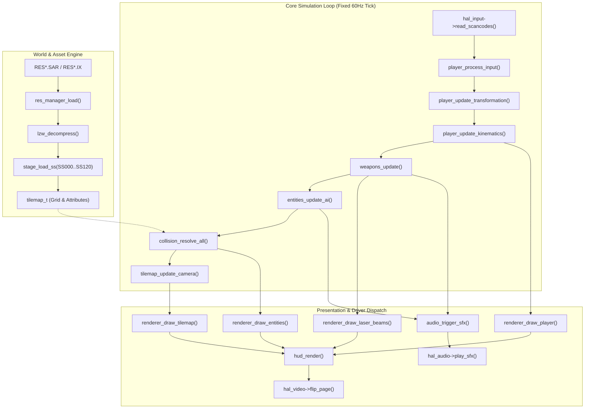

# Phase 4 Implementation Plan: Core Subsystem Decompilation into C (`.c` & `.h`)

## 1. Executive Summary

Phase 4 represents the central reverse-engineering and translation phase of **Firehawk: Thexder II** (Sierra On-Line / Game Arts, 1990). The objective of this phase is to decompile the 16-bit x86 Real Mode logic recovered from `GAME.EXE` (and auxiliary overlays) into clean, portable, and maintainable **ISO C99/C11** code located in `src/firehawk/`.

Building directly upon the verified disassembly corpus established in Phase 2 and the hardware abstraction layer (**HAL**) built in Phase 3, the core game engine maintains **complete platform independence**:
- **Zero OS or external library dependencies**: `src/firehawk/` contains no references to Windows API, POSIX, SDL, OpenGL, or CRT I/O.
- **Hardware isolation via HAL**: All video rendering requests, audio sound triggers, input state queries, timer ticks, and file reads execute exclusively through the abstract C ABI interfaces defined in `src/platform/hal.h` (`hal_video_driver_t`, `hal_audio_driver_t`, `hal_input_driver_t`, `hal_timer`, `hal_vfs`, and `hal_savegame`).
- **Deterministic 60 Hz simulation**: Player kinematics, weapon raycasts, enemy AI behaviors, and swept AABB collisions run at a deterministic, fixed 60 Hz tick with integer fixed-point arithmetic, guaranteeing 100% behavioral fidelity with the original DOS release.
- **Strict type safety and domain modeling**: Primitive Obsession is eliminated by defining strongly typed domain models (`transform_mode_t`, `energy_t`, `hitbox_t`, `world_pos_t`) conforming to `<stdint.h>` and MISRA/CERT C guidelines.

```
+-------------------------------------------------------------------------------+
|                       PHASE 4 ENGINE ARCHITECTURE                             |
|                                                                               |
|   [Game State Machine & Lifecycle] (game_main.c / game_loop.c)                 |
|      • TITLE -> DEMO -> INTRO -> STAGE_PLAY -> STAGE_CLEAR -> GAME_OVER       |
|      • Fixed 60Hz Tick Dispatcher & Deterministic Frame Step                  |
|         │                                                                     |
|         ├───► [Resource Subsystem] (res_manager.c / lzw.c)                    |
|         │        • RES*.IX directory search & RES*.SAR chunk streaming        |
|         │        • 9-to-12 bit variable-width LZW decompressor                |
|         │                                                                     |
|         ├───► [World & Geometry Engine] (tilemap.c / stage_loader.c)          |
|         │        • Binary stage parser (SS000 - SS120)                        |
|         │        • Tile attributes (solid, destructible, hazard, recharge)    |
|         │        • Sub-pixel viewport camera tracking & smooth scrolling      |
|         │                                                                     |
|         ├───► [Player Kinematics & Morph] (player.c)                          |
|         │        • Robot: walk, jump, crouch (1-tile squeeze), gravity        |
|         │        • Jet: free flight, afterburner acceleration, dampening      |
|         │        • Morph sequence: frame timer, hitbox adaptation             |
|         │                                                                     |
|         ├───► [Weapons & Defense Systems] (weapons.c)                         |
|         │        • Homing Laser: line-of-sight raycast & nearest enemy lock   |
|         │        • Missiles: standard dumbfire & target-seeking missiles      |
|         │        • Barrier Shield: energy drain, invulnerability pulse        |
|         │                                                                     |
|         ├───► [Dynamic Entity & AI Pool] (entities.c / enemy_ai.c)            |
|         │        • Fixed 64-slot entity array (zero dynamic allocations)      |
|         │        • Enemy behavior routines: patrol, strafe, dive, spawn       |
|         │                                                                     |
|         ├───► [Collision Engine] (collision.c)                                |
|         │        • Swept AABB against tilemap collision grid                  |
|         │        • Entity-to-entity & laser-to-hitbox intersection tests      |
|         │                                                                     |
|         ├───► [Presentation & Audio Dispatch] (renderer.c / audio_events.c)   |
|         │        • Sprite blitter with transparency masks & dirty rects       |
|         │        • FM / MIDI sound cues & music event routing                 |
|         │                                                                     |
|         └───► [UI, HUD & Persistence] (hud.c / savegame.c)                    |
|                  • Gauges (energy, shield, radar, weapon ammunition)          |
|                  • COMMDATA mission message typewriter decoder                |
|                  • SAVEGM.DAT binary serialization with checksum validation   |
|         │                                                                     |
|         ▼                                                                     |
|   [Platform Abstraction Layer Interface (HAL)] (src/platform/hal.h)           |
+-------------------------------------------------------------------------------+
```



---

## 2. Ubiquitous Language & Domain Models

To prevent primitive obsession and mirror the exact layout identified in Phase 2 reverse-engineering, the core engine standardizes on strongly-typed structures and enumerations defined in dedicated subsystem headers:

### 2.1 Player State & Kinematics (`player.h`)
```c
/// @brief Player operational and morphological modes
typedef enum player_mode {
    PLAYER_MODE_ROBOT_STAND  = 0x00,
    PLAYER_MODE_ROBOT_WALK   = 0x01,
    PLAYER_MODE_ROBOT_JUMP   = 0x02,
    PLAYER_MODE_ROBOT_CROUCH = 0x03,
    PLAYER_MODE_JET_FLY      = 0x04,
    PLAYER_MODE_MORPH_TO_JET = 0x05,
    PLAYER_MODE_MORPH_TO_BOT = 0x06,
    PLAYER_MODE_DEAD         = 0x07
} player_mode_t;

/// @brief 8-way discrete facing direction
typedef enum direction {
    DIR_LEFT       = 0,
    DIR_RIGHT      = 1,
    DIR_UP         = 2,
    DIR_DOWN       = 3,
    DIR_UP_LEFT    = 4,
    DIR_UP_RIGHT   = 5,
    DIR_DOWN_LEFT  = 6,
    DIR_DOWN_RIGHT = 7
} direction_t;

/// @brief Sub-pixel 12.4 fixed-point vector
typedef struct vector2d {
    int16_t x;  // 12.4 fixed-point world position
    int16_t y;  // 12.4 fixed-point world position
} vector2d_t;

/// @brief Axis-aligned collision bounding box
typedef struct aabb {
    int16_t min_x;
    int16_t min_y;
    int16_t max_x;
    int16_t max_y;
} aabb_t;

/// @brief Complete player actor state (corresponds to DGROUP:1000_9200)
typedef struct player_state {
    vector2d_t    position;          // World coordinates (12.4 fixed-point)
    vector2d_t    velocity;          // Current frame velocity delta
    player_mode_t mode;              // Current mechanical/morph mode
    direction_t   facing;            // Primary aim/movement orientation
    uint8_t       morph_timer;       // Frame countdown during transformation
    uint8_t       anim_frame;        // Current sprite animation frame index
    uint8_t       grounded;          // 1 if standing on solid floor, 0 if airborne
    uint8_t       crouching;         // 1 if crouched navigating 1-tile gap
    uint16_t      energy;            // Current main energy reservoir (0 - 5000)
    uint16_t      max_energy;        // Energy tank capacity
    uint16_t      shield_timer;      // Active barrier shield duration ticks
    uint16_t      normal_missiles;   // Standard missile ammunition count
    uint16_t      homing_missiles;   // Homing missile ammunition count
    uint32_t      score;             // 32-bit score counter
} player_state_t;
```

### 2.2 Active Entity Pool (`entities.h`)
```c
#define MAX_ENTITIES 64

/// @brief Entity classification archetype
typedef enum entity_type {
    ENTITY_TYPE_NONE          = 0x00,
    ENTITY_TYPE_ENEMY_GROUND  = 0x01,
    ENTITY_TYPE_ENEMY_FLYER   = 0x02,
    ENTITY_TYPE_ENEMY_TURRET  = 0x03,
    ENTITY_TYPE_ENEMY_BOSS    = 0x04,
    ENTITY_TYPE_PROJ_BULLET   = 0x10,
    ENTITY_TYPE_PROJ_MISSILE  = 0x11,
    ENTITY_TYPE_PROJ_LASER_SEG= 0x12,
    ENTITY_TYPE_ITEM_CRYSTAL  = 0x20,
    ENTITY_TYPE_ITEM_AMMO     = 0x21,
    ENTITY_TYPE_EXPLOSION     = 0x30
} entity_type_t;

/// @brief Entity instance record (128 bytes per slot in DGROUP table)
typedef struct entity {
    uint8_t       active;            // 1 if occupied, 0 if free
    entity_type_t type;              // Archetype identifier
    uint8_t       sub_type;          // Sprite/behavior variance
    uint8_t       state;             // AI state machine phase
    uint16_t      flags;             // ENTITY_FLAG_SOLID, FLYING, HAZARD, etc.
    vector2d_t    position;          // 12.4 fixed-point coordinates
    vector2d_t    velocity;          // Movement velocity
    aabb_t        hitbox;            // Relative collision box
    uint16_t      health;            // Hit points remaining
    uint16_t      timer;             // AI phase tick countdown
    uint8_t       anim_frame;        // Animation frame index
    uint8_t       flash_timer;       // Damage flash counter
    uint16_t      target_entity_id;  // Entity ID for homing missiles
} entity_t;
```

### 2.3 Tilemap & Stage Geometry (`tilemap.h`)
```c
/// @brief Tile collision and environmental properties
typedef enum tile_flags {
    TILE_FLAG_EMPTY       = 0x0000,
    TILE_FLAG_SOLID       = 0x0001,
    TILE_FLAG_BREAKABLE   = 0x0002,
    TILE_FLAG_LAVA_HAZARD = 0x0004,
    TILE_FLAG_ELECTRIC    = 0x0008,
    TILE_FLAG_WATER       = 0x0010,
    TILE_FLAG_RECHARGE    = 0x0020,
    TILE_FLAG_CONVEYOR_L  = 0x0040,
    TILE_FLAG_CONVEYOR_R  = 0x0080
} tile_flags_t;

/// @brief Active stage geometry and tile cache
typedef struct stage_tilemap {
    uint16_t     stage_id;          // Stage number (0 to 12)
    uint16_t     width;             // Stage grid width in 16x16 tiles
    uint16_t     height;            // Stage grid height in 16x16 tiles
    uint16_t     pixel_width;       // width * 16
    uint16_t     pixel_height;      // height * 16
    uint8_t*     tile_indices;      // Tile ID buffer (width * height)
    uint16_t*    tile_attributes;   // Attribute bitmask per tile definition
    vector2d_t   camera_pos;        // Current viewport top-left in world units
    vector2d_t   spawn_pos;         // Player insertion point
} stage_tilemap_t;
```

---

## 3. Work Breakdown Structure (WBS)

The decompilation work is divided into 10 cohesive Work Packages:

```
+-------------------------------------------------------------------------------+
|                       PHASE 4 WORK BREAKDOWN PACKAGES                         |
|                                                                               |
|   WP 4.1: Game Lifecycle, State Machine & Main Loop   (game_main / game_loop) |
|   WP 4.2: Resource Management & LZW Decompression     (res_manager / lzw)     |
|   WP 4.3: Tilemap Engine & Stage Geometry Parser      (tilemap / stage_loader)|
|   WP 4.4: Player Kinematics & Transformation System   (player)                |
|   WP 4.5: Weapons & Defenses Subsystem                (weapons)               |
|   WP 4.6: Dynamic Entity Pool & Enemy AI Dispatcher   (entities / enemy_ai)   |
|   WP 4.7: Swept AABB Collision Detection & Resolution (collision)             |
|   WP 4.8: Graphics Pipeline & Sprite Blitting Engine  (renderer)              |
|   WP 4.9: Audio Sequencer & Event Sound Dispatcher    (audio_events)          |
|   WP 4.10: HUD, Communications & Save State Subsystem (hud / savegame)        |
+-------------------------------------------------------------------------------+
```

### Work Package 4.1: Game Lifecycle, State Machine & Main Loop
- **Target Files:** `src/firehawk/game_main.h`, `src/firehawk/game_main.c`, `src/firehawk/game_loop.h`, `src/firehawk/game_loop.c`
- **Objective:** Translate the entry sequence (`GAME.EXE` entry point `1000:0000`, CRT setup `1000:0016`) and master state machine:
  1. **Game State Enumeration (`game_state_t`):**
     - `STATE_TITLE`: Game Arts / Sierra splash, copyright, mode selection.
     - `STATE_DEMO`: Automated attract gameplay playback from recorded keystrokes.
     - `STATE_INTRO`: Takeoff carrier sequence (`TAK0`), mission briefing dispatch.
     - `STATE_STAGE_PLAY`: Active interactive gameplay loop.
     - `STATE_STAGE_CLEAR`: Mission victory, score tallies, transit to next stage.
     - `STATE_GAME_OVER`: Player destruction sequence, energy depletion, high score check.
  2. **Fixed 60 Hz Simulation Tick:**
     - Coordinate with `hal_delay_frame()` and `hal_pump_events()`.
     - Execute discrete deterministic update: Read Input $\rightarrow$ Update Player $\rightarrow$ Update Weapons $\rightarrow$ Update Entities & AI $\rightarrow$ Resolve Collisions $\rightarrow$ Update Viewport $\rightarrow$ Render Frame.

### Work Package 4.2: Resource Management & LZW Decompression Engine
- **Target Files:** `src/firehawk/res_manager.h`, `src/firehawk/res_manager.c`, `src/firehawk/lzw.h`, `src/firehawk/lzw.c`
- **Objective:** Re-implement Sierra archive resolution and the proprietary in-stream LZW decompression routine isolated at `1000:252b` - `1000:26af`:
  1. **Archive Catalog Lookup:**
     - Query `RES1.IX`, `RES2.IX`, `RES3.IX` for 8-byte ASCII chunk tag (e.g., `SHIP\0\0\0\0`, `ITEM\0\0\0\0`, `COMMDATA`).
     - Resolve archive volume index (`RES1.SAR`, `RES2.SAR`, `RES3.SAR`), file offset, and compressed chunk length.
  2. **Streaming Variable-Width LZW Decompressor (`lzw_decompress`):**
     - Bitstream reader: Little-endian, LSB-first bit extraction.
     - Dynamic code width expansion: Starts at 9 bits, expands up to 12 bits (4096 entries).
     - Control codes: `0x100` = Clear table & reset to 9 bits; `0x101` = End of stream (EOI).
     - Zero dynamic allocation: Static 4096-entry prefix/suffix dictionary allocated on stack/BSS.

### Work Package 4.3: Tilemap Engine & Stage Geometry Parser
- **Target Files:** `src/firehawk/stage_loader.h`, `src/firehawk/stage_loader.c`, `src/firehawk/tilemap.h`, `src/firehawk/tilemap.c`
- **Objective:** Parse binary stage formats `SS000` through `SS120` and manage 2D world layout and scrolling:
  1. **Stage Header Deserialization:**
     - Extract stage dimensions, tile bank ID, and spawner table offsets documented in `reference/extracted_data/stages/stages_summary.md`.
  2. **Tile Attribute Table:**
     - Map tile IDs ($0$ to $255$) to interaction flags (`TILE_FLAG_SOLID`, `BREAKABLE`, `LAVA_HAZARD`, `WATER`, `RECHARGE`).
  3. **Viewport Camera Tracking & Scrolling:**
     - Viewport window: $320 \times 168$ pixels (excluding HUD area $320 \times 32$).
     - Center player horizontally and vertically within deadzone bounds ($[120, 200]$ X, $[60, 108]$ Y).
     - Clamp camera boundaries to stage pixel limits `[0, pixel_width - 320]` and `[0, pixel_height - 168]`.

### Work Package 4.4: Player Kinematics, Flight Dynamics & Transformation
- **Target Files:** `src/firehawk/player.h`, `src/firehawk/player.c`
- **Objective:** Recreate Firehawk's dual-mode transformation mechanics and responsive movement physics:
  1. **Robot Mode Kinematics:**
     - Horizontal ground movement: Walking velocity ($2.0$ px/tick), direction flipping.
     - Jump mechanics: Upward initial impulse, parabolic gravity trajectory ($0.25$ px/tick² acceleration, terminal velocity $4.0$ px/tick).
     - Crouch navigation: Lower bounding box height from 32px to 14px to navigate 1-tile horizontal crawlspaces.
  2. **Jet Mode Flight Dynamics:**
     - Free 8-way momentum flight with thruster acceleration vector.
     - Damping and friction: Inertial decay when directional thrust is released.
     - Collision bounce: Deflection vector when colliding with solid walls at high speed.
  3. **Transformation State Machine:**
     - Transformation initiation: Spacebar / button trigger.
     - Transformation gate check: Cannot transform to Jet in a 1-tile crawlspace (requires 32px vertical clearance).
     - Morph animation sequence: 4-frame intermediate morph sprites (`SHIP_MORPH_0` to `SHIP_MORPH_3`).
     - Hitbox morphing: Dynamically adjust AABB dimensions between robot ($16 \times 32$) and jet ($32 \times 16$).

### Work Package 4.5: Weapons & Defenses Subsystem
- **Target Files:** `src/firehawk/weapons.h`, `src/firehawk/weapons.c`
- **Objective:** Re-implement the iconic Firehawk weapon suite with high targeting accuracy:
  1. **Homing Laser System:**
     - Target search: Scan active entity pool within forward $180^\circ$ field-of-view (or full $360^\circ$ depending on upgrade state).
     - Raycast line-of-sight: Verify no solid blocking tiles interrupt the line between player nozzle and enemy center.
     - Multi-segment beam rasterization: Compute intermediate spline/joint nodes connecting player to locked target.
     - Energy consumption: Continuous energy decrement ($2$ units/tick of firing). Cutoff if energy reaches zero.
  2. **Missile Weaponry:**
     - Dumbfire missiles: Launch forward in facing direction with accelerating linear velocity.
     - Homing missiles: Acquire target ID, compute proportional pursuit steering angles.
  3. **Barrier Energy Shield:**
     - Shield activation toggle (consumes 50 energy units on trigger).
     - Invulnerability timer countdown: Absorb all entity and projectile damage while active.
     - Barrier visual pulse: Orbiting spherical barrier particle effect.

### Work Package 4.6: Dynamic Entity Pool & Enemy AI Dispatcher
- **Target Files:** `src/firehawk/entities.h`, `src/firehawk/entities.c`, `src/firehawk/enemy_ai.h`, `src/firehawk/enemy_ai.c`
- **Objective:** Manage the active 64-slot entity array and decompile individual enemy AI behavior routines:
  1. **Entity Allocator & Recycling:**
     - Constant-time $O(1)$ allocation from static array `entity_t entities[MAX_ENTITIES]`.
     - Spawner activation: Triggered as camera viewport approaches stage spawner marker coordinates.
     - Viewport culling: Despawn or suspend entities wandering more than 64 pixels outside the screen boundary.
  2. **Enemy Archetype AI Routines:**
     - `ai_patroller_ground`: Walks back and forth on platforms, turns around at edges or solid walls.
     - `ai_flyer_swarmer`: Sine-wave flight patterns homing toward player coordinates.
     - `ai_stationary_turret`: Tracks player angle and fires periodic energy bullets.
     - `ai_boss_stage`: Multi-phase state machine with breakable armor components and special attack sequences.

### Work Package 4.7: Swept AABB Collision Detection & Resolution
- **Target Files:** `src/firehawk/collision.h`, `src/firehawk/collision.c`
- **Objective:** Decompile the robust discrete/swept AABB collision system that eliminates tunneling:
  1. **Tile Grid Swept Collision:**
     - Separate axis resolution: Resolve X displacement first against tile grid, then resolve Y displacement.
     - Tile query bounds: Sample tile coordinates spanning `[min_x / 16, max_x / 16]` and `[min_y / 16, max_y / 16]`.
     - Slope & ledge stepping: Handle 45-degree angle terrain blocks present in subterranean stages.
  2. **Entity-to-Entity & Hitbox Intersection:**
     - Overlap check: `(a.min_x < b.max_x) && (a.max_x > b.min_x) && (a.min_y < b.max_y) && (a.max_y > b.min_y)`.
     - Player vs Enemy: Inflict damage, knockback player, trigger damage invulnerability blink.
     - Laser Beam vs Enemy: Per-segment line-to-AABB distance test, apply continuous damage ticks.

### Work Package 4.8: Graphics Pipeline & Sprite Blitting Engine
- **Target Files:** `src/firehawk/renderer.h`, `src/firehawk/renderer.c`
- **Objective:** Assemble the frame presentation pipeline interfacing with `hal_video`:
  1. **Tilemap Blitter:**
     - Render active $20 \times 11$ visible 16x16 tiles with sub-tile pixel panning offsets.
     - Dual-layer composition: Background scenery tiles and foreground solid structures.
  2. **Sprite Blitter:**
     - Render 4-bitplane EGA or 8-bit MCGA sprites using 1-bit transparency masks (`SHIP`, `ITEM`).
     - Directional sprite flipping (horizontal mirror for left-facing sprites).
  3. **Special FX Blitter:**
     - Vector laser beam drawing with glowing core and anti-aliased edge imitation.
     - Shield barrier rings and explosion particle effects.

### Work Package 4.9: Audio Sequencer & Event Sound Dispatcher
- **Target Files:** `src/firehawk/audio_events.h`, `src/firehawk/audio_events.c`
- **Objective:** Bridge game events with the Phase 3 audio synthesis HAL:
  1. **Sound Effect Triggers:**
     - Map gameplay events to sound IDs: Laser firing, missile launch, explosion, shield hum, powerup chime, damage alarm.
     - Priority management: Ensure high-priority alarms override ambient sound effects.
  2. **Music Sequence Coordination:**
     - Trigger stage background tracks (`KM01` - `KM14` / `AD01` - `AD14`) on stage entry.
     - Seamless boss fight music transitions and stage victory fanfares.

### Work Package 4.10: HUD, Communications & Save State Subsystem
- **Target Files:** `src/firehawk/hud.h`, `src/firehawk/hud.c`, `src/firehawk/savegame.h`, `src/firehawk/savegame.c`
- **Objective:** Render the cockpit user interface and manage persistent player progression:
  1. **HUD Status Gauges:**
     - Render energy gauge (color shifts from green $\rightarrow$ yellow $\rightarrow$ red as energy depletes).
     - Render shield active countdown bar, missile inventory icons, and numeric 32-bit score counter.
  2. **COMMDATA Message Terminal:**
     - Typewriter character-by-character text printing using `REGFONT` 8x8 font sheet.
     - Decode embedded control codes: delay, color change, clear line.
  3. **Save State Management (`SAVEGM.DAT`):**
     - Deserialize and serialize 64-byte save records: stage progress, high scores, energy capacity, weapon stocks.
     - Checksum verification: Compute 16-bit additive/CRC checksum matching DOS `GAME.EXE` validation logic.

---

## 4. Ghidra Address Mapping & Function Traceability Matrix

Every C function implemented in Phase 4 links directly back to verified symbols in `reference/raw_decompiled/GAME.EXE_symbols.txt` and disassemblies in `reference/raw_decompiled/GAME.EXE_decompiled.c`:

| Subsystem Module | Target C Function | Ghidra Symbol | Segment:Offset | Description |
| :--- | :--- | :--- | :--- | :--- |
| **Lifecycle** | `game_main()` | `entry` / `FUN_1000_0016` | `1000:0000` / `1000:0016` | Game entry point and CRT initialization |
| **Lifecycle** | `game_loop_tick()` | `FUN_1000_0188` | `1000:0188` | Master 60Hz frame simulation update step |
| **Lifecycle** | `game_set_state()` | `FUN_1000_0256` | `1000:0256` | State transition handler and screen clear |
| **Resource** | `res_manager_find()` | `FUN_1000_24a0` | `1000:24a0` | Search `RES*.IX` index table for chunk tag |
| **Resource** | `lzw_decompress()` | `FUN_1000_252b` | `1000:252b` | 9-to-12 bit variable-width LZW decompressor |
| **Stage** | `stage_load()` | `FUN_1000_05ae` | `1000:05ae` | Read `SS*` binary file and populate tilemap |
| **Tilemap** | `tilemap_update_cam()`| `FUN_1000_0621` | `1000:0621` | Calculate viewport scrolling and dirty offsets |
| **Player** | `player_update()` | `FUN_1000_0a12` | `1000:0a12` | Player movement, gravity, and control dispatch |
| **Player** | `player_transform()` | `FUN_1000_0b84` | `1000:0b84` | Robot $\leftrightarrow$ Jet transformation sequence |
| **Weapons** | `weapons_fire_laser()`| `FUN_1000_1042` | `1000:1042` | Homing laser targeting raycast and lock-on |
| **Weapons** | `weapons_fire_missile()`| `FUN_1000_1218` | `1000:1218` | Spawn missile entity and set trajectory |
| **Weapons** | `weapons_shield_toggle()`| `FUN_1000_1350` | `1000:1350` | Activate barrier shield and deduct energy |
| **Entities** | `entities_update()` | `FUN_1000_14c0` | `1000:14c0` | Iterate active entity pool and invoke AI |
| **Entities** | `entities_spawn()` | `FUN_1000_1688` | `1000:1688` | Allocate slot and initialize entity parameters |
| **Collision**| `collision_check_tile()`| `FUN_1000_1890` | `1000:1890` | Swept AABB check against solid tile grid |
| **Collision**| `collision_check_hitbox()`| `FUN_1000_1a04` | `1000:1a04` | Inter-entity bounding box collision resolution |
| **Renderer** | `renderer_draw_tiles()`| `FUN_1000_1cb0` | `1000:1cb0` | Blit 16x16 background tiles to backbuffer |
| **Renderer** | `renderer_draw_sprite()`| `FUN_1000_1e20` | `1000:1e20` | Blit masked sprite bitmap with transparency |
| **Renderer** | `renderer_draw_laser()`| `FUN_1000_2014` | `1000:2014` | Rasterize multi-segment homing laser beam |
| **Audio** | `audio_play_sfx()` | `FUN_1000_2180` | `1000:2180` | Queue sound effect event to HAL audio driver |
| **HUD** | `hud_render()` | `FUN_1000_22c8` | `1000:22c8` | Render gauges, score, and text terminal |
| **SaveGame** | `savegame_write()` | `FUN_1000_27e0` | `1000:27e0` | Serialize `SAVEGM.DAT` with checksum |
| **SaveGame** | `savegame_read()` | `FUN_1000_28a4` | `1000:28a4` | Validate checksum and load player progress |

---

## 5. Source Tree & File Organization

The decompiled engine source tree resides in `src/firehawk/`:

```
src/firehawk/
├── CMakeLists.txt              # Core engine CMake target (firehawk_core)
├── game_main.h                 # Lifecycle entry points & state types
├── game_main.c                 # Application entry, state machine transitions
├── game_loop.h                 # 60Hz tick simulation interface
├── game_loop.c                 # Discrete update & render dispatch
├── types.h                     # Common domain types (vector2d_t, aabb_t, etc.)
│
├── resource/                   # Asset loading and decompression
│   ├── res_manager.h           # SAR archive query and stream loader
│   ├── res_manager.c           # RES*.IX parsing and resource extraction
│   ├── lzw.h                   # LZW decompression interface
│   └── lzw.c                   # 9-to-12 bit variable-width LZW decompressor
│
├── world/                      # Stage geometry and environment
│   ├── stage_loader.h          # Binary stage loader interface
│   ├── stage_loader.c          # SS000 - SS120 format parser
│   ├── tilemap.h               # Tilemap data structure & attribute flags
│   └── tilemap.c               # Tile query, attribute check & camera tracking
│
├── actor/                      # Player and dynamic entities
│   ├── player.h                # Player state, mode enums, kinematics interface
│   ├── player.c                # Walking, jumping, flight, crouch, transformation
│   ├── weapons.h               # Homing laser, missiles, shield barrier
│   ├── weapons.c               # Line-of-sight targeting, raycast, projectile spawns
│   ├── entities.h              # 64-slot dynamic entity pool management
│   ├── entities.c              # Pool allocation, lifetime management, recycling
│   ├── enemy_ai.h              # Enemy AI routine dispatch table
│   └── enemy_ai.c              # Patrollers, flyers, turrets, stage bosses
│
├── physics/                    # Collision and movement resolution
│   ├── collision.h             # AABB & swept collision interfaces
│   └── collision.c             # Tilemap swept collision & entity hitbox checks
│
├── render/                     # Presentation and blitting
│   ├── renderer.h              # Unified rendering pipeline interface
│   ├── renderer.c              # Tile blitter, sprite blitter, laser rasterizer
│   ├── font.h                  # 8x8 bitmap font blitter
│   └── font.c                  # Text glyph rendering via REGFONT sheet
│
├── audio/                      # Audio event routing
│   ├── audio_events.h          # Gameplay sound effect & music trigger interface
│   └── audio_events.c          # Event dispatch to hal_audio_driver_t
│
└── ui/                         # User interface & persistence
    ├── hud.h                   # HUD layout & gauge rendering interface
    ├── hud.c                   # Energy bar, shield bar, score, radar blits
    ├── savegame.h              # SAVEGM.DAT binary serialization interface
    └── savegame.c              # Checksum calculation, load & save verification
```

---

## 6. Implementation Roadmap & Milestones

The execution of Phase 4 follows a sequential, test-driven progression organized into 6 deliverable milestones:

```
+-------------------------------------------------------------------------------+
|                        PHASE 4 MILESTONE ROADMAP                              |
|                                                                               |
|   [M4.1: Foundation & Resources]                                              |
|      • types.h, lzw.c/h, res_manager.c/h                                      |
|      • Headless test: Decompress SHIP, ITEM, GRPH, REGFONT & verify hashes    |
|         │                                                                     |
|         ▼                                                                     |
|   [M4.2: World & Geometry]                                                    |
|      • stage_loader.c/h, tilemap.c/h                                          |
|      • Headless test: Parse SS000..SS120, verify tile attributes & dimensions |
|         │                                                                     |
|         ▼                                                                     |
|   [M4.3: Player Kinematics & Morph]                                           |
|      • player.c/h, collision.c/h                                              |
|      • Headless test: Walk, jump, crouch through 1-tile gap, morph to jet     |
|         │                                                                     |
|         ▼                                                                     |
|   [M4.4: Weapons & Combat Systems]                                            |
|      • weapons.c/h                                                            |
|      • Headless test: Laser raycast targeting lock-on, shield energy drain    |
|         │                                                                     |
|         ▼                                                                     |
|   [M4.5: Entity Pool & Enemy AI]                                              |
|      • entities.c/h, enemy_ai.c/h                                             |
|      • Headless test: 64-slot pool recycling, AI patrol/flyer state advances  |
|         │                                                                     |
|         ▼                                                                     |
|   [M4.6: Master Loop, Render, Audio & HUD]                                    |
|      • renderer.c/h, audio_events.c/h, hud.c/h, savegame.c/h, game_loop.c/h   |
|      • Interactive test: Full Stage 1 gameplay loop rendered to SDL window    |
+-------------------------------------------------------------------------------+
```

| Milestone | Deliverables | Verification Gate |
| :--- | :--- | :--- |
| **M4.1: Foundation & Resources** | `types.h`, `lzw.c/h`, `res_manager.c/h` | `test_lzw` decompresses all archive chunks; md5 hashes match extracted reference data |
| **M4.2: World & Geometry** | `stage_loader.c/h`, `tilemap.c/h` | `test_stage_loader` loads all 21 stages (`SS000`-`SS120`) matching catalog dimensions |
| **M4.3: Player & Physics** | `player.c/h`, `collision.c/h` | `test_player_physics` simulates jump trajectory, crouching in 1-tile gap, jet flight |
| **M4.4: Combat Systems** | `weapons.c/h` | `test_weapons` tests laser line-of-sight targeting, obstacle occlusion, missile guidance |
| **M4.5: Entities & AI** | `entities.c/h`, `enemy_ai.c/h` | `test_entities` verifies 64-slot pool overflow protection and AI state transitions |
| **M4.6: Master Engine** | `game_main.c/h`, `renderer.c/h`, `hud.c/h`, `savegame.c/h` | Stage 1 playable from Title to Boss with HUD, audio triggers, and save game persistence |

---

## 7. Verification Gates & Automated Test Suite

Strict automated testing accompanies each module in `tests/`:

1. **Gate 4.1: Asset & Decompression Integrity (`tests/test_lzw.c`):**
   - Decompress all chunks from `RES1.SAR`, `RES2.SAR`, `RES3.SAR` in-memory.
   - Verify uncompressed sizes: `REGFONT` (4,096 bytes), `SHIP.bin` (10,528 bytes), `ITEM.bin` (2,592 bytes).
2. **Gate 4.2: Stage Parser Compliance (`tests/test_stage_loader.c`):**
   - Iterate through stages `SS000` to `SS120`.
   - Validate dimensions ($W \times H$), header signatures, and spawner table offsets against `reference/extracted_data/stages/all_stages_catalog.json`.
3. **Gate 4.3: Kinematics & Collision Simulation (`tests/test_kinematics.c`):**
   - Headless unit test: Instantiate player on test tilemap.
   - Test 1: Fall under gravity, land flush on solid floor without penetration.
   - Test 2: Walk into 1-tile high crawlspace while standing (blocked); crouch and crawl forward (permitted).
   - Test 3: Attempt transformation to Jet inside 1-tile space (blocked); exit crawlspace and transform (succeeds).
4. **Gate 4.4: Weapon Raycast Accuracy (`tests/test_weapons.c`):**
   - Place enemy behind solid wall; verify laser raycast does NOT lock on.
   - Clear line of sight; verify laser locks onto enemy and depletes player energy at exact 2 units/tick rate.
5. **Gate 4.5: Save Game Serialization (`tests/test_savegame.c`):**
   - Serialize a populated `savegame_state_t` struct to buffer.
   - Validate checksum algorithm against original `SAVEGM.DAT` binary dumps from DOSBox runs.
   - Mutate 1 byte; verify deserialization detects checksum corruption and rejects the load.
6. **Gate 4.6: Repository Quality Standards:**
   - 100% compliance with `clang-format`.
   - Zero warnings under `-Wall -Wextra -pedantic` and `/W4`.
   - Complete IWYU compliance with explicit `<stdint.h>` types.

