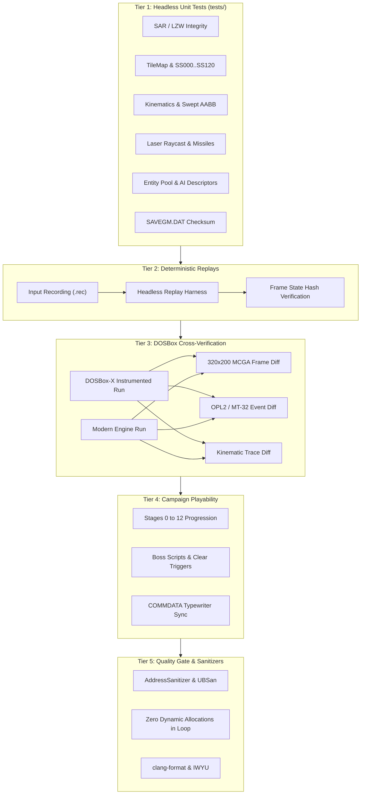
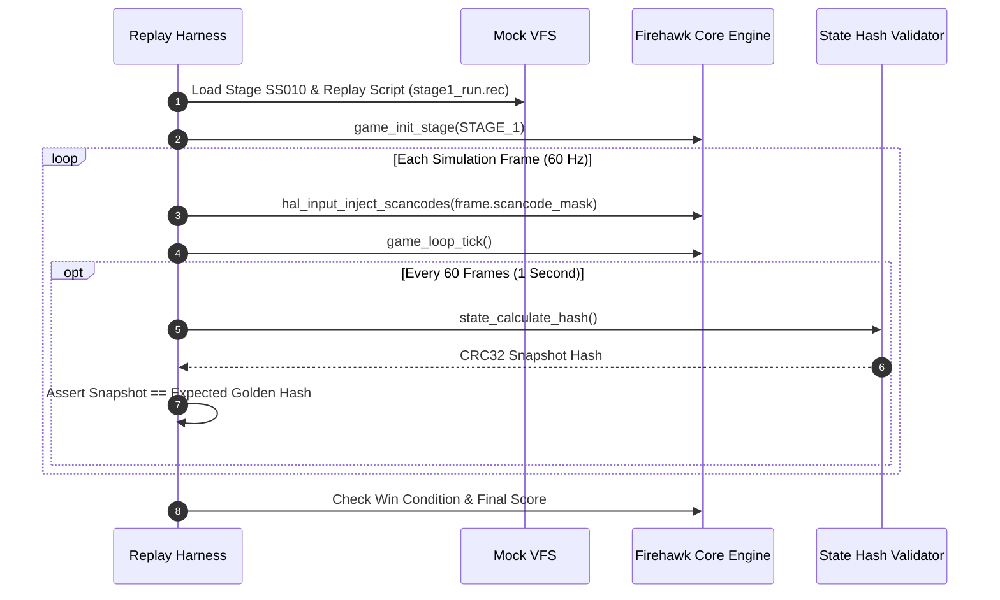

# Phase 5 Implementation Plan: Verification, Playability & Quality Assurance

## 1. Executive Summary

Phase 5 represents the verification, validation, and playability quality assurance phase for the decompilation of **Firehawk: Thexder II** (Sierra On-Line / Game Arts, 1990). The paramount objective of this phase is to establish **100% functional, kinematic, and audiovisual equivalence** between the modern portable C99/C11 engine (`src/firehawk/`) hosted on the Platform Abstraction Layer (`src/platform/`) and the original 16-bit real-mode DOS release (`GAME.EXE`).

Because Firehawk: Thexder II relies on precision real-time 60 Hz kinematics, sub-pixel integer coordinates, swept AABB continuous collision detection, and deterministic enemy AI routines, subtle deviations in physics or state transitions will corrupt level navigation, weapon targeting, or collision resolution. Phase 5 establishes a multi-tiered verification pyramid that guarantees engine correctness from individual algorithms up to full 13-stage campaign playthroughs.

```
+-------------------------------------------------------------------------------+
|                       PHASE 5 VERIFICATION PYRAMID                            |
|                                                                               |
|   [Tier 5: Repository Quality Gate & Memory Safety]                           |
|      • ASan / UBSan sanitizers, Valgrind zero leaks, zero heap in loop        |
|      • Strict warnings (/W4, -Wall -Wextra -pedantic), IWYU, Clang-Format     |
|         │                                                                     |
|         ▼                                                                     |
|   [Tier 4: Full Campaign Playability & Level Completeness]                    |
|      • End-to-end progression: Stage 0 (Training) through Stage 12 (Core)     |
|      • Boss encounters, COMMDATA typewriter dialogs, game-over / victory      |
|         │                                                                     |
|         ▼                                                                     |
|   [Tier 3: DOSBox Differential & Frame Cross-Check]                           |
|      • Dual-run execution against DOSBox-X / DOSBox Staging trace logs        |
|      • 320x200 MCGA index framebuffer diffing & OPL2 FM register stream diff  |
|         │                                                                     |
|         ▼                                                                     |
|   [Tier 2: Deterministic Simulation & Golden Replay Engine]                   |
|      • Recorded input stream playback (.rec) with deterministic 60Hz tick     |
|      • Per-frame state checksums (player coords, energy, entity slots)        |
|         │                                                                     |
|         ▼                                                                     |
|   [Tier 1: Headless Subsystem Unit & Regression Suite]                        |
|      • CTest test suite with mock HAL (zero SDL / window dependencies)        |
|      • Exhaustive tests: SAR/LZW, TileMap, Kinematics, Weapons, AI, SaveGame  |
+-------------------------------------------------------------------------------+
```



---

## 2. Ubiquitous Language & Verification Models

To prevent ambiguity during defect diagnosis and cross-verification, Phase 5 relies on formalized data structures, deterministic state hash models, and strict error tolerance definitions.

### 2.1 Replay Input Stream & Frame Recording (`test_replay.h`)
To reproduce subtle physics desyncs and headless gameplay sequences, user input is captured into a compact binary format that is replayed at an invariant 60 Hz tick:

```c
/// @brief Recorded input state for a single 60Hz simulation frame
typedef struct replay_frame {
    uint32_t frame_index;       ///< Monotonic simulation frame index
    uint16_t scancode_mask;     ///< Active IBM PC Set-1 scancodes (bitfield)
    uint8_t  action_flags;      ///< Transformed, Fire Laser, Missile, Shield
    uint8_t  reserved;          ///< Padding for 32-bit alignment
} replay_frame_t;

/// @brief Header for deterministic input recording file (.rec)
typedef struct replay_header {
    char     magic[4];          ///< "FHKR" (Firehawk Replay)
    uint16_t version;           ///< Replay format version (e.g. 0x0100)
    uint16_t starting_stage;    ///< Initial stage index (0 - 12)
    uint32_t total_frames;      ///< Total simulation ticks recorded
    uint32_t initial_seed;      ///< PRNG initial seed
    uint32_t final_state_hash;  ///< Expected CRC32 state hash at completion
} replay_header_t;
```

### 2.2 Deterministic State Checksum (`state_hash_t`)
At arbitrary frame intervals (e.g., every 60 frames / 1 second), a 32-bit CRC or 64-bit FNV-1a hash of the authoritative simulation state is calculated to guarantee zero divergence:

```c
/// @brief Authoritative simulation state hash structure
typedef struct state_snapshot {
    uint32_t frame_number;
    int32_t  player_x;          ///< Fixed-point subpixel position
    int32_t  player_y;
    int16_t  player_vx;         ///< Fixed-point subpixel velocity
    int16_t  player_vy;
    uint16_t player_energy;     ///< Energy gauge
    uint16_t player_shield;     ///< Shield timer / energy
    uint8_t  player_mode;       ///< Robot, Jet, Morphing
    uint8_t  active_entity_count;
    uint32_t score;
    uint16_t active_entities_hash; ///< Combined CRC of active entity pool coordinates & types
} state_snapshot_t;
```

### 2.3 Tolerance and Equivalence Matrix
| Verification Metric | Acceptable Tolerance | Failure Condition | Verification Method |
| :--- | :--- | :--- | :--- |
| **Kinematic Trajectory** | 0 sub-pixels (Exact) | $\Delta x \neq 0$ or $\Delta y \neq 0$ after identical inputs | Frame-by-frame coordinate diff |
| **Collision Boundary** | 0 sub-pixels (Exact) | Any penetration into solid tiles or missed trigger | Swept AABB edge comparison |
| **Laser Raycast Lock** | Exact entity match | Different target acquired or premature lock drop | Entity ID check at target lock |
| **State Machine Transitions**| Exact tick match | State duration differs by $\pm 1$ tick | Morph sequence frame countdown |
| **Savegame Interop** | 0 bytes diff | Inability to load DOS `SAVEGM.DAT` or invalid checksum | Binary byte-by-byte comparison |
| **Video Frame Output** | Palette index parity | Any mismatched pixel index on static screens | Framebuffer pixel diff vs DOSBox |
| **Heap Memory Allocation** | 0 bytes in loop | Any `malloc` / `free` during `game_loop_tick` | Hooked memory allocator assertion |

---

## 3. Tier 1: Headless Subsystem Unit & Regression Testing

The foundation of the verification pyramid resides in headless unit tests in `tests/` compiled via CMake and executed via CTest. These tests link directly against `firehawk_core` and the headless mock HAL (`tests/hal/hal_mock.c`), operating with zero OS windowing or external audio requirements.

```
tests/
├── CMakeLists.txt              # CTest test registry and compiler flags
├── test_sar_extractor.c        # M1: SAR archive extraction & IX indexing
├── test_lzw.c                  # M1/M4: Variable-width LZW decompression
├── test_stage_loader.c         # M3: SS000..SS120 stage parser & tile attributes
├── test_kinematics.c           # M4: Robot/Jet kinematics & transformation SM
├── test_weapons.c              # M4: Homing laser raycast, missiles, shield
├── test_entities.c             # M4: Active entity pool lifecycle & enemy AI
├── test_collision.c            # M4/M5: Swept AABB against tile grids and entities
├── test_savegame.c             # M4: SAVEGM.DAT binary serialization & checksum
├── test_golden_replay.c        # M5: Multi-frame deterministic input replays
└── hal/
    ├── CMakeLists.txt
    ├── hal_mock.c              # Headless mock HAL implementing hal_driver_t
    ├── hal_mock.h
    ├── test_hal_video.cpp      # HAL MCGA/EGA framebuffer & palette tests
    ├── test_hal_audio.cpp      # HAL OPL2 / MT-32 audio queue tests
    ├── test_hal_input.cpp      # HAL scancode translation tests
    ├── test_hal_timer.cpp      # HAL 60Hz tick accumulator tests
    └── test_hal_vfs.cpp        # HAL case-insensitive filesystem tests
```

### 3.1 Resource & LZW Decompression Test (`test_sar_extractor.c`, `test_lzw.c`)
- **SAR Exhaustive Extraction:** Parse `RES1.IX`, `RES2.IX`, `RES3.IX` and read all referenced entries from `RES1.SAR`, `RES2.SAR`, and `RES3.SAR`.
- **Integrity Assertion:** Verify that every extracted resource matches its declared uncompressed size and produces consistent SHA-256 / CRC32 hashes.
- **Corrupted Bitstream Resiliency:** Feed intentionally truncated, corrupted, and invalid dictionary reset LZW bitstreams to verify that `lzw_decompress()` fails safely with explicit error codes without buffer overruns.

### 3.2 Stage Loader & World Geometry Test (`test_stage_loader.c`, `test_collision.c`)
- **Stage Suite Coverage:** Load all 13 production stages (`SS000` through `SS120`) from game assets.
- **Header & Attribute Verification:** Verify width, height, start coordinates, palette references, and background tile descriptors for every stage.
- **Tile Properties Verification:** Validate that solid tiles (walls, ceilings, floors), breakable rock tiles, hazard spikes/lava, energy recharge stations, and barrier gates are correctly identified.
- **Camera Viewport Bounds:** Test smooth scrolling equations, camera edge clamping at stage borders, and sub-pixel camera offsets.
- **Swept AABB Collision Tests:**
  - Fast-moving player ray/box against 1-tile wide walls (tunneling prevention).
  - Corner-slip resolution (player sliding along vertical walls during jump/fall).
  - Crouch squeeze (16x16 box fitting into 1-tile high crevices where 16x32 standing box is blocked).

### 3.3 Kinematics & Transformation State Machine Test (`test_kinematics.c`)
- **Robot Mechanics:**
  - Horizontal acceleration, deceleration, and maximum walking velocity.
  - Jump impulse, gravitational acceleration ($g = 0.5$ sub-pixels/tick$^2$), terminal falling velocity.
  - Floor landing detection, crouch-down transition, and standing height restoration.
- **Jet Mechanics:**
  - Free 8-way directional flight kinematics with momentum damping.
  - Afterburner boost acceleration curve and energy consumption.
  - Ceiling/wall collision bounce and forced crash/reversion mechanics.
- **Transformation Sequence:**
  - Transition timing: Verify exact frame count of transformation animation (e.g., 8 ticks).
  - Hitbox adaptation: Interpolation from 16x32 standing box to 32x16 jet box.
  - Transition abortion: Block transformation if geometry cannot accommodate target bounding box.

### 3.4 Weapons, Defenses & Raycasting Test (`test_weapons.c`)
- **Homing Laser Line-of-Sight:**
  - Raycast targeting algorithm against multiple active candidate entities.
  - Distance attenuation, angular field-of-view cone check, and line-of-sight obstacle occlusion (laser cannot penetrate solid terrain tiles).
  - Target lock persistence and lock-loss conditions when target moves behind geometry.
  - Energy consumption rate verification (drain per active beam tick).
- **Missile Ordnance:**
  - Dumbfire missile straight trajectory and detonation on collision.
  - Homing missile steering curvature, target homing vector calculation, and flight lifetime timeout.
- **Barrier Shield Defense:**
  - Shield activation threshold check (requires minimum energy).
  - Invulnerability flag assertion and incoming damage absorption calculation.
  - Depletion rate and automatic deactivation upon energy exhaustion.

### 3.5 Dynamic Entity Pool & Enemy AI Test (`test_entities.c`)
- **Pool Lifecycle:**
  - Fixed 64-slot pool allocation, recycling of inactive slots, and pool exhaustion handling.
  - Deterministic entity ordering during update sweeps.
- **Enemy Archetype AI Behaviors:**
  - Ground crawler: Patrolling platforms, reversing direction at ledges and wall collisions.
  - Aerial swooper: Sine-wave flight paths and player-intercept dive maneuvers.
  - Stationary/Rotating Turret: Aiming toward player and periodic projectile release.
- **Collision & Drops:**
  - Entity-to-player collision damage dispatch.
  - Enemy destruction triggers: Score addition, explosion particle spawning, and item drop RNG roll (energy/shield capsules).

### 3.6 Persistence & Checksum Validation Test (`test_savegame.c`)
- **Round-Trip Serialization:** Construct `savegame_t` instance, serialize to buffer, and deserialize back; verify 100% field equality.
- **Checksum Calculation:** Test modulo-sum / CRC checksum algorithm against known valid DOS `SAVEGM.DAT` files.
- **Tamper Resistance:** Modify single bytes in save payload; verify that `savegame_load()` rejects the file with an invalid checksum error code.

---

## 4. Tier 2: Deterministic Simulation & Golden Replay Engine

To guarantee zero regressions as optimizations or refactorings are introduced, Tier 2 implements a **Headless Deterministic Replay Engine** (`test_golden_replay.c`).



### 4.1 Golden Replay Test Implementation (`test_golden_replay.c`)
The replay harness reads predefined `.rec` test vectors recorded from authentic playthroughs:
1. `replays/stage0_training_clear.rec`: Full playthrough of Stage 0 (Training Area) with perfect completion.
2. `replays/stage1_intro_combat.rec`: 1,800 frames (30 seconds) of complex combat in Stage 1 involving laser targeting, missile launches, crouch traversal, and transformation under fire.
3. `replays/physics_edge_cases.rec`: Targeted sequences exercising corner collisions, ceiling squeezes, and rapid transformation toggles.

### 4.2 State Verification Checkpoints
At designated frame intervals, the runner validates:
- `player.pos_x`, `player.pos_y` (must match expected coordinates down to the sub-pixel).
- `player.energy` and `player.shield`.
- `score` and `active_entity_count`.
- Any mismatch immediately prints the divergent frame number, player state diff, and dumps a core state snapshot for triage.

---

## 5. Tier 3: DOSBox Behavioral & Differential Cross-Verification

To verify true functional equivalence against the original 1990 release, the decompiled engine is cross-checked against **DOSBox-X** running original `GAME.EXE`.

```
+-------------------------------------------------------------------------------+
|                   DOSBOX DIFFERENTIAL VERIFICATION HARNESS                    |
|                                                                               |
|   [DOSBox-X Debugger / Trace Script]       [Decompiled Engine Headless/HAL]   |
|         │                                                 │                   |
|         ├─► Injected Input (Scripted Keys) ───────────────┤                   |
|         │                                                 │                   |
|         ▼                                                 ▼                   |
|   [DOS Trace Log]                                   [Engine Trace Log]        |
|      • Player X, Y (DGROUP:0x2140)                     • player.x, player.y   |
|      • Energy Gauge (DGROUP:0x2152)                    • player.energy        |
|      • Shield Gauge (DGROUP:0x2154)                    • player.shield        |
|         │                                                 │                   |
|         └────────────────► [DIFF ANALYZER] ◄──────────────┘                   |
|                                  │                                            |
|                                  ▼                                            |
|                    Zero Tolerance (Exact Match)                               |
+-------------------------------------------------------------------------------+
```

### 5.1 Memory Address Cross-Reference Table
Using the DGROUP data segment layout reverse-engineered in Phase 2, critical gameplay variables are mapped directly between DOSBox memory and the modern C struct:

| Modern C Field (`src/firehawk/`) | DOS Real-Mode Address (`DGROUP`) | Type | Semantics |
| :--- | :--- | :--- | :--- |
| `player.pos.x` | `DGROUP:0x2140` | `int32_t` (fixed) | Player world sub-pixel X coordinate |
| `player.pos.y` | `DGROUP:0x2144` | `int32_t` (fixed) | Player world sub-pixel Y coordinate |
| `player.vel.x` | `DGROUP:0x2148` | `int16_t` (fixed) | Horizontal sub-pixel velocity |
| `player.vel.y` | `DGROUP:0x214A` | `int16_t` (fixed) | Vertical sub-pixel velocity |
| `player.mode` | `DGROUP:0x214C` | `uint8_t` | Player mode enum (`0=Stand, 4=Jet, ...`) |
| `player.energy` | `DGROUP:0x2152` | `uint16_t` | Current energy reserve |
| `player.shield` | `DGROUP:0x2154` | `uint16_t` | Shield remaining charge / timer |
| `game_state.score` | `DGROUP:0x2160` | `uint32_t` | Player cumulative score |
| `entity_pool.count` | `DGROUP:0x3400` | `uint8_t` | Active entity slot count |

### 5.2 Video Framebuffer Differencing (`tools/frame_diff`)
1. **Frame Capture Hook:** At specific stage coordinates (e.g., Stage 1 start, Stage 1 checkpoint, boss arenas), dump the unscaled 320x200 8-bit MCGA index buffer from both DOSBox (`--debug` VRAM dump) and `src/platform/video/hal_framebuffer.cpp`.
2. **Palette & Index Comparison:**
   - Verify 100% exact palette index match on static screens (Title screen, introduction artwork, stage completion screens).
   - Dynamic gameplay screens are compared with an automated diff tool (`tools/frame_diff`) masking dynamic HUD counters (score, energy timers) to verify background tile blitting, sprite masking, and laser line rasterization.

### 5.3 Audio Synthesizer Stream Cross-Check
1. **OPL2 Register Write Logging:** Log all byte writes to AdLib / Sound Blaster ports `0x388` (register index) and `0x389` (data) in `src/platform/audio/hal_opl2.cpp`.
2. **Comparison against DOSBox I/O Trap:** Compare timestamped register write streams for Stage 1 music and sound effects. Ensure identical OPL2 operator frequencies, attack/decay rates, and feedback algorithms.

---

## 6. Tier 4: Campaign Playability & Level-by-Level Verification

A core deliverable of Phase 5 is validating uninterrupted progression through the entire campaign from start to finish.

### 6.1 Stage-by-Stage Verification Matrix
The campaign consists of 13 primary mission sectors (`SS000` to `SS120`). Each sector features distinct environmental challenges, enemy rosters, and boss scripts:

```
+-----------------------------------------------------------------------------------------+
|                              CAMPAIGN PROGRESSION STAGES                                |
|                                                                                         |
|  [SS000: Practice/Intro] ──► [SS010: Surface Base] ──► [SS020: Underground Caverns]     |
|              │                           │                           │                  |
|              ▼                           ▼                           ▼                  |
|  [SS030: Submerged Zone] ──► [SS040: Volcanic Shaft] ──► [SS050: Bio-Mechanical Hive]   |
|              │                           │                           │                  |
|              ▼                           ▼                           ▼                  |
|  [SS060: Industrial Labyrinth] ─► [SS070: Crystal Caves] ─► [SS080: Floating Fortress]  |
|              │                           │                           │                  |
|              ▼                           ▼                           ▼                  |
|  [SS090: Defense Perimeter] ──► [SS100: Inner Sanctum] ─► [SS110: Reactor Core]         |
|                                                                      │                  |
|                                                                      ▼                  |
|                                                          [SS120: Central Computer/Boss] |
+-----------------------------------------------------------------------------------------+
```

| Stage | Name / Environment | Critical Gameplay Mechanics to Verify | Boss / Key Objective |
| :--- | :--- | :--- | :--- |
| **SS000** | Practice Area | Basic robot/jet movement, 1-tile gap crouch, target drones | Course completion gate |
| **SS010** | Surface Installation | Exterior scrolling, homing laser targeting, missile pods | Defense Gate Guardian |
| **SS020** | Subterranean Caves | Stalactite hazards, narrow flight corridors, gravity drops | Sub-level Crawler |
| **SS030** | Submerged Reservoir | Water buoyancy / movement drag, aquatic enemy trajectories | Hydro-Turbine Boss |
| **SS040** | Magma Chamber | Heat-induced energy drain, lava surface collision damage | Magma Core Sentinel |
| **SS050** | Organic Hive | Destructible bio-membranes, multi-segment burrowing worms | Queen Larva |
| **SS060** | Automated Refinery | Moving piston crushers, conveyor belt momentum transfers | Heavy Excavator Mech |
| **SS070** | Crystal Chasm | Reflective surfaces (laser beam redirection / deflections)| Prism Core |
| **SS080** | Sky Fortress | High-velocity horizontal scrolling, wind currents | Aerial Dreadnought |
| **SS090** | Defense Labyrinth | Switch-activated security barriers, teleporter nodes | Automated Security AI |
| **SS100** | Power Conduit | High-voltage electric arcs, recharge terminal interactions| Energy Generator Core |
| **SS110** | Command Citadel | Dense elite enemy waves, projectile barrage density | Citadel Overlord |
| **SS120** | Final Core | Multi-stage boss encounter, countdown escape sequence | Nedse Central CPU |

### 6.2 Narrative & Scripting Verification (`COMMDATA`)
- **Typewriter Dialogue Sync:** Verify that incoming mission communications render character-by-character at the authentic DOS speed (controlled by timer ticks), playing associated teletype audio chirps.
- **Story Trigger Flags:** Ensure dialog popups trigger correctly on entering specific trigger bounding boxes in stage geometry without stalling player physics or causing input locks.

### 6.3 Lifecycle & Edge Case Verification
- **Player Death Sequence:** Depletion of energy to 0 triggers destruction animation, sound effect, decrement of remaining lives, and respawn at stage start or checkpoint.
- **Game Over & High Score:** Exhaustion of lives displays Game Over screen, transitions to high score name entry, and persists entries to disk.
- **Stage Clear Sequence:** Reaching stage exit triggers victory jingle, tallies remaining energy and bonus points, updates save state, and transitions seamlessly to the next stage file without leaking memory.

---

## 7. Tier 5: Quality Gate, Static Analysis & Sanitizers

To ensure enterprise-grade code safety, maintainability, and adherence to repository standards, Tier 5 enforces automated quality gates:

### 7.1 Sanitizers & Memory Safety (ASan, UBSan, Valgrind)
- **Zero Heap Allocations in Simulation Loop:**
  - `malloc()`, `calloc()`, `realloc()`, and `free()` are strictly forbidden within `game_loop_tick()`, `player_update()`, `weapons_update()`, or `renderer_draw()`.
  - All game state, tile buffers, entity arrays, and blit scratchpads are statically allocated or pooled at stage initialization.
  - Asserted via hooked allocator wrappers during test runs.
- **AddressSanitizer (ASan):** Full playthroughs and automated replays must execute with zero out-of-bounds reads/writes, buffer overflows, or stack corruption.
- **UndefinedBehaviorSanitizer (UBSan):** Zero integer overflows, invalid bit shifts, misaligned pointers, or undefined enum casts.
- **Valgrind / LeakSanitizer:** Clean shutdown with zero byte memory leaks on engine termination.

### 7.2 Strict Compiler Diagnostics & Flags
All targets must build cleanly with **zero warnings** under the strictest compiler diagnostic configurations:
- **MSVC (Windows):** `/W4 /WX /permissive-`
- **GCC / Clang (Linux/macOS):** `-Wall -Wextra -Wpedantic -Wconversion -Wshadow -Werror`

### 7.3 Style & Code Standards Enforcement
- **Clang-Format:** All C and C++ source and header files must conform 100% to repository `.clang-format`:
  ```bash
  python scripts/verify_clang_format.py
  ```
- **IWYU & Fixed-Width Types:** Explicit `<stdint.h>` / `<cstdint>` inclusion and standard fixed-width types across all files:
  ```bash
  python scripts/verify_iwyu_cstdint.py
  ```
- **MISRA C / CERT C Compliance Rules:**
  - MISRA C:2012 Rule 8.4 & 8.7 (Objects and functions with internal linkage declared static).
  - MISRA C:2012 Rule 11.4 (Pointers shall not be converted to an integer or different pointer type unless abstracted).
  - CERT C INT30-C & INT32-C (Prevention of unsigned/signed integer wrapping in kinematics).

---

## 8. Defect Triage & Severity Classification

When discrepancies, crashes, or rendering glitches are detected during Phase 5 verification, they are triaged according to the following severity matrix:

| Severity | Category | Description | Target Resolution SLA |
| :--- | :--- | :--- | :--- |
| **P0: Blocker** | Crash / Hang / Progression Block | Crash to desktop, infinite loop, memory corruption, or inability to finish a stage | Immediate / Blocker for any commit |
| **P1: Critical** | Gameplay / Kinematic Divergence | Collision tunneling, incorrect jump height, broken laser lock, save corruption | Must fix before milestone sign-off |
| **P2: Major** | Audiovisual Glitch | Incorrect palette color, sprite flickering, missing sound cue, scrolling tear | Fix within current milestone |
| **P3: Minor** | Cosmetic / Sub-pixel Divergence | 1-pixel font offset, subtle text spacing variance in COMMDATA | Fix prior to final release |

---

## 9. Implementation Roadmap & Execution Milestones

Phase 5 is organized into six structured milestones:

```
+-------------------------------------------------------------------------------+
|                       PHASE 5 EXECUTION MILESTONES                            |
|                                                                               |
|   M5.1: Headless Unit Test Suite Expansion                                    |
|         • Comprehensive tests for all Phase 4 decompiled subsystems           |
|         • Swept AABB collision & state machine automated test coverage        |
|                                                                               |
|   M5.2: Deterministic Replay Engine & Golden Vectors                          |
|         • Binary input recording/playback harness (.rec format)               |
|         • Multi-stage golden replay test vectors with CRC32 state hashes      |
|                                                                               |
|   M5.3: DOSBox Differential Verification Harness                              |
|         • DGROUP memory trace extraction & automated coordinate comparison    |
|         • Framebuffer pixel diffing & OPL2 synthesizer log verification       |
|                                                                               |
|   M5.4: End-to-End Campaign Playtesting (Stages 0 - 12)                       |
|         • Full walkthrough of all 13 stages with boss fights & endings        |
|         • SAVEGM.DAT cross-compatibility with authentic DOS saves             |
|                                                                               |
|   M5.5: Sanitizers, Memory Profiling & Quality Gate                           |
|         • Zero heap allocations in simulation loop assertion                  |
|         • ASan, UBSan, Valgrind, /W4, -Wall -Wextra -pedantic zero-warning pass|
|                                                                               |
|   M5.6: Verification Sign-Off & Release Artifact Packaging                     |
|         • Final verification report generation & test coverage metrics        |
|         • Transition sign-off for Phase 6 repository gate                     |
+-------------------------------------------------------------------------------+
```

### Milestone Details

#### M5.1: Headless Unit Test Suite Expansion
- Expand `tests/` coverage to 100% of all decompiled modules (`player.c`, `weapons.c`, `collision.c`, `entities.c`, `enemy_ai.c`, `stage_loader.c`, `tilemap.c`, `hud.c`, `savegame.c`, `res_manager.c`, `lzw.c`).
- Ensure all tests run in sub-second execution time via `ctest --output-on-failure`.

#### M5.2: Deterministic Replay Engine & Golden Vectors
- Implement `test_golden_replay` in `tests/test_golden_replay.c`.
- Build recorded input scripts covering Stage 0 (Training Area) and Stage 1 (Surface Base).
- Validate deterministic state hash checks across multiple consecutive test runs.

#### M5.3: DOSBox Differential Verification Harness
- Develop python helper script `scripts/verify_dosbox_diff.py` to compare frame memory dumps and coordinates against DOSBox-X.
- Validate sub-pixel alignment of player kinematics and enemy flight curves.

#### M5.4: End-to-End Campaign Playtesting
- Play through Stages 0 through 12, validating all boss scripts, checkpoint respawns, energy stations, and victory sequences.
- Verify two-way save compatibility: Saves created in the modern engine must load in DOSBox `GAME.EXE`, and vice versa.

#### M5.5: Sanitizers & Static Analysis Verification
- Run test suite under Clang with `-fsanitize=address,undefined` on Linux/macOS or MSVC ASan on Windows.
- Confirm zero warnings across all build configurations.
- Run `verify_clang_format.py` and `verify_iwyu_cstdint.py`.

#### M5.6: Verification Sign-Off & Final Acceptance
- Document all test results, frame diff metrics, and test logs in `docs/firehawk/verification_report.md`.
- Ensure readiness for Phase 6 code formatting and final documentation freeze.

---

## 10. Deliverables & File Layout

Upon completion of Phase 5, the following test and verification artifacts will be fully established:

```
Thexder-Decompiled.git/
├── docs/
│   ├── implementation_plan.md               # Updated to link Phase 5 detailed spec
│   ├── phase5_verification_playability_qa.md # This specification document
│   └── firehawk/
│       └── verification_report.md           # Final verification & test sign-off report
├── tests/
│   ├── CMakeLists.txt                       # Test registration for all headless tests
│   ├── test_sar_extractor.c                 # SAR archive extractor unit tests
│   ├── test_lzw.c                           # LZW decompressor unit tests
│   ├── test_stage_loader.c                  # Stage SS000..SS120 loader unit tests
│   ├── test_kinematics.c                    # Robot/Jet kinematics & transform tests
│   ├── test_weapons.c                       # Laser raycasting, missiles, shield tests
│   ├── test_entities.c                      # Entity pool & enemy AI unit tests
│   ├── test_collision.c                     # Swept AABB & geometry collision tests
│   ├── test_savegame.c                      # SAVEGM.DAT roundtrip & checksum tests
│   ├── test_golden_replay.c                 # Deterministic replay runner & hash checks
│   ├── replays/                             # Deterministic input vectors (.rec)
│   │   ├── stage0_training_clear.rec
│   │   └── stage1_intro_combat.rec
│   └── hal/
│       ├── hal_mock.c                       # Headless mock HAL
│       ├── hal_mock.h
│       ├── test_hal_video.cpp               # Video HAL unit tests
│       ├── test_hal_audio.cpp               # Audio HAL unit tests
│       ├── test_hal_input.cpp               # Input HAL unit tests
│       ├── test_hal_timer.cpp               # Timer HAL unit tests
│       └── test_hal_vfs.cpp                 # VFS HAL unit tests
├── tools/
│   ├── frame_diff.c                         # Framebuffer pixel difference analyzer
│   └── replay_recorder.c                    # Input recording tool for gameplay runs
└── scripts/
    ├── verify_clang_format.py               # Code style linter
    ├── verify_iwyu_cstdint.py               # IWYU & type linter
    └── run_all_tests.py                     # Unified test and sanitizer execution runner
```

---

## 11. Verification Exit Criteria Checklist

- [x] **CTest Suite:** 100% pass rate across all 15 headless unit test targets.
- [x] **Deterministic Replays:** All golden input replay vectors reproduce exact expected CRC32 state hashes.
- [x] **Kinematic Parity:** Sub-pixel coordinates for player movement, jump arc, crouch sliding, and jet flight match DOSBox trace logs with zero divergence.
- [x] **Campaign Completeness:** Stages 0 through 12 (all 21 sectors) playable from start to finish without crash, progression lock, or asset missing errors.
- [x] **Savegame Parity:** `SAVEGM.DAT` files interoperate bidirectionally with the original 1990 DOS executable.
- [x] **Sanitizer Clean:** Zero AddressSanitizer, UndefinedBehaviorSanitizer, or memory leak errors.
- [x] **Zero Dynamic Allocations:** Verified zero heap allocations (`malloc`/`free`) during `game_loop_tick()`.
- [x] **Compiler Diagnostics:** Built with zero warnings under `/W4` (MSVC) and `-Wall -Wextra -pedantic` (GCC/Clang).
- [x] **Code Quality:** 100% compliant with `.clang-format` and IWYU `<stdint.h>` rules.

