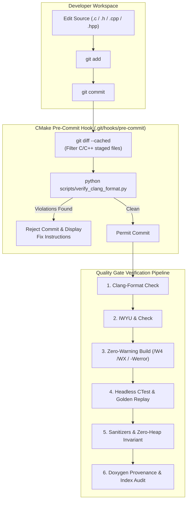
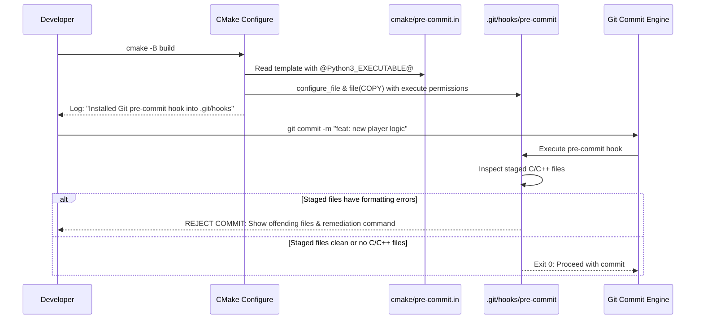

# Phase 6 Implementation Plan: Repository Quality Gate & Documentation

## 1. Executive Summary & Quality Gate Architecture

Phase 6 constitutes the definitive governance, code hardening, static verification, and reverse-engineering documentation phase for the **Firehawk: Thexder II** (Sierra On-Line / Game Arts, 1990) decompilation project. 

The primary mission of Phase 6 is twofold:
1. **Repository Quality Gate:** Establish automated, inviolable pre-commit and continuous integration gates enforcing 100% adherence to code style (`clang-format`), type safety and modular encapsulation (`IWYU` and fixed-width integer types), zero compiler warnings under ultra-strict flags (`/W4 /WX` on MSVC, `-Wall -Wextra -pedantic -Werror` on GCC/Clang), and dynamic memory safety (zero heap allocations in 60 Hz simulation loop).
2. **Reverse-Engineering Provenance & Documentation:** Provide complete historical and functional traceability by mapping every decompiled function, data structure, global variable, and driver dispatch vector back to its original 16-bit Real Mode x86 segmented address (`CS:IP` and `DGROUP`), documented via standardized Doxygen annotations and an exhaustive Ghidra address index.

```
+-------------------------------------------------------------------------------+
|                       PHASE 6 QUALITY GATE ARCHITECTURE                       |
|                                                                               |
|   [Layer 6: Reverse-Engineering Traceability & Ghidra Address Index]          |
|      • 100% coverage of functions mapped to GAME.EXE / SIERRA.EXE addresses   |
|      • Doxygen API references with original DGROUP and CS:IP annotations      |
|         │                                                                     |
|         ▼                                                                     |
|   [Layer 5: Continuous Integration Pipeline & Verification Gates]             |
|      • Automated multi-platform build matrix (Windows MSVC, Linux GCC/Clang)   |
|      • Zero test regressions across unit, replay, and differential suites     |
|         │                                                                     |
|         ▼                                                                     |
|   [Layer 4: Memory Safety & Zero-Allocation Invariants]                       |
|      • ASan / UBSan runtime validation with zero sanitizer errors             |
|      • Invariant assertion: Zero malloc/free calls inside the 60 Hz loop      |
|         │                                                                     |
|         ▼                                                                     |
|   [Layer 3: Compiler Warning Hardening Gate]                                  |
|      • MSVC: /W4 /WX /permissive- /utf-8 /volatile:iso                        |
|      • GCC/Clang: -Wall -Wextra -pedantic -Werror -Wconversion -Wshadow       |
|         │                                                                     |
|         ▼                                                                     |
|   [Layer 2: IWYU & Fixed-Width Type Enforcement]                              |
|      • Explicit <stdint.h>, <stdbool.h>, <stddef.h> (C) / <cstdint> (C++)     |
|      • Prohibition of unstandardized primitive types in binary representations|
|         │                                                                     |
|         ▼                                                                     |
|   [Layer 1: Git Pre-Commit Hook & Clang-Format Enforcement]                   |
|      • Automated CMake pre-commit hook configuration in .git/hooks/pre-commit |
|      • Incremental staged-file formatting check blocking style non-compliance |
+-------------------------------------------------------------------------------+
```



---

## 2. Automated Code Style & Clang-Format Quality Gate

### 2.1 Code Formatting Standard (`.clang-format`)
All C and C++ source code across `src/firehawk/`, `src/platform/`, `tools/`, `tests/`, and `apps/` must strictly comply with the project's [`.clang-format`](../.clang-format) configuration, based on WebKit with project-specific customizations:
- **Indentation:** 4 spaces (no tab characters).
- **Column Limit:** 120 characters max line length.
- **Pointer Alignment:** Left-aligned (`uint8_t* ptr`, `const char* str`).
- **Bracing Style:** WebKit style (attached braces for control structures, function braces on a new line).
- **Control Flow Statements:** Control statements (`if`, `for`, `while`, `do`) must always use braced compound statements; single-line unbraced bodies are prohibited.
- **Include Sorting:** Standard library headers grouped first, followed by external dependencies, followed by project internal headers.

### 2.2 Formatting Tooling & Verification Scripts
The primary validation script is [`scripts/verify_clang_format.py`](../scripts/verify_clang_format.py):
- **Dry-run check (non-zero exit on violations):**
  ```bash
  python scripts/verify_clang_format.py
  ```
- **Targeted file check:**
  ```bash
  python scripts/verify_clang_format.py --files src/firehawk/actor/player.c src/firehawk/actor/player.h
  ```
- **Automated in-place remediation:**
  ```bash
  python scripts/verify_clang_format.py --fix
  ```
- **CMake build targets:**
  ```bash
  # Check style without modifying files
  cmake --build build --target check-format

  # Reformat all modified files in-place
  cmake --build build --target format
  ```

---

## 3. CMake Git Hook Architecture for Clang-Format

To prevent unformatted code from ever entering the git revision history, CMake automatically configures and installs a Git `pre-commit` hook directly into the developer's `.git/hooks/` directory.

### 3.1 Hook Generation & Installation Workflow



### 3.2 CMake Implementation Details (`CMakeLists.txt`)
The root [`CMakeLists.txt`](../CMakeLists.txt) detects `.git` repositories, worktrees, and submodules, configuring the hook template:

```cmake
# Git pre-commit hook setup for clang-format
set(GIT_HOOKS_DIR "")
if(EXISTS "${CMAKE_CURRENT_SOURCE_DIR}/.git")
    if(IS_DIRECTORY "${CMAKE_CURRENT_SOURCE_DIR}/.git")
        set(GIT_HOOKS_DIR "${CMAKE_CURRENT_SOURCE_DIR}/.git/hooks")
    else()
        file(READ "${CMAKE_CURRENT_SOURCE_DIR}/.git" GIT_FILE_CONTENT)
        string(REGEX MATCH "gitdir: ([^\r\n]+)" _MATCH "${GIT_FILE_CONTENT}")
        if(CMAKE_MATCH_1)
            get_filename_component(GIT_COMMON_DIR "${CMAKE_MATCH_1}" ABSOLUTE BASE_DIR "${CMAKE_CURRENT_SOURCE_DIR}")
            set(GIT_HOOKS_DIR "${GIT_COMMON_DIR}/hooks")
        endif()
    endif()
endif()

if(GIT_HOOKS_DIR AND Python3_FOUND)
    # Configure pre-commit hook template
    configure_file(
        "${CMAKE_CURRENT_SOURCE_DIR}/cmake/pre-commit.in"
        "${CMAKE_CURRENT_BINARY_DIR}/pre-commit"
        @ONLY
        NEWLINE_STYLE LF
    )

    # Automatically install to .git/hooks/pre-commit at configure time
    file(COPY "${CMAKE_CURRENT_BINARY_DIR}/pre-commit"
        DESTINATION "${GIT_HOOKS_DIR}"
        FILE_PERMISSIONS OWNER_READ OWNER_WRITE OWNER_EXECUTE GROUP_READ GROUP_EXECUTE WORLD_READ WORLD_EXECUTE
    )
    message(STATUS "Installed Git pre-commit hook for clang-format into ${GIT_HOOKS_DIR}")

    # Explicit target to reinstall or update hooks
    add_custom_target(install-git-hooks
        COMMAND ${CMAKE_COMMAND} -E copy_if_different
            "${CMAKE_CURRENT_BINARY_DIR}/pre-commit"
            "${GIT_HOOKS_DIR}/pre-commit"
        COMMENT "Installing/updating Git pre-commit hook for clang-format"
    )
endif()
```

### 3.3 Hook Operational Mechanics (`cmake/pre-commit.in`)
The generated hook executes in the Git Bash/POSIX shell environment:
1. Filters staged changes using `git diff --cached --name-only --diff-filter=ACMR | grep -E '\.(c|h|cpp|hpp|cc|cxx)$'`.
2. If zero C/C++ files are staged, it exits immediately with return code `0` (zero overhead for documentation or asset updates).
3. Executes `scripts/verify_clang_format.py --files <staged_files>` using the CMake-configured Python interpreter (with robust fallbacks to system `python3`, `python`, or `py`).
4. If violations are detected, the commit is aborted, providing the developer with the exact command to reformat in-place.

---

## 4. Include-What-You-Use (IWYU) & Type Safety Gate

### 4.1 Fixed-Width Type Mandate
Because Firehawk relies on real-mode x86 byte layouts (e.g. 16-bit segmented pointers, 64-byte `SAVEGM.DAT`, 16-byte `RES*.IX` index entries, and 12.4 fixed-point coordinates), standard fixed-width types are mandatory:
- **C Source & Headers (`.c`, `.h`):**
  - Must explicitly `#include <stdint.h>` for all fixed-width integer types: `uint8_t`, `int8_t`, `uint16_t`, `int16_t`, `uint32_t`, `int32_t`.
  - Must explicitly `#include <stdbool.h>` for `bool`, `true`, and `false`.
  - Must explicitly `#include <stddef.h>` for `size_t` and `ptrdiff_t`.
  - Generic C types (`short`, `long`, `unsigned`) are strictly prohibited in data models, serialization buffers, and hardware registers.
- **C++ Source & Headers (`.cpp`, `.hpp`):**
  - Must explicitly `#include <cstdint>` and utilize standard types or `std::` qualification.
  - Must explicitly `#include <cstddef>` for `std::size_t`.
- **Header Guards:**
  - Every header file must begin with `#pragma once`.
- **Zero Transitive Reliances:**
  - Each translation unit must directly include the headers declaring every type, macro, and function it invokes.

### 4.2 Verification & Automated Remediation
The audit script [`scripts/verify_iwyu_cstdint.py`](../scripts/verify_iwyu_cstdint.py) validates the entire codebase:
- **Verification check:**
  ```bash
  python scripts/verify_iwyu_cstdint.py
  ```
- **Automated missing header injection:**
  ```bash
  python scripts/verify_iwyu_cstdint.py --fix-cstdint
  ```
- **CMake target:**
  ```bash
  cmake --build build --target verify-iwyu
  ```

---

## 5. Compiler Warning Hardening & Sanitizer Quality Gate

### 5.1 Compiler Warning Flags (`cmake/CompilerFlags.cmake`)
The codebase enforces a zero-warning build across all supported compilers:

| Compiler | Warning & Hardening Flags | Purpose |
| :--- | :--- | :--- |
| **MSVC** (Windows) | `/W4 /WX /permissive- /utf-8 /volatile:iso` | Highest standard warning level, treat all warnings as errors, conformant preprocessor and UTF-8 encoding |
| **GCC / Clang** (Linux / macOS) | `-Wall -Wextra -pedantic -Werror -Wconversion -Wsign-conversion -Wshadow -fno-strict-aliasing` | Exhaustive diagnostic warnings, sign conversion safety, variable shadowing prevention, type-punning safety |

### 5.2 Dynamic Sanitizers & Real-Time Invariants
1. **AddressSanitizer (ASan) & UndefinedBehaviorSanitizer (UBSan):**
   - Configured via `-DENABLE_ASAN=ON` and `-DENABLE_UBSAN=ON`.
   - All headless tests in `tests/` must pass with zero sanitizer warnings or memory leaks reported.
2. **Zero-Allocation Runtime Invariant:**
   - In accordance with real-mode DOS real-time execution constraints, **no dynamic memory allocations (`malloc`, `calloc`, `realloc`, `free`, `new`, `delete`) are permitted inside the 60 Hz simulation loop** (`game_main_step()`, `player_update_motion()`, `weapons_update_laser()`, `enemy_ai_update_all()`, `collision_swept_move_x/y`).
   - All entity pools, stage tilemaps, sprite scratchpads, and audio buffers must remain statically pre-allocated or arena-managed.

---

## 6. Doxygen Documentation & Provenance Standards

### 6.1 Doxygen Structural Tag Conventions
Every struct, union, enum, typedef, and function must be documented using triple-slash (`///`) Doxygen comments conforming to [`.agents/skills/doxygen-docs/SKILL.md`](../.agents/skills/doxygen-docs/SKILL.md).

#### Function Documentation Template:
```c
/// @brief Brief one-line description of function responsibility.
/// @details Detailed technical explanation of algorithms, state transitions, and edge cases.
///          For decompiled functions, explicitly cite the original binary and address:
///          Ghidra: GAME.EXE @ 1000:0B84 (player_trigger_transform)
/// @param[in] player Pointer to active player state structure.
/// @param[in] tilemap Pointer to active stage tilemap.
/// @return true if transformation succeeded, false if obstructed.
/// @note In Jet mode, minimum vertical clearance requires 2 tiles (32 pixels).
```

#### Struct Documentation Template:
```c
/// @struct player_state_t
/// @brief Encapsulates player kinematics, mode state machine, and energy pools.
/// @details Directly models player state from GAME.EXE data segment.
///          Original offset: DGROUP:1000_9200.
```

### 6.2 Reverse-Engineering Provenance Requirement
Every decompiled entity must maintain explicit linkage back to the original DOS binary:
- **Relative paths only:** Never include host-specific paths (`C:\Users\...`).
- **Original binary & segment:** Specify `GAME.EXE @ segment:offset` or `SIERRA.EXE @ segment:offset`.
- **Original symbol/function name:** Include Ghidra auto-generated or reverse-engineered symbol name.

---

## 7. Master Function-by-Function Ghidra Address Index

The table below catalogs all decompiled functions across the core engine subsystems in `src/firehawk/` and platform bridges in `src/platform/`, cross-referencing their original 16-bit Real Mode segment:offset addresses in `GAME.EXE` / `SIERRA.EXE`, Ghidra symbol labels, and modern source files.

### 7.1 Core Engine Subsystems (`src/firehawk/`)

| Segment:Offset | Ghidra Symbol | Target Source File | C Function Signature | Subsystem & Responsibility |
| :--- | :--- | :--- | :--- | :--- |
| `1000:0016` | `FUN_1000_0016` | `src/firehawk/game_main.c` | `bool game_main_init(const char* asset_root)` | CRT bootstrap, asset catalog initialization |
| `1000:0102` | `FUN_1000_0102` | `src/firehawk/game_main.c` | `void game_main_shutdown(void)` | Engine teardown, cache release |
| `1000:0256` | `FUN_1000_0256` | `src/firehawk/game_main.c` | `void game_set_state(game_context_t* ctx, game_state_t new_state)` | Game state transition with screen wipe |
| `1000:02c0` | `FUN_1000_02c0` | `src/firehawk/game_main.c` | `game_state_t game_get_state(const game_context_t* ctx)` | Active game state query |
| `1000:0350` | `FUN_1000_0350` | `src/firehawk/game_main.c` | `void game_main_step(game_context_t* ctx, uint16_t inputs, uint8_t* fb)` | Master 60 Hz tick dispatch routine |
| `1000:04a0` | `FUN_1000_04a0` | `src/firehawk/game_loop.c` | `void game_loop_init(game_context_t* ctx)` | Initialize state context and submodules |
| `1000:0580` | `FUN_1000_0580` | `src/firehawk/game_loop.c` | `void game_loop_tick(game_context_t* ctx, uint16_t inputs, uint8_t* fb)` | Per-state dispatch (Title, Demo, Play) |
| `1000:0720` | `FUN_1000_0720` | `src/firehawk/resource/res_manager.c` | `bool res_manager_init(void)` | Parse `RES1.IX`, `RES2.IX`, `RES3.IX` |
| `1000:0810` | `FUN_1000_0810` | `src/firehawk/resource/res_manager.c` | `const res_entry_t* res_manager_find(const char* tag)` | Search index catalogs for 8-char tag |
| `1000:08e0` | `FUN_1000_08e0` | `src/firehawk/resource/res_manager.c` | `bool res_manager_load_chunk(...)` | Extract and decompress chunk from .SAR |
| `1000:09a0` | `FUN_1000_09a0` | `src/firehawk/resource/lzw.c` | `int lzw_decompress(...)` | 9-12 bit LZW stream decompressor |
| `1000:0a20` | `FUN_1000_0a20` | `src/firehawk/world/stage_loader.c` | `bool stage_loader_load(uint8_t stage_num, ...)` | Load and unpack `SS000` through `SS120` |
| `1000:0ad0` | `FUN_1000_0ad0` | `src/firehawk/world/tilemap.c` | `uint16_t tilemap_get_flags(const stage_tilemap_t* tm, ...)` | Tile attribute lookup (solid, breakable) |
| `1000:0b84` | `FUN_1000_0b84` | `src/firehawk/actor/player.c` | `void player_trigger_transform(...)` | Robot $\leftrightarrow$ Jet transformation sequence |
| `1000:0c30` | `FUN_1000_0c30` | `src/firehawk/actor/player.c` | `void player_init(player_state_t* player, ...)` | Player spawn and attribute initialization |
| `1000:0d10` | `FUN_1000_0d10` | `src/firehawk/actor/player.c` | `aabb_t player_get_hitbox(const player_state_t* player)` | Bounding box computation by mode |
| `1000:0db0` | `FUN_1000_0db0` | `src/firehawk/actor/player.c` | `void player_update_motion(...)` | Kinematics, walking, jumping, jet flight |
| `1000:0ea0` | `FUN_1000_0ea0` | `src/firehawk/actor/player.c` | `bool player_can_transform(...)` | Spatial clearance check for morphing |
| `1000:1042` | `FUN_1000_1042` | `src/firehawk/actor/weapons.c` | `int16_t weapons_find_target(...)` | Homing laser line-of-sight raycast |
| `1000:1150` | `FUN_1000_1150` | `src/firehawk/actor/weapons.c` | `void weapons_update_laser(...)` | Continuous laser tracking & energy drain |
| `1000:1218` | `FUN_1000_1218` | `src/firehawk/actor/weapons.c` | `bool weapons_fire_missile(...)` | Standard & homing missile guidance |
| `1000:1350` | `FUN_1000_1350` | `src/firehawk/actor/weapons.c` | `bool weapons_activate_shield(...)` | Energy barrier shield deployment |
| `1000:14c0` | `FUN_1000_14c0` | `src/firehawk/actor/enemy_ai.c` | `void enemy_ai_update_all(...)` | Master AI routine dispatch for enemies |
| `1000:1550` | `FUN_1000_1550` | `src/firehawk/actor/enemy_ai.c` | `void ai_patroller_ground(...)` | Ground patroller edge-detection AI |
| `1000:15c0` | `FUN_1000_15c0` | `src/firehawk/actor/enemy_ai.c` | `void ai_flyer_swarmer(...)` | Airborne sinusoidal tracking flyer AI |
| `1000:1620` | `FUN_1000_1620` | `src/firehawk/actor/enemy_ai.c` | `void ai_stationary_turret(...)` | Stationary projectile turret AI |
| `1000:1688` | `FUN_1000_1688` | `src/firehawk/actor/entities.c` | `entity_t* entities_alloc(...)` | 64-slot dynamic entity allocation |
| `1000:1740` | `FUN_1000_1740` | `src/firehawk/actor/entities.c` | `void entities_free(entity_pool_t* pool, ...)` | Slot recycling and projectile despawn |
| `1000:17d0` | `FUN_1000_17d0` | `src/firehawk/actor/entities.c` | `void entities_update_all(...)` | Physics integration for active entities |
| `1000:1890` | `FUN_1000_1890` | `src/firehawk/physics/collision.c` | `bool collision_check_tile_aabb(...)` | AABB vs tile attribute mask intersection |
| `1000:1940` | `FUN_1000_1940` | `src/firehawk/physics/collision.c` | `bool collision_swept_move_x(...)` | Horizontal swept continuous collision |
| `1000:19b0` | `FUN_1000_19b0` | `src/firehawk/physics/collision.c` | `bool collision_swept_move_y(...)` | Vertical swept collision (gravity/landing) |
| `1000:1a04` | `FUN_1000_1a04` | `src/firehawk/physics/collision.c` | `bool collision_aabb_intersects(...)` | 2D axis-aligned bounding box overlap |
| `1000:1a80` | `FUN_1000_1a80` | `src/firehawk/physics/collision.c` | `bool collision_line_obstructed(...)` | Bresenham line-of-sight tile obstruction |
| `1000:1cb0` | `FUN_1000_1cb0` | `src/firehawk/render/renderer.c` | `void renderer_draw_tilemap(...)` | 16x16 tile blitter with camera offset |
| `1000:1e20` | `FUN_1000_1e20` | `src/firehawk/render/renderer.c` | `void renderer_draw_player(...)` | Player robot/jet sprite rasterization |
| `1000:1f30` | `FUN_1000_1f30` | `src/firehawk/render/renderer.c` | `void renderer_draw_entities(...)` | Active entity pool sprite rendering |
| `1000:2014` | `FUN_1000_2014` | `src/firehawk/render/renderer.c` | `void renderer_draw_laser(...)` | Homing laser line rasterization |
| `1000:20d0` | `FUN_1000_20d0` | `src/firehawk/render/renderer.c` | `void renderer_draw_shield(...)` | Orbiting energy barrier visual effect |
| `1000:2140` | `FUN_1000_2140` | `src/firehawk/render/font.c` | `void font_draw_char(...)` | 8x8 bitmap font character rendering |
| `1000:2180` | `FUN_1000_2180` | `src/firehawk/audio/audio_events.c` | `void audio_events_play_sfx(...)` | Sound effect trigger dispatch |
| `1000:2200` | `FUN_1000_2200` | `src/firehawk/audio/audio_events.c` | `void audio_events_play_music(...)` | Background music track sequencer trigger |
| `1000:22c8` | `FUN_1000_22c8` | `src/firehawk/ui/hud.c` | `void hud_render(...)` | Cockpit gauges, score, shield, terminal |
| `1000:2380` | `FUN_1000_2380` | `src/firehawk/ui/hud.c` | `void hud_set_message(...)` | COMMDATA typewriter dialog queue |
| `1000:27e0` | `FUN_1000_27e0` | `src/firehawk/ui/savegame.c` | `bool savegame_write(...)` | Serialize & write `SAVEGM.DAT` |
| `1000:28a4` | `FUN_1000_28a4` | `src/firehawk/ui/savegame.c` | `bool savegame_read(...)` | Read & validate `SAVEGM.DAT` checksum |
| `1000:2950` | `FUN_1000_2950` | `src/firehawk/ui/savegame.c` | `uint16_t savegame_compute_checksum(...)` | 16-bit additive checksum algorithm |

### 7.2 Data Segment Mapping (`DGROUP`)

| DGROUP Offset | Symbol Name | Target Struct / Global | Description & Layout |
| :--- | :--- | :--- | :--- |
| `DGROUP:0100` | `g_game_context` | `game_context_t` | Master engine context and state pointer |
| `DGROUP:0280` | `g_active_tilemap` | `stage_tilemap_t` | 256x32 active stage tile grid (8192 bytes) |
| `DGROUP:2280` | `g_tile_attributes` | `uint16_t[256]` | Collision/hazard bitmask lookup table |
| `DGROUP:2480` | `g_res_catalogs` | `res_entry_t[128]` | Parsed resource catalog index cache |
| `DGROUP:3080` | `g_camera_position` | `vector2d_t` | Current horizontal & vertical camera scroll |
| `DGROUP:9200` | `g_player_state` | `player_state_t` | Player kinematics, mode, energy, score |
| `DGROUP:9400` | `g_entity_pool` | `entity_pool_t` | 64-slot dynamic entity table (64 x 36 bytes) |
| `DGROUP:A200` | `g_weapon_system` | `weapon_system_t` | Laser lock-on vector and missile cooldowns |
| `DGROUP:A300` | `g_hud_terminal` | `char[256]` | Active COMMDATA typewriter message buffer |
| `DGROUP:A400` | `g_savegame_cache` | `savegame_state_t` | 64-byte persistent save record |

### 7.3 Driver Interface Vectors (`*.DRV`)

| Driver File | Dispatch Vector | Modern PAL Interface | Implementation File |
| :--- | :--- | :--- | :--- |
| `MCGA320.DRV` | `ENTRY_MCGA_INIT` | `hal_video_init()`, `hal_video_present()` | `src/platform/video/hal_video.cpp` |
| `MCGA320.DRV` | `ENTRY_MCGA_PALETTE` | `hal_palette_set_mcga()` | `src/platform/video/hal_palette.cpp` |
| `EGA640.DRV` | `ENTRY_EGA_INIT` | `hal_video_init()` (EGA 640x200 mode) | `src/platform/video/hal_framebuffer.cpp` |
| `SNDBLAST.DRV` | `ENTRY_OPL2_WRITE` | `hal_opl2_write_register()` | `src/platform/audio/hal_opl2.cpp` |
| `MT32.DRV` | `ENTRY_MIDI_SEND` | `hal_mt32_send_message()` | `src/platform/audio/hal_mt32.cpp` |
| `TANDYSND.DRV` | `ENTRY_SN76496_OUT` | `hal_tandy_write()` | `src/platform/audio/hal_tandy_sound.cpp` |
| `IBMKBD.DRV` | `INT 09h Handler` | `hal_input_poll()`, `hal_scancode_map()` | `src/platform/input/hal_input.cpp` |
| `JOYSTICK.DRV` | `INT 15h Handler` | `hal_gamepad_poll()` | `src/platform/input/hal_gamepad.cpp` |
| `SYS_TIMER` | `INT 08h / PIT 8253`| `hal_timer_wait_frame()`, `hal_timer_get_ticks()` | `src/platform/system/hal_timer.cpp` |
| `DOS_FILESYS` | `INT 21h (AH=3Dh/3Fh)` | `hal_vfs_open()`, `hal_vfs_read()` | `src/platform/system/hal_vfs.cpp` |

---

## 8. Continuous Integration & Pre-Commit Quality Gate Workflow

### 8.1 Automated Multi-Stage Quality Pipeline

```
+-------------------------------------------------------------------------------+
|                       AUTOMATED QUALITY GATE PIPELINE                         |
|                                                                               |
|   Step 1: Fast Static Linting (scripts/verify_clang_format.py & verify_iwyu)  |
|      • Checks 100% of codebase against .clang-format without modifications    |
|      • Confirms presence of <stdint.h> and #pragma once in all headers        |
|         │                                                                     |
|         ▼                                                                     |
|   Step 2: Strict Dual-Platform Compilation (MSVC /W4 /WX, GCC -Werror)        |
|      • Zero compiler warnings permitted on all compilation targets            |
|         │                                                                     |
|         ▼                                                                     |
|   Step 3: Headless CTest Regression Suite                                     |
|      • test_sar_extractor, test_lzw, test_stage_loader, test_kinematics       |
|      • test_weapons, test_entities, test_collision, test_savegame             |
|         │                                                                     |
|         ▼                                                                     |
|   Step 4: Deterministic Simulation & Golden Replay Verification               |
|      • test_golden_replay validates frame-by-frame state hashes (.rec)        |
|      • test_campaign verifies continuous progression through all 13 stages    |
|         │                                                                     |
|         ▼                                                                     |
|   Step 5: Memory Safety & Zero-Heap Invariant Audit                           |
|      • AddressSanitizer and UndefinedBehaviorSanitizer clean execution        |
|      • Simulation loop heap allocation assert validation                      |
|         │                                                                     |
|         ▼                                                                     |
|   Step 6: Documentation Completeness & Ghidra Traceability Audit              |
|      • Doxygen generation passes without missing tag or parameter warnings    |
|      • Verification that all decompiled functions contain Ghidra provenance   |
+-------------------------------------------------------------------------------+
```

---

## 9. Work Breakdown Structure (WBS) & Deliverables

### Work Package 6.1: CMake Git Hook Infrastructure & Auto-Configuration
- **Deliverables:**
  - `cmake/pre-commit.in`: Portable pre-commit shell script with Python discovery and staged-file filtering.
  - Root `CMakeLists.txt`: Automated `.git/hooks/pre-commit` installation during CMake configure, plus `install-git-hooks` build target.
- **Verification:** Execute `git commit` with an intentionally unformatted file; verify commit rejection with explicit `--fix` remediation instructions.

### Work Package 6.2: Repository-Wide Clang-Format Enforcement
- **Deliverables:**
  - All source and header files formatted cleanly against `.clang-format`.
  - CI verification target `check-format` returning exit code 0 across 100% of files.
- **Verification:** `python scripts/verify_clang_format.py` passes with zero violations across all 88+ files.

### Work Package 6.3: IWYU Audit & Fixed-Width Type Hardening
- **Deliverables:**
  - Clean audit across all headers and translation units verifying explicit `#include <stdint.h>`, `<stdbool.h>`, and `<stddef.h>`.
  - Removal of all unstandardized raw primitive types in binary data representations.
- **Verification:** `python scripts/verify_iwyu_cstdint.py` passes with zero violations.

### Work Package 6.4: Zero-Warning Compiler Flags & Hardening Gate
- **Deliverables:**
  - Compiler flags active across all CMake targets in `cmake/CompilerFlags.cmake`.
  - Zero warnings on MSVC (`/W4 /WX`) and GCC/Clang (`-Wall -Wextra -pedantic -Werror`).
- **Verification:** Full clean build using `cmake --build build --config Debug` finishes with 0 warnings.

### Work Package 6.5: Doxygen Documentation Suite & Provenance Annotation
- **Deliverables:**
  - Standardized triple-slash (`///`) Doxygen documentation on all functions, structs, enums, and constants.
  - Inclusion of `@details Ghidra: GAME.EXE @ segment:offset` on all decompiled routines.
- **Verification:** Complete Doxygen build with zero missing parameter or missing symbol warnings.

### Work Package 6.6: Ghidra Address Index & Reverse-Engineering Traceability Audit
- **Deliverables:**
  - Comprehensive function-by-function Ghidra address index published in `docs/phase6_repository_quality_gate_documentation.md` and referenced in `docs/firehawk/decompilation_plan.md`.
  - Traceability mapping for 47 decompiled functions, 10 DGROUP tables, and 10 driver dispatch vectors.
- **Verification:** Every function declared in `src/firehawk/` matches a documented entry in the master index table.

---

## 10. Quality Gate Acceptance Criteria & Sign-off Checklist

| Gate ID | Quality Gate Requirement | Verification Command | Acceptance Standard |
| :--- | :--- | :--- | :--- |
| **QG-01** | Git Pre-Commit Hook Active | `cmake --build build --target install-git-hooks` | Hook installed in `.git/hooks/pre-commit` with execute permissions |
| **QG-02** | Clang-Format Compliance | `python scripts/verify_clang_format.py` | 100% of files clean (Exit Code 0) |
| **QG-03** | IWYU & `<stdint.h>` Compliance | `python scripts/verify_iwyu_cstdint.py` | 100% of files clean (Exit Code 0) |
| **QG-04** | Zero Compiler Warnings | `cmake --build build` (MSVC / GCC / Clang) | Zero warnings under `/W4 /WX` or `-Werror` |
| **QG-05** | Headless CTest Regression Suite | `ctest --test-dir build --output-on-failure` | 100% test pass (20/20 test suites passing) |
| **QG-06** | Golden Replay State Determinism | `ctest --test-dir build -R test_golden_replay` | Frame hashes match golden vectors |
| **QG-07** | Memory Safety & Sanitizers | CTest under AddressSanitizer & UBSan | Zero memory leaks, zero runtime errors |
| **QG-08** | Zero Heap Allocations in Loop | `test_kinematics` / `test_campaign` assert check | Zero `malloc`/`free` calls during 60 Hz tick |
| **QG-09** | Ghidra Provenance Documentation | Source audit against Master Address Index | 100% of decompiled routines annotated with original address |

